> **Update terakhir: 15 Oktober 2026.** Data diambil dari hasil turnamen sampai 13 Oktober 2026. Meta Beyblade X gerak cepat tiap ada rilis baru, jadi anggap halaman ini sebagai potret saat ini, bukan aturan baku.

## Ringkasnya

Kalau kamu cuma mau intinya:

- **Wizard Rod** masih jadi blade paling banyak dipakai dan paling sering juara. Combo andalannya **Wizard Rod 1-60 Hexa**.
- **Shark Scale** jadi lawan utamanya. Gara-gara Shark Scale (dan sempat juga Hover Wyvern), tipe attack balik lagi ke papan atas, jadi bawa stamina semua sekarang lebih berisiko.
- Ratchet yang paling laku **1-60**, disusul **9-60** dan **3-60**.
- Bit yang paling sering muncul di podium: **Rush**, **Hexa**, **Low Rush**, **Free Ball**, dan **Elevate**.
- Seminggu terakhir **Meteor Dragoon** dan **Silver Wolf** lagi naik, sementara **Hover Wyvern** dan **Aero Pegasus** agak turun. Di deck juara terbaru, **Shark Scale 1-70 Low Rush** paling sering muncul.
- Dari Custom Line, Over Blade **Blast** sekarang sudah masuk tier teratas di BEYWATCH.GG.

## Cara baca nama combo

Combo Beyblade X ditulis dengan format **Blade Ratchet Bit**, misalnya `Wizard Rod 1-60 Hexa`:

- **Blade**: bagian atas yang kena lawan. Ini yang paling menentukan karakter combo.
- **Ratchet**: angka pertama itu jumlah tonjolannya, angka kedua tingginya dalam sepersepuluh milimeter. Jadi `1-60` artinya satu tonjolan dengan tinggi 6,0 mm.
- **Bit**: ujung bawah yang menyentuh stadium. Ini yang menentukan gerakannya: ngebut menyerang, diam di tengah, atau muter lama.

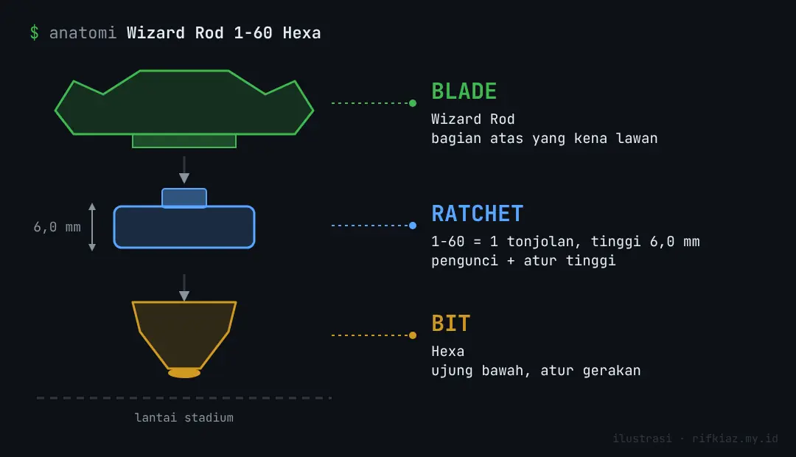

## Combo yang lagi kuat

Data dari ribuan top cut turnamen (BEYWATCH.GG) dan rangkuman meta dari BeyX Hub:

Tiga combo teratas pakai foto koleksi saya sendiri: foto pertama sudah terpasang, foto kedua dibongkar jadi blade, ratchet, dan bit. Sisanya masih kartu ilustrasi buatan saya. Warna kartunya menandai peran: merah attack, biru stamina, hijau stamina yang cenderung bertahan, ungu counter. Panah putus-putus menunjukkan arah putaran.

### Wizard Rod 1-60 Hexa

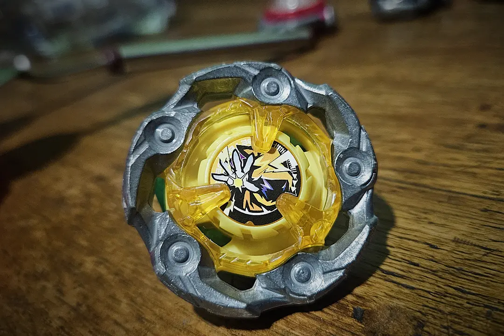
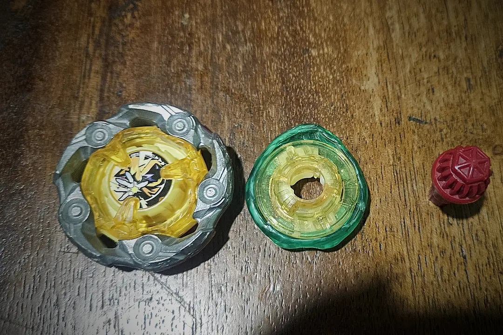

Combo dengan volume terbesar: lebih dari 2.600 top cut dan sekitar 26% dari semua kemenangan di data BEYWATCH.GG. Tahan burst dan awet muternya.

### Shark Scale 1-70 Low Rush

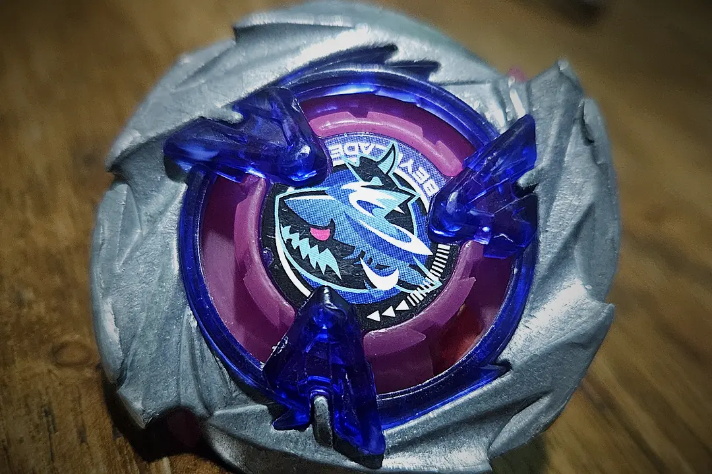
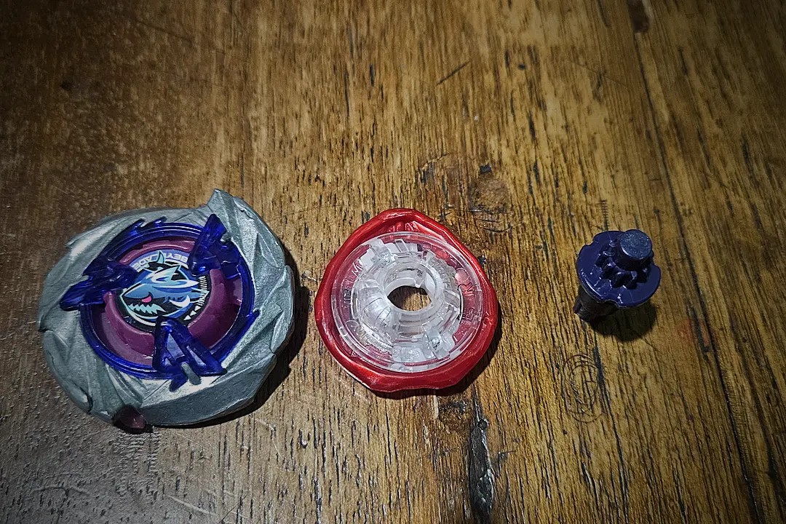

Paling ditakuti buat lawan stamina. Varian 3-60 atau 7-60 Rush juga sering juara.

### Aero Pegasus 1-60 / 3-60 Rush

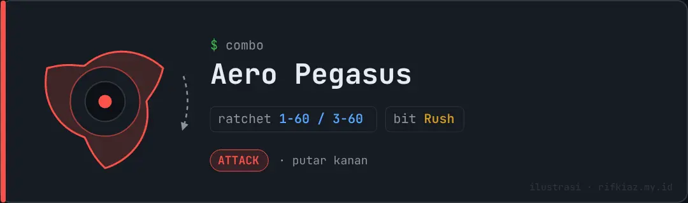

Alternatif attack yang lebih gampang dicari, persentase juaranya tinggi.

### Cobalt Dragoon 5-60 Elevate

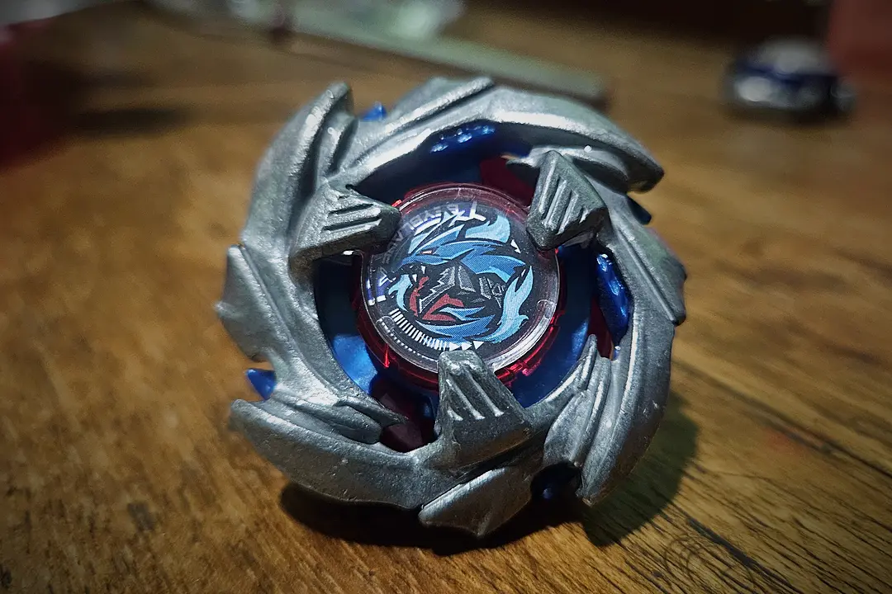
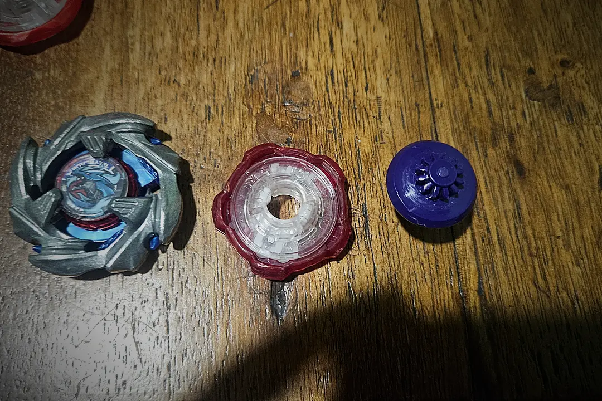

Satu-satunya blade putar kiri yang rutin muncul di meta. Enak buat ngelawan blade putar kanan dan tipe stamina.

### Silver Wolf 9-60 Free Ball

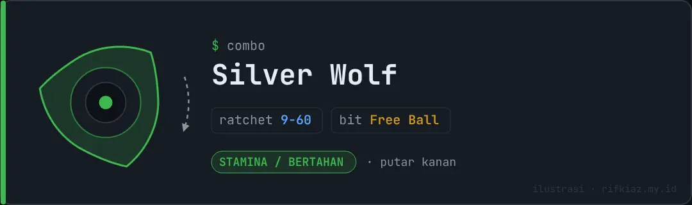

Orbitnya susah ditebak, merepotkan attack maupun stamina. Butuh jam terbang buat maksimal.

### Hover Wyvern 1-60 Rush

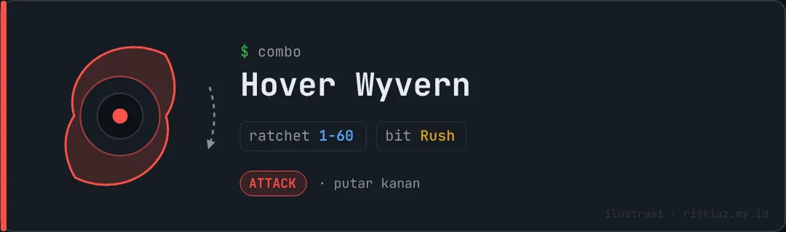

Serangannya pakai kontak menggesek. Sebagian data lama pakai 9-60 Kick, data 2026 lebih condong ke 1-60 atau 1-70 Rush.

### Wizard Rod 9-60 Ball / Free Ball

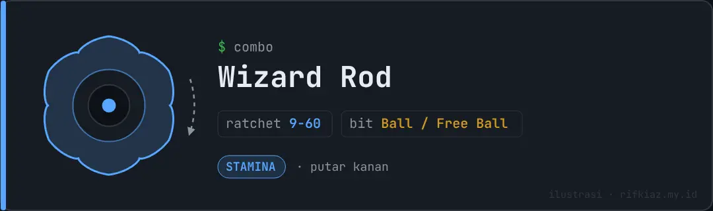

Varian Wizard Rod yang lebih tinggi, masih sering juara.

Yang lagi naik daun: **Meteor Dragoon 9-60 Elevate** sekarang masuk 10 besar combo di BEYWATCH.GG, dan varian **Meteor Dragoon 7-60 Level** juga rutin muncul di deck juara.

Contoh hasil turnamen akhir Agustus sampai awal September 2026 juga kelihatan polanya: Shark Scale 7-60 Rush, Shark Scale 1-50 Low Rush, Wizard Rod 7-60 Narrow, Aero Pegasus 1-60 Rush, dan Phoenix Wing 3-60 Rush semuanya sempat juara di event yang berbeda.

## Tren seminggu terakhir

Blade yang paling sering ada di combo juara minggu ini, lengkap dengan naik turunnya peringkat dibanding minggu sebelumnya. Bar menunjukkan berapa kali blade itu dipakai combo juara, dan di bawah nama blade ada combo yang paling sering menang bareng blade itu (kalau minggu ini tidak ada datanya, diambil dari combo terbaiknya di BEYWATCH.GG). Daftarnya lengkap sampai urutan terakhir, 10 blade per halaman. Blade di urutan 11 ke bawah cuma muncul sekali, jadi naik turunnya tidak dicatat (ditandai –).



Sampelnya kecil, jadi naik turun satu-dua posisi belum tentu berarti banyak. Yang konsisten dari minggu ke minggu tetap duo Wizard Rod dan Shark Scale.

## Part yang paling sering dipakai

**Blade**: Wizard Rod, Shark Scale, Phoenix Wing, Cobalt Dragoon, Aero Pegasus, Silver Wolf, Hover Wyvern, dan yang lagi naik Meteor Dragoon.

**Ratchet**: 1-60 jauh di depan, lalu 9-60, 3-60, 5-60, 1-70, dan 7-60.

**Bit**: Rush, Hexa, Low Rush, Free Ball, dan Elevate. Di bawahnya ada Narrow, Level, Low Orb, Ball, dan Kick.

## Custom Line (CX)

Part Custom Line seperti Lock Chip **Emperor** dan **Cerberus**, Over Blade **Blast** dan **Flame**, serta Assist Blade **Heavy** dan **Wheel** mulai muncul di daftar juara. Yang paling menonjol sekarang **Blast**: per pertengahan Oktober, tier list BEYWATCH.GG sudah menaruhnya di tier X (paling atas) dengan combo 9-60 Kick, sejajar Shark Scale, Aero Pegasus, dan Wizard Rod. Part CX lain masih satu-dua per minggu, jadi belum cukup data buat bilang mana yang benar-benar kuat. Kalau kamu mau mulai koleksi CX, Blast pilihan paling aman buat sekarang.

## Kalau mau nyusun deck

Saran saya buat format 3on3, berdasarkan data di atas:

- **Satu attack**: Shark Scale atau Aero Pegasus dengan Rush atau Low Rush.
- **Satu stamina**: Wizard Rod 1-60 Hexa, atau Silver Wolf 9-60 Free Ball kalau kamu sudah nyaman dengan orbitnya.
- **Satu counter**: Cobalt Dragoon 5-60 Elevate buat jaga-jaga ketemu deck yang isinya putar kanan semua.

Ini cuma titik awal. Kondisi stadium, gaya launch kamu, dan meta di komunitas lokal bisa bikin hasilnya beda.

## Catatan

- Datanya mayoritas dari turnamen WBO dan komunitas di luar negeri. Meta di komunitas lokal bisa beda tergantung part yang gampang didapat.
- Nama part di sini mengikuti penamaan yang dipakai situs-situs data turnamen. Beberapa rilis Hasbro bisa punya nama atau kemasan yang berbeda dari versi Takara Tomy.
- Halaman ini akan saya perbarui kalau ada perubahan meta yang lumayan besar.

## Sumber

- [BEYWATCH.GG: Best Beyblade X Combos](https://beywatch.gg/combos), statistik top cut turnamen sampai 12 Oktober 2026
- [BBXHub: Meta Tier List & Best Combos](https://bbxhub.net/), peringkat mingguan 4 sampai 11 Oktober 2026
- [BEYWATCH.GG: Tournaments](https://beywatch.gg/tournaments), deck juara turnamen 8 sampai 11 Oktober 2026
- [BeyX Hub: Best Beyblade X Combos 2026](https://beyxhub.org/en/guide/best-beyblade-x-combos-2026), panduan meta Juni 2026
- [beybladewiki.com: Tournament Results](https://beybladewiki.com/competitive/results), daftar podium turnamen terbaru
- [WBO: Winning Combinations at WBO Organized Events](https://worldbeyblade.org/Thread-Winning-Combinations-at-WBO-Organized-Events-Beyblade-X-BBX)
