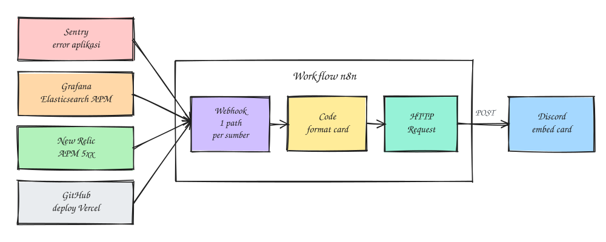
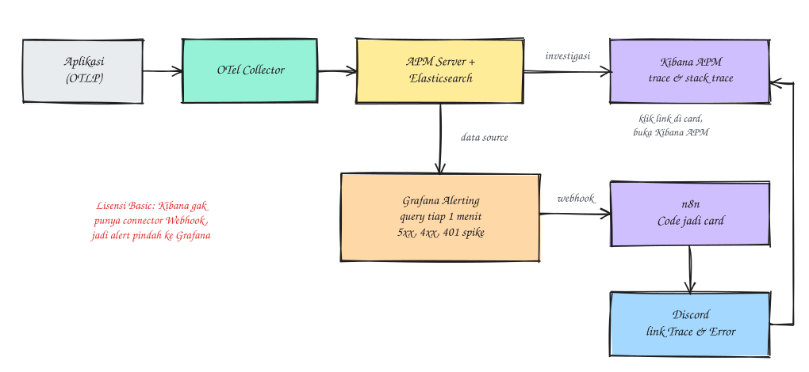
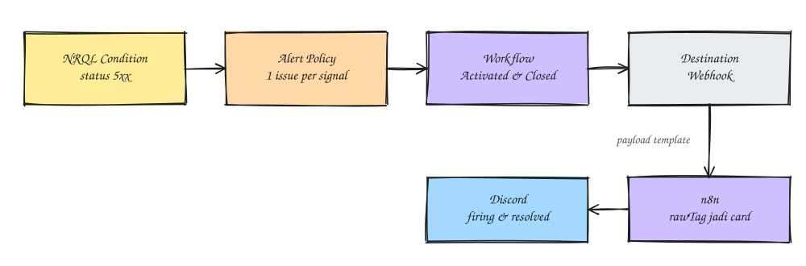
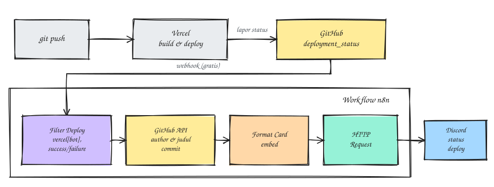

### Introduction
Alerting is one of those things you absolutely need, but it gets messy fast when you have lots of sources. Where I work, alerts were scattered everywhere: application errors in Sentry, APM in Elastic, some services in New Relic, and frontend deploys on Vercel. Each one has its own Discord integration, but some are paid, some are locked behind a license, and they all look different (a real headache in the middle of an incident).

So I ended up using one pattern for all of them:
```
Alert source → n8n Webhook → Code (format embed) → HTTP Request → Discord
```



n8n becomes the single "gateway". Every message gets tidied up in a Code node into a Discord **embed card** with a consistent format: what happened, where, the likely cause, and links for investigating. In this post I'll share the setup, including the traps I ran into along the way.

Note: every URL, service name, and endpoint in this post is just an example, so adjust them to your own setup.

### Requirements
- A running n8n (self-hosted or cloud)
- A Discord channel and its webhook
- Admin access to Sentry, Grafana, New Relic, and the GitHub repo connected to Vercel (only the ones you actually use)

### The Basic Pattern in n8n

Every source uses three nodes:

1. **Webhook** (POST) to receive the payload.
2. **Code** (JavaScript, *Run Once for All Items* mode) to turn the payload into `{ username, embeds }`.
3. **HTTP Request** to send it to the Discord webhook.

The HTTP Request settings are always the same:

| Setting | Value |
|---|---|
| Method | `POST` |
| URL | Discord webhook URL (Edit Channel > Integrations > Webhooks) |
| Send Body | ON, type **JSON** |
| Specify Body | **Using JSON** |
| JSON | `{{ JSON.stringify($json) }}` (*Expression* mode) |

Why not use n8n's built-in Discord node? Because with HTTP Request we get full control over the shape of the embed.

A few things that tend to confuse people at first:

- **The JavaScript goes in the Code node**, not in the HTTP Request JSON field. The JSON field only accepts JSON or `{{ }}` expressions.
- **Test vs production URL.** `/webhook-test/...` is only active while you click *Listen for test event*. For real use, **Publish** the workflow and use `/webhook/...`.
- **A Discord webhook URL is a secret.** Anyone who has it can post messages to your channel. Be careful when sharing screenshots.
- **Discord limits:** title 256 characters, description 4096, field value 1024, at most 10 embeds per message. Empty strings and relative URLs get rejected with a 400 error.

That's why every Code node below uses the same three helpers:

```
// truncate to Discord's limits; undefined if empty (Discord rejects empty strings)
const trunc = (s, n) => {
  s = String(s ?? '').trim();
  if (!s) return undefined;
  return s.length > n ? s.slice(0, n - 1) + '…' : s;
};

// Discord only accepts absolute URLs
const safeUrl = (u) => (typeof u === 'string' && /^https?:\/\//.test(u) ? u : undefined);

// normalize timestamps to standard ISO
const safeTs = (t) => {
  const d = new Date(Number(t) || t);
  return isNaN(d) ? new Date().toISOString() : d.toISOString();
};
```

One workflow can have several Webhook triggers. I put the Sentry and Grafana paths on one canvas with different paths, so when one path needs debugging, the other stays untouched. The alternative is a single Webhook plus a **Switch** node that routes based on a header or the body, but I find two triggers clearer.

### 1. Sentry > Discord

Sentry's webhook payload is big (it can be hundreds of KB, mostly stacktrace and `debug_meta`). So just pick a few important fields.

```
const body = $input.first().json.body;
const ev = body?.data?.event ?? {};

// Sentry tags come as an array of [key, value]
const tags = Object.fromEntries(ev.tags ?? []);

const exc = ev.exception?.values?.[0] ?? {};
const frames = exc.stacktrace?.frames ?? [];
// last in_app frame = the spot in our code closest to the crash
const appFrame = [...frames].reverse().find(f => f.in_app && f.filename);

const project = ev.url?.match(/\/projects\/[^/]+\/([^/]+)\//)?.[1] ?? '-';

const trunc = (s, n) => {
  if (s === null || s === undefined || s === '') return '-';
  s = String(s);
  return s.length > n ? s.slice(0, n - 1) + '…' : s;
};

const levelColor = {
  fatal: 0x8B0000, error: 0xE03E2F, warning: 0xF5A623, info: 0x3498DB, debug: 0x95A5A6,
};

const level = ev.level ?? tags.level ?? 'error';
const isTest = tags.sample_event === 'yes' || !!ev.occurrence;

const errType  = ev.metadata?.type ?? exc.type;
const errValue = ev.metadata?.value ?? exc.value;
let title = errType ? `${errType}: ${errValue ?? ''}` : (ev.message || ev.title || 'Sentry Issue');
if (isTest) title = `[TEST] ${title}`;

const location = appFrame
  ? `\`${appFrame.filename}:${appFrame.lineno ?? '?'}\`\n${appFrame.function ?? ''}`
  : (ev.culprit ?? '-');

const embed = {
  title: trunc(title, 250),
  url: ev.web_url,
  color: levelColor[level] ?? levelColor.error,
  description: trunc(ev.culprit ? `**Culprit:** \`${ev.culprit}\`` : '', 4000),
  fields: [
    { name: '📦 Project',     value: trunc(project, 1000),        inline: true },
    { name: '🌍 Environment', value: trunc(ev.environment, 1000), inline: true },
    { name: '🚨 Level',       value: level.toUpperCase(),         inline: true },
    { name: '🏷️ Release',     value: trunc(ev.release, 1000),     inline: true },
    { name: '📱 Device',      value: trunc(ev.contexts?.device?.model ?? tags.device, 1000), inline: true },
    { name: '💻 OS',          value: trunc(ev.contexts?.os?.os ?? tags.os, 1000),            inline: true },
    { name: '📍 Location',    value: trunc(location, 1000),       inline: false },
  ],
  footer: { text: `Rule: ${body?.data?.triggered_rule ?? '-'} • Issue #${ev.issue_id ?? '-'}` },
  timestamp: ev.datetime ?? new Date().toISOString(),
};

// @here only for production errors that aren't tests
const mention = (ev.environment === 'production' && ['error', 'fatal'].includes(level) && !isTest)
  ? '@here' : '';

return [{
  json: {
    username: 'Sentry',
    content: mention,
    embeds: [embed],
    allowed_mentions: { parse: ['everyone'] },
  },
}];
```

A few notes:

- **Sentry's test notification is a sample event** (tag `sample_event: yes`), so the data is dummy data. The code above adds a `[TEST]` prefix so nobody panics.
- I deliberately **don't show user data** (email, id) in Discord. A Discord channel usually has wider access than Sentry.
- Add an **IF** node before the Code node with the condition `{{ $json.body.action }}` equals `triggered`, so other events don't get sent too.
- For security, verify the `sentry-hook-signature` header (an HMAC-SHA256 of the body using your Sentry integration's Client Secret) so nobody else can spam your webhook.

### 2. Elasticsearch APM > Discord (via Grafana)

This is the part with the most traps.

#### Why not straight from Kibana?

The original plan was Kibana Alerting with a Webhook connector to n8n. Turns out on the **Basic** (free) license, the only connectors available are *Index* and *Server log*. Webhook needs Gold or above. The *Start trial* button isn't a solution either, since it only lasts 30 days and can't be repeated.

The remaining options:

| | n8n polling Elasticsearch | ElastAlert2 | Grafana Alerting |
|---|---|---|---|
| Extra infra | None | One more service | None if you already have Grafana |
| Dedup / grouping / resolved | DIY | Built-in | Built-in |
| Cost | Free | Free | Free (OSS) |

Since we already had Grafana for Prometheus, the lightest path was to **add Elasticsearch as a data source in Grafana** and build the alerts there. No duplicated data, no changes to the OTel Collector config, and Kibana APM stays the place to investigate.



I also briefly considered moving to LGTM (Loki, Grafana, Tempo, Mimir), or sending data in parallel via *collector chaining*. That works and is pretty common, but if Elastic already covers your APM needs and the only thing missing is alerting, there's no need to build a whole new stack just for that.

#### Find the status code field name

The APM documents that carry the HTTP status are **transactions**, not spans. In Grafana Explore, check which field is populated:

```
processor.event:transaction AND service.environment:PROD AND _exists_:http.response.status_code
```

If that's empty, try `labels.http_response_status_code`. That happens when an older APM Server doesn't recognize the newer OTel attribute names yet, so the attributes land in `labels.*`.

Then look at the 4xx and 5xx volume over 30 days to pick thresholds. In my case 5xx was rare (less than one a day), while 4xx was dominated by **401** from expired tokens. If 401 is lumped into a normal 4xx rule, the alert will fire nonstop.

#### Three rules

| Rule | Extra query | Threshold / 5 min | Pending | Severity |
|---|---|---|---|---|
| HTTP 5xx - PROD | `http.response.status_code:[500 TO 599]` | > 0 | None | critical |
| HTTP 4xx - PROD | `http.response.status_code:[400 TO 499] AND NOT http.response.status_code:401` | > 3 | 2m | warning |
| HTTP 401 spike - PROD | `http.response.status_code:401` | > 20 | 1m | warning |

Every query starts with `processor.event:transaction AND service.environment:PROD AND ...`. The 401 spike rule isn't for catching ordinary expired tokens, it's for detecting mass authentication problems, like the auth service going down or the JWT secret changing.

The 5xx rule settings in Grafana:

- **Query A** (Elasticsearch, Query type *Metrics*), time range **now-5m**, metric **Count**.
- **Group by**, and the order matters: Terms `service.name` > Terms `transaction.name` > Terms `http.response.status_code` (all *Order by Doc Count*) > **Date Histogram** `@timestamp` with a **1m** interval.
- **Expression B**: Reduce, **Sum**, mode **Drop Non-numeric Values** (*Strict* mode can produce NaN).
- **Expression C**: Threshold, input B, **IS ABOVE 0**, set as the alert condition.
- **No data handling: Normal.** This one is a must. Without it, every period with no errors sends a `DatasourceNoData` alert.
- Labels: `severity=critical`, `env=PROD`, `team=backend`.
- Custom annotation `count`: `{{ humanize $values.B.Value }}`, plus `apm_transaction_url` and `apm_errors_url` pointing to the APM pages in Kibana:

```
https://kibana.example.com/app/apm/services/{{ index $labels "service.name" }}/transactions/view?transactionName={{ urlquery (index $labels "transaction.name") }}&transactionType=request&environment=PROD&rangeFrom=now-30m&rangeTo=now
```

```
https://kibana.example.com/app/apm/services/{{ index $labels "service.name" }}/errors?environment=PROD&rangeFrom=now-30m&rangeTo=now
```

For the 401 spike rule, remove the Terms `transaction.name` so spikes spread across many endpoints still get counted per service.

Notification grouping: group by `alertname`, `service.name`, `transaction.name`, `http.response.status_code`, with Group wait 30s, Group interval 5m, Repeat interval 1h. The result is one card per service + endpoint + status combination, repeated at most once an hour, plus a resolved card when the errors stop.

#### Trap: "too many buckets"

To test the rule against real data, my trick was to temporarily change the time range to **now-30d**. Instead I got an error:

```
Trying to create too many buckets. Must be less than or equal to: [65536]
```

The cause is a Date Histogram with an *auto* interval. Over 30 days, the auto interval works out to about 1 minute, so there are 43,200 buckets per service × endpoint × status combination. Just two combinations already blow past the limit.

The fix is to set the interval explicitly:

| Setting | Test | Production |
|---|---|---|
| Time range | now-30d | **now-5m** |
| Date Histogram interval | 1d | **1m** |

Since the reduce is a **Sum**, the interval size doesn't change the count. And don't forget to switch back to the production settings after testing, or old alerts will be resent every hour for a month.

#### From a text template to an embed card

Grafana's built-in Discord integration can be customized with a notification template (Go template), but the result is still plain text. I went through a few iterations of the template and it always felt messy. In the end I switched the contact point to **Webhook > n8n** so it could become an embed card like the Sentry one.

The Code node for the Grafana payload:

```
const p = $input.first().json.body;

const CODE_NAME = {
  400: 'Bad Request', 401: 'Unauthorized', 403: 'Forbidden', 404: 'Not Found',
  409: 'Conflict', 422: 'Unprocessable Entity', 429: 'Too Many Requests',
  500: 'Internal Server Error', 502: 'Bad Gateway', 503: 'Service Unavailable', 504: 'Gateway Timeout',
};

const HINT = {
  400: 'Request validation failed, check the payload from the client',
  401: 'Invalid/expired token; if widespread, check the auth service',
  403: 'User has no access to the resource',
  404: 'Resource/URL not found',
  409: 'Data/state conflict (duplicate or state already changed)',
  422: 'Business validation failed',
  429: 'Hit a rate limit',
  500: 'Bug/exception in the app, check the stack trace in APM Errors',
  502: 'Upstream/dependency returned an invalid response',
  503: 'Service/dependency down or overloaded',
  504: 'Timeout to a dependency (DB/Redis/API)',
};

const COLOR = { critical: 0xE03E2F, warning: 0xF5A623, resolved: 0x2ECC71, system: 0x95A5A6 };

const trunc = (s, n) => {
  s = String(s ?? '').trim();
  if (!s) return undefined;
  return s.length > n ? s.slice(0, n - 1) + '…' : s;
};
const safeUrl = (u) => (typeof u === 'string' && /^https?:\/\//.test(u) ? u : undefined);
const safeTs = (t) => {
  const d = new Date(t);
  return isNaN(d) ? new Date().toISOString() : d.toISOString();
};

const embeds = (p?.alerts ?? []).map(a => {
  const L = a.labels ?? {};
  const A = a.annotations ?? {};
  const resolved = a.status === 'resolved';
  const ts = safeTs(resolved && a.endsAt && !a.endsAt.startsWith('0001') ? a.endsAt : a.startsAt);
  const svc = L['service.name'];

  // system alerts (DatasourceNoData / DatasourceError / TestAlert)
  if (!svc) {
    return {
      title: trunc(`⚠️ ${L.alertname ?? 'Grafana alert'}${resolved ? ' · resolved' : ''}`, 250),
      url: safeUrl(a.generatorURL),
      color: resolved ? COLOR.resolved : COLOR.system,
      description: trunc([
        L.rulename && `Rule: **${L.rulename}**`,
        A.summary,
        A.Error && '```' + A.Error + '```',
      ].filter(Boolean).join('\n'), 4000),
      footer: { text: 'Grafana Alerting' },
      timestamp: ts,
    };
  }

  const code = String(L['http.response.status_code'] ?? '');
  const name = CODE_NAME[code] ?? 'HTTP Error';
  const endpoint = L['transaction.name'];
  const sev = L.severity ?? 'warning';
  const count = A.count ?? a.values?.B ?? '-';
  const where = `**${svc}**${endpoint ? `\n\`${endpoint}\`` : ''}`;

  if (resolved) {
    return {
      title: trunc(`✅ Resolved · ${code} ${name}`, 250),
      description: trunc(where, 4000),
      color: COLOR.resolved,
      footer: { text: trunc(`${L.alertname ?? 'Grafana'} · Grafana`, 2000) },
      timestamp: ts,
    };
  }

  const trace = safeUrl(A.apm_transaction_url);
  const error = safeUrl(A.apm_errors_url);
  const links = [trace && `[Trace](${trace})`, error && `[Error](${error})`].filter(Boolean).join(' · ');

  const fields = [
    { name: 'Count', value: `${count}x / 5 min`, inline: true },
    { name: 'Env', value: trunc(L.env, 100) ?? '-', inline: true },
    { name: 'Severity', value: sev, inline: true },
    { name: '💡 Likely cause', value: HINT[code] ?? 'Check the transaction details in APM', inline: false },
  ];
  if (links) fields.push({ name: '🔗 Link', value: links, inline: false });

  return {
    title: trunc(`${sev === 'critical' ? '🔴' : '🟠'} ${code} ${name}`, 250),
    url: trace,
    description: trunc(where, 4000),
    color: COLOR[sev] ?? COLOR.warning,
    fields,
    footer: { text: trunc(`${L.alertname ?? 'Grafana'} · Grafana`, 2000) },
    timestamp: ts,
  };
});

// Discord allows at most 10 embeds per message
const out = [];
for (let i = 0; i < embeds.length; i += 10) {
  out.push({ json: { username: 'Grafana Alert', embeds: embeds.slice(i, i + 10) } });
}
if (!out.length) {
  out.push({ json: { username: 'Grafana Alert', content: '⚠️ Grafana sent a notification with no alerts.' } });
}
return out;
```

If it works, you'll get a card roughly like this:

```
┃ 🔴 504 Gateway Timeout                ← title links to APM
┃ orders-service
┃ /v1/orders/:id
┃
┃ Count           Env      Severity
┃ 6x / 5 min      PROD     critical
┃
┃ 💡 Likely cause
┃ Timeout to a dependency (DB/Redis/API)
┃ 🔗 Trace · Error
┃ HTTP 5xx - PROD · Grafana
```

Two traps in this part:

- **Error 400 `{"embeds": ["0"]}` from Discord.** The Test button on a Grafana contact point sends a relative `generatorURL` (`?orgId=1`), and Discord rejects any URL that isn't absolute. That's what `safeUrl` is for. If links from real alerts are relative too, set Grafana's `root_url` (`GF_SERVER_ROOT_URL`).
- **The Test (Predefined) button has no `service.name` label**, so you always get the grey "system alert" card. Use **Test > Custom** with made-up labels and annotations to see the full card.

#### Pause vs Silence

When one rule gets too noisy (say, 400s from client validation), you have two options:

| | Pause evaluation | Silence |
|---|---|---|
| Rule still evaluated | No | Yes |
| Alert state still visible in Grafana | No | Yes, just not sent |
| Good for | Stopping until some undecided time | Holding notifications for a set duration |

If you only want to mute 400s, change the query to `... AND NOT http.response.status_code:(400 OR 401)`.

### 3. New Relic > Discord

Same pattern: **NRQL Condition > Alert Policy > Workflow > Destination (Webhook) > n8n**. Alerting is included in the New Relic plan at no extra cost.



#### Trap: `http.statusCode` is a string

My query `WHERE http.statusCode >= 500` came back empty, even though the data was there. Turns out that attribute is stored as a **string** in some events, and `>=` only works on numbers. You can't see this in the FACET view because strings and numbers look the same there. The fix is to wrap it in `numeric()`:

```
SELECT count(*) FROM Transaction
WHERE appName LIKE 'Prod-%' AND numeric(http.statusCode) >= 500
FACET appName, name, http.statusCode
```

Check an attribute's type with `SELECT keyset() FROM Transaction ...`; it'll show up under either `stringKeys` or `numericKeys`.

When I broke it down, 4xx in New Relic was almost entirely noise (health checks hitting the wrong path, polling with invalid tokens), so for New Relic I only watch **5xx**. The `appName` filter is a must too, because dev apps produce tens of thousands of 4xx a day.

#### Condition settings

| Part | Value |
|---|---|
| Window duration | 1 minute |
| Streaming method | Event timer, 1 minute (good for sparse data) |
| Fill data gaps with | **Custom static value: 0** |
| Threshold | Critical, above 0, at least once in 1 minute |
| Signal loss | Don't open an incident when the signal is lost |

**Fill data gaps = 0** is important. Without it, when there are no 5xx at all New Relic has no data to evaluate, the incident never closes, and the resolved card never gets sent.

The Alert Policy uses *One issue per condition and signal*, so every app, endpoint, and status combination becomes its own alert.

#### Payload template

In the Workflow, replace the default payload template with this, then tick notify on **Activated** and **Closed**:

```
{
  "source": "newrelic",
  "issueUrl": {{json issuePageUrl}},
  "title": {{json annotations.title.[0]}},
  "state": {{json state}},
  "priority": {{json priority}},
  "createdAt": {{json createdAt}},
  "updatedAt": {{json updatedAt}},
  "totalIncidents": {{json totalIncidents}},
  "policyName": {{json accumulations.policyName.[0]}},
  "conditionName": {{json accumulations.conditionName.[0]}},
  "entityNames": {{json entitiesData.names}},
  "accumulations": {
    "rawTag": {{json accumulations.rawTag}},
    "deepLinkUrl": {{json accumulations.deepLinkUrl}}
  }
}
```

The FACET values (app, transaction name, status code) live in `accumulations.rawTag`, keyed by attribute name. My advice: capture a real payload before writing any code. The easiest way is to Publish the n8n workflow, point the Destination at the production URL, then check the **Executions** tab in n8n. That way you capture both the Activated and Closed payloads.

#### Code node

```
const b = $input.first().json.body ?? {};
const acc = b.accumulations ?? {};
const raw = acc.rawTag ?? {};
const first = (v) => (Array.isArray(v) ? v[0] : v);

const CODE_NAME = {
  500: 'Internal Server Error', 501: 'Not Implemented', 502: 'Bad Gateway',
  503: 'Service Unavailable', 504: 'Gateway Timeout',
};
const HINT = {
  500: 'Bug/exception in the app, check the error trace in New Relic',
  501: 'Endpoint/method not implemented yet',
  502: 'Upstream/dependency returned an invalid response',
  503: 'Service/dependency down or overloaded',
  504: 'Timeout to a dependency (DB/Redis/third-party API)',
};
const COLOR = { CRITICAL: 0xE03E2F, HIGH: 0xF5A623, MEDIUM: 0xF5A623, LOW: 0x3498DB, resolved: 0x2ECC71 };

const trunc = (s, n) => {
  s = String(s ?? '').trim();
  if (!s) return undefined;
  return s.length > n ? s.slice(0, n - 1) + '…' : s;
};
const safeUrl = (u) => (typeof u === 'string' && /^https?:\/\//.test(u) ? u : undefined);
const safeTs = (t) => {
  const d = new Date(Number(t) || t);
  return isNaN(d) ? new Date().toISOString() : d.toISOString();
};

const app = first(raw.appName) ?? first(b.entityNames) ?? '-';
const txn = first(raw.name);
const code = String(first(raw['http.statusCode']) ?? '');

// "WebTransaction/Expressjs/POST//api/v1/x" -> "POST /api/v1/x"
const endpoint = txn
  ? String(txn).replace(/^WebTransaction\/[^/]+\//, '').replace(/^([A-Z]+)\/\//, '$1 /')
  : undefined;

const closed = b.state === 'CLOSED';
const priority = b.priority ?? 'CRITICAL';
const label = code
  ? `${code} ${CODE_NAME[code] ?? 'HTTP Error'}`
  : (b.conditionName ?? b.title ?? 'New Relic alert');

const where = `**${app}**${endpoint ? `\n\`${endpoint}\`` : ''}`;
const footer = { text: trunc(`${b.policyName ?? 'New Relic'} · New Relic`, 2000) };

const issue = safeUrl(b.issueUrl);
const query = safeUrl(first(acc.deepLinkUrl));
let links = issue ? `[Issue](${issue})` : '';
if (query && (links.length + query.length + 15) <= 1000) {
  links += `${links ? ' · ' : ''}[Query](${query})`;
}

let embed;
if (closed) {
  const mins = b.createdAt && b.updatedAt
    ? Math.max(1, Math.round((Number(b.updatedAt) - Number(b.createdAt)) / 60000))
    : null;
  embed = {
    title: trunc(`✅ Resolved · ${label}`, 250),
    url: issue,
    description: trunc(`${where}${mins ? `\nDuration: ${mins} min` : ''}`, 4000),
    color: COLOR.resolved,
    footer,
    timestamp: safeTs(b.updatedAt),
  };
} else {
  const fields = [
    { name: 'Priority', value: priority, inline: true },
    { name: 'Incident', value: String(b.totalIncidents ?? 1), inline: true },
    { name: 'Condition', value: trunc(b.conditionName, 100) ?? '-', inline: true },
  ];
  if (code) fields.push({ name: '💡 Likely cause', value: HINT[code] ?? 'Check the error details in New Relic', inline: false });
  if (links) fields.push({ name: '🔗 Link', value: links, inline: false });

  embed = {
    title: trunc(`${priority === 'CRITICAL' ? '🔴' : '🟠'} ${label}`, 250),
    url: issue,
    description: trunc(where, 4000),
    color: COLOR[priority] ?? COLOR.CRITICAL,
    fields,
    footer,
    timestamp: safeTs(b.createdAt),
  };
}

return [{ json: { username: 'New Relic Alert', embeds: [embed] } }];
```

The New Relic payload doesn't include an error count, so the card shows the number of incidents and, once resolved, how long it lasted.

#### Testing without waiting for a real error

1. **Pin fake data on the Webhook node.** In the Webhook node's Output panel, click the pencil icon, fill in a mock payload (for example `state: "ACTIVATED"` with a `rawTag` containing an app, a transaction name, and `"http.statusCode": ["500"]`), then Execute the Code and HTTP Request nodes. Change it to `CLOSED` to see the resolved card. **Don't forget to Unpin** afterwards, or the workflow will keep using the fake data.
2. **End to end with a temporary condition**, for example a query for 400s from one app. Wait for the card to arrive, then delete the condition and wait for the resolved card.

If the Code node output has a `myNewField: 1` field, it's still running n8n's default sample code. If you get `Unexpected token '}'`, the code probably got cut off while pasting; make sure the last line in the editor is `return ...`.

### 4. Vercel deploy notifications > Discord

Vercel account webhooks are only available on the Pro and Enterprise plans. The free route goes through **GitHub**: if a Vercel project is connected to a GitHub repo, Vercel always reports deploy status to GitHub as a *deployment status*, and GitHub webhooks are free.



#### GitHub webhook

In the repo's **Settings > Webhooks** (or at the organization level so every repo is included):

- Payload URL: `https://n8n.example.com/webhook/github-vercel`
- Content type: **`application/json`** (the default is form-urlencoded, which is easy to miss)
- Events: *Let me select individual events*, uncheck **Pushes**, tick **Deployment statuses** only

#### n8n workflow

I also wanted the card to show **who made the commit** and the commit title. The problem is that in the `deployment_status` event, the deploy creator is recorded as `vercel[bot]`. So it takes one call to the GitHub API.

The node order is the same as in the diagram above: `Filter Deploy` > `GitHub Commit` > `Format Card` > HTTP Request to Discord.

**Code `Filter Deploy`** (the name must match exactly, because the next node reads it):

```
// set to true if you only want notifications for Production deploys (no Preview)
const ONLY_PRODUCTION = false;

const h = $input.first().json.headers ?? {};
const b = $input.first().json.body ?? {};

// ignore events other than deployment_status (including "ping")
if (h['x-github-event'] !== 'deployment_status') return [];

const ds = b.deployment_status ?? {};
const dep = b.deployment ?? {};

// only deploys from Vercel
if (ds.creator?.login !== 'vercel[bot]') return [];

// only when the deploy has finished
if (!['success', 'failure', 'error'].includes(ds.state)) return [];

// "Production – project-name" / "Preview – project-name"
const envRaw = ds.environment ?? dep.environment ?? '';
const [envName, projectFromEnv] = envRaw.split(/\s+[–-]\s+/);
const isProd = /production/i.test(envName ?? '');
if (ONLY_PRODUCTION && !isProd) return [];

const safeUrl = (u) => (typeof u === 'string' && /^https?:\/\//.test(u) ? u : undefined);
const repo = b.repository?.full_name ?? '';

return [{
  json: {
    ok: ds.state === 'success',
    isProd,
    project: projectFromEnv || b.repository?.name || repo,
    repo,
    sha: dep.sha ?? '',
    ref: dep.ref ?? '-',
    siteUrl: safeUrl(ds.environment_url),
    logUrl: safeUrl(ds.target_url),
    createdAt: ds.created_at,
  },
}];
```

**HTTP Request `GitHub Commit`:**

- Method **GET**, URL `https://api.github.com/repos/{{ $json.repo }}/commits/{{ $json.sha }}`
- Auth: Header Auth `Authorization: Bearer <token>`, using a fine-grained token with only the **Contents: Read-only** permission
- Header `Accept: application/vnd.github+json` and any `User-Agent`
- **Settings > On Error: Continue**, so if the token expires or you hit a rate limit, the notification still goes out without the author name

**Code `Format Card`:**

```
const d = $('Filter Deploy').first().json;
const c = $input.first().json ?? {};

const trunc = (s, n) => {
  s = String(s ?? '').trim();
  if (!s) return undefined;
  return s.length > n ? s.slice(0, n - 1) + '…' : s;
};

const login = c.author?.login;                              // GitHub username
const name = c.commit?.author?.name;                        // name from git config
const avatar = c.author?.avatar_url;
const message = (c.commit?.message ?? '').split('\n')[0];   // commit title

const shortSha = d.sha.slice(0, 7);
const commitUrl = d.sha && d.repo ? `https://github.com/${d.repo}/commit/${d.sha}` : undefined;

const links = [
  d.siteUrl && `[Open website](${d.siteUrl})`,
  d.logUrl && `[Vercel log](${d.logUrl})`,
  commitUrl && `[Commit](${commitUrl})`,
].filter(Boolean).join(' · ');

const fields = [
  { name: 'Environment', value: d.isProd ? '🚀 Production' : '🧪 Preview', inline: true },
  { name: 'Branch', value: `\`${d.ref}\``, inline: true },
  { name: 'Commit', value: shortSha ? `\`${shortSha}\`` : '-', inline: true },
];
if (!d.ok) fields.push({ name: '💡 Next step', value: 'Check the build log in Vercel to see the error', inline: false });
if (links) fields.push({ name: '🔗 Link', value: links, inline: false });

const embed = {
  title: `${d.ok ? '✅ Deploy succeeded' : '❌ Deploy failed'} · ${d.project}`,
  url: d.ok ? (d.siteUrl ?? d.logUrl) : d.logUrl,
  description: [message && `**${trunc(message, 200)}**`, `Repo ${d.repo}`].filter(Boolean).join('\n'),
  color: d.ok ? 0x2ECC71 : 0xE03E2F,
  fields,
  footer: { text: 'Vercel via GitHub' },
  timestamp: new Date(d.createdAt ?? Date.now()).toISOString(),
};

if (login || name) {
  embed.author = {
    name: login ? `${name ?? login} (@${login})` : name,
    url: login ? `https://github.com/${login}` : undefined,
    icon_url: avatar,
  };
}

return [{ json: { username: 'Vercel Deploy', embeds: [embed] } }];
```

Notes:

- **Preview deploys can get busy.** One PR can produce several preview deploys. If the channel is only for releases, set `ONLY_PRODUCTION = true`.
- **The author shown is the commit author.** For squash merges, that's the person who opened the PR. If only a name shows up and no GitHub username, that person's git config email isn't linked to their GitHub account.
- To test again without a new deploy, open **Recent Deliveries** on the GitHub webhook page, pick a successful `deployment_status` event, and hit **Redeliver**.
- This only works for deploys from Vercel's Git integration. Deploys via the CLI from a CI pipeline don't go through GitHub, so it's easier to add the notification in that pipeline itself.

### Production Checklist

Once every path is working:

1. **Secure the n8n webhooks.** Right now anyone who knows the URL can send fake cards. Set Header Auth on the Webhook node (`Authorization: Bearer <token>`, generate one with `openssl rand -hex 24`) and put the same token in the Grafana contact point or New Relic Destination. For GitHub, fill in the *Secret* and verify the signature.
2. **Set up an Error Workflow in n8n.** Since every alert goes through n8n, if n8n has problems, no alerts arrive. Build a small workflow with an *Error Trigger* that posts to Discord, then set it as the Error Workflow.
3. **Put every rule back on its production settings** after testing (5 minute time range, 1m interval).
4. **Back up the rules.** Export the Grafana alert rules to YAML and keep them in a repo.
5. **Review after a week.** Too noisy? Raise the threshold or exclude certain endpoints. Do routine deploys often trigger 502/503? Create a *mute timing* for deploy hours.

### Bonus: Check What's in Your Logs

While tinkering with all this, I found **debug** level logs in production that recorded full requests/responses to third parties, including customers' personal data, plus one line that logged a secret token value in plaintext. Anyone with Kibana access could read them.

If you use the OTel Collector, add redaction as a safety net before data is sent to the backend:

```
processors:
  transform/redact:
    log_statements:
      - context: log
        statements:
          - replace_pattern(body, "\"email\":\"[^\"]*\"", "\"email\":\"***\"")
          - replace_pattern(body, "\"phone_number\":\"[^\"]*\"", "\"phone_number\":\"***\"")
          - replace_pattern(body, "expected \\S+", "expected ***")
```

But the real fix is still in the application: set the production log level to `info`, never log secret values, and rotate any secret that got logged.

Voila, now every alert lands in Discord in the same format, no matter where it comes from. Adding a new source is easy too: just one more Webhook trigger and one more Code node.

That's it, hope it helps.

References:
- [n8n Webhook node](https://docs.n8n.io/integrations/builtin/core-nodes/n8n-nodes-base.webhook/)
- [Discord Webhook Resource](https://discord.com/developers/docs/resources/webhook)
- [Grafana Alerting](https://grafana.com/docs/grafana/latest/alerting/)
- [New Relic webhook destinations](https://docs.newrelic.com/docs/alerts/get-notified/notification-integrations/)
