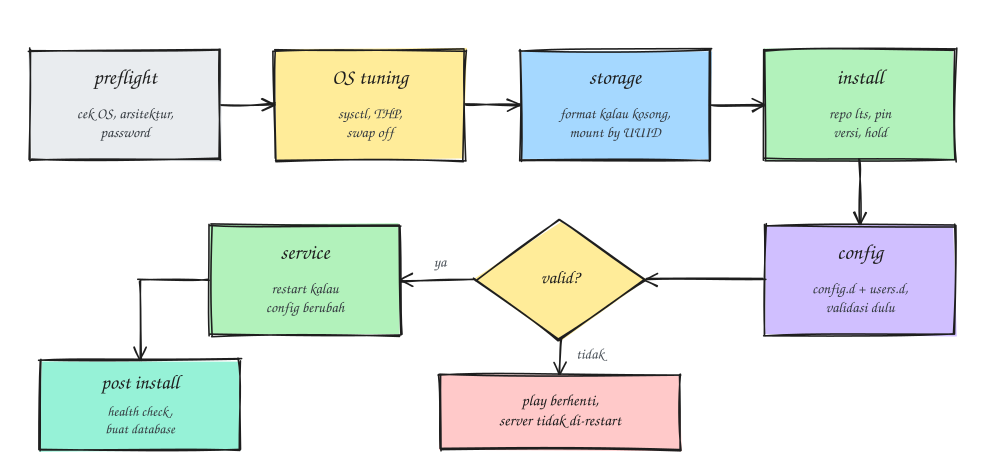
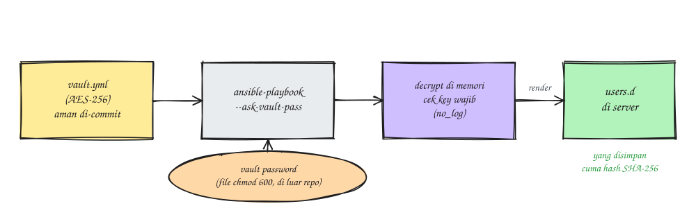
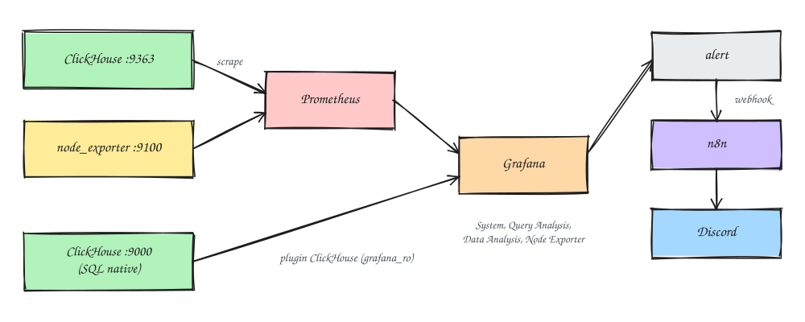

### Introduction
[ClickHouse](https://clickhouse.com/) is a columnar (OLAP) database built for analytical queries and aggregating large amounts of data. Lately the data warehouse where I work, still on PostgreSQL, has been getting heavy: more dbt jobs, fatter tables, and analytical queries queuing up behind each other (lots of waiting around). So the plan is to move the DWH to ClickHouse.

For the first stage, a single node on one EC2 instance is enough. So it's easy to rebuild at any time, I turned the whole install and configuration into an Ansible role. In this post I'll share the steps from zero until ClickHouse is running, including a few problems I ran into.

Oh, and every IP, ID, username, and password in this post is just an example, so adjust them to your setup.

The architecture looks roughly like this:


### Requirements
- EC2 with Ubuntu 24.04
- An extra EBS volume for data (gp3)
- Ansible on your laptop, plus the `ansible.posix` and `community.general` collections
- SSH access to the server (I go through a VPN here)

### Why not a container?
I did think about Docker at first, but in the end I went with a native install from the `.deb` packages. Here's why:
1. This EC2 instance is dedicated to ClickHouse, so the benefits of containers (isolation and many services on one host) don't apply.
2. OS tuning like sysctl, THP, swap, and disk mounts still has to happen on the host, container or not.
3. With a container you have to sort out `ulimit`, capabilities, and volumes for data and config yourself. The `.deb` package already ships a systemd unit with the right settings.
4. Day-to-day operations are simpler: just `systemctl status`, logs are in `/var/log/clickhouse-server/`, and upgrading is a single variable change.

Containers are still useful though, for example to try dbt models on a laptop before they go to production.

### Sizing
At first I wanted 2 cores and 4 GB to save money (budget, you know). It turns out 4 GB is really the bare minimum, because ClickHouse only gets about 3.6 GB and part of that already goes to caches, merges, and system logs. Big JOINs or GROUP BYs will often hit `MEMORY_LIMIT_EXCEEDED` errors.

In the end I went with 2 vCPU / 8 GB. A few instance types that make sense:

| Instance | Spec | Notes |
|---|---|---|
| `t4g.large` | 2 vCPU / 8 GB | Cheap, good for batch jobs |
| `m7g.large` / `m6g.large` | 2 vCPU / 8 GB | Non-burstable CPU, steadier performance |
| `r7g.large` | 2 vCPU / 16 GB | If you have lots of heavy JOINs |

Instances with a `g` in the name are Graviton (ARM). ClickHouse officially supports ARM64, and this Ansible role automatically picks the `arm64` or `amd64` repo. Just make sure you pick the **64-bit (Arm)** Ubuntu 24.04 AMI when launching the instance.

For disk, data in ClickHouse is usually 3 to 10 times smaller than in PostgreSQL because it's columnar and compressed. EBS volumes can also be grown later without downtime, but they can't be shrunk. I ended up with 500 GB of gp3 to have room to breathe.

### Preparing the Data Disk in the AWS Console
This stage happens **before** running Ansible.
1. Open EC2 > Instances, select the instance, and note its **Availability Zone**. A volume can only be attached to an instance in the same AZ.
2. Create a new volume
   - EC2 > Elastic Block Store > Volumes > Create volume
````
Volume type : gp3
Size : whatever you need
IOPS : 3000 (default)
Throughput : 125 MiB/s (default)
Availability Zone : same as the instance
Encryption : (✓)
Tag : Name = clickhouse-data
````
3. Attach the volume to the instance
   - Select the volume > Actions > Attach volume
````
Instance : pick the ClickHouse instance
Device name : /dev/sdf
````
4. Log in to the server and find a stable path for the disk. On Nitro instances, `/dev/sdf` shows up as `/dev/nvme1n1`, but that name can change after a reboot, so use the `by-id` path
```
lsblk -o NAME,SIZE,FSTYPE,MOUNTPOINT
ls -l /dev/disk/by-id/ | grep Elastic_Block_Store | grep -v part
```
The output looks roughly like this:
````
nvme-Amazon_Elastic_Block_Store_vol0abc123def4567890 -> ../../nvme1n1
````
5. Make sure the disk is still empty and there's no ClickHouse data yet
```
sudo lsblk -f /dev/nvme1n1      # the FSTYPE column should be empty
ls /var/lib/clickhouse           # should say "No such file or directory"
```
Note: don't format or mount it by hand; let Ansible do that later.

### Project Layout
````
ansible-clickhouse-deployment/
├── ansible.cfg
├── requirements.yml
├── site.yml
├── inventory/
│   ├── hosts.ini
│   └── group_vars/clickhouse/
│       ├── main.yml
│       ├── connection.yml
│       ├── secrets.yml
│       ├── vault.yml.example
│       └── vault.yml
└── roles/clickhouse/
    ├── defaults/main.yml
    ├── handlers/main.yml
    ├── tasks/
    └── templates/
````
The `clickhouse` role runs these stages in order:



- **preflight**: checks the OS is Ubuntu 24.04, the architecture is supported, and the passwords are filled in (at least 12 characters).
- **OS tuning**: sysctl, Transparent Huge Pages set to `madvise`, and swap turned off.
- **storage**: formats and mounts the data EBS volume at `/var/lib/clickhouse`.
- **install**: installs ClickHouse from the official repo, `lts` channel.
- **config**: adds override files in `config.d/` and `users.d/`, validated before restarting.
- **service** and **post install**: health check, then create the database.

### Steps
1. Fill in the inventory with the server's private IP
```
vim inventory/hosts.ini

............
[clickhouse]
clickhouse-01 ansible_host=10.0.1.10 ansible_user=ubuntu
```
2. Set up the SSH connection
```
vim inventory/group_vars/clickhouse/connection.yml

............
ansible_ssh_private_key_file: ~/.ssh/id_ed25519
ansible_ssh_common_args: -o StrictHostKeyChecking=accept-new
```
If you don't have a VPN, you can also go through AWS SSM without opening port 22. Put the Instance ID in `ansible_host`, then add this ProxyCommand:
````
ansible_ssh_common_args: >-
  -o ProxyCommand="aws ssm start-session --target %h
  --document-name AWS-StartSSHSession --parameters portNumber=%p --region <region>"
````
3. Fill in the data disk path from the preparation step
```
vim inventory/group_vars/clickhouse/main.yml

............
clickhouse_data_device: /dev/disk/by-id/nvme-Amazon_Elastic_Block_Store_vol0abc123def4567890
clickhouse_data_fstype: ext4
```
4. Create the secrets file and encrypt it with ansible-vault
```
cd inventory/group_vars/clickhouse
cp vault.yml.example vault.yml
vim vault.yml
```
```
............
vault_clickhouse_secrets:
  default_password: "<your-password>"
  admin_username: "admin"
  admin_password: "<your-password>"
  etl_password: "<your-password>"
  bi_password: "<your-password>"
  grafana_password: "<your-password>"
```
You can generate passwords with `openssl rand -base64 24`. Then encrypt the file
```
ansible-vault encrypt vault.yml
head -1 vault.yml
cd -
```
If it worked, the first line becomes `$ANSIBLE_VAULT;1.1;AES256`.

5. Install the collections and test the connection
```
ansible-galaxy collection install -r requirements.yml
ansible clickhouse -m ping --ask-vault-pass
```
If it works, you'll see output like this:
````
clickhouse-01 | SUCCESS =>
    changed: false
    ping: pong
````
6. Run the OS and disk preparation stages first
```
ansible-playbook site.yml --ask-vault-pass --tags preflight,os,storage
```
Then check on the server that the disk is mounted
```
df -h /var/lib/clickhouse
grep clickhouse /etc/fstab
```
````
Filesystem      Size  Used Avail Use% Mounted on
/dev/nvme1n1    492G   28K  467G   1% /var/lib/clickhouse
UUID=xxxx-xxxx /var/lib/clickhouse ext4 defaults,noatime,nofail 0 0
````
Optionally, since this is a data-only disk, you can lower the space ext4 reserves for root from 5% to 1%
```
sudo tune2fs -m 1 /dev/nvme1n1
```
7. Once the disk looks right, run the full deploy
```
ansible-playbook site.yml --ask-vault-pass
```
At the end of the play you'll see `ClickHouse 26.8.x.x berjalan di clickhouse-01` ("ClickHouse 26.8.x.x running on clickhouse-01"). Run the playbook once more; the result should be `changed=0`, which means the role is safe to re-run.

8. Pin the ClickHouse version so a rebuilt server gets the same version
```
dpkg -l clickhouse-server | tail -1
```
```
vim inventory/group_vars/clickhouse/main.yml

............
clickhouse_version: "26.8.x.y"
```
The ClickHouse packages are also put on `hold`, so they don't get upgraded by `apt upgrade`.

9. Check on the server
```
systemctl status clickhouse-server
clickhouse-client --user admin --password -q "SHOW DATABASES"
curl -s localhost:9363/metrics | head
```

Voilà, ClickHouse is running.

### Inside the Role
#### A data disk that's safe to re-run
The storage part is deliberately careful so it never formats a disk that already has data:
```
- name: Create filesystem on data device (only if there is no filesystem yet)
  community.general.filesystem:
    dev: "{{ clickhouse_data_device }}"
    fstype: "{{ clickhouse_data_fstype }}"
    force: false

- name: Mount data device to {{ clickhouse_data_path }}
  ansible.posix.mount:
    path: "{{ clickhouse_data_path }}"
    src: "UUID={{ clickhouse_data_uuid.stdout }}"
    fstype: "{{ clickhouse_data_fstype }}"
    opts: defaults,noatime,nofail
    state: mounted
```
- `force: false` means the filesystem is only created if the disk is still empty.
- It mounts by UUID, not device name.
- `nofail` so the server can still boot even if the volume gets detached.

On top of that, preflight has a check: if `/var/lib/clickhouse` already has contents but isn't mounted from EBS, the play stops. Without that check, the mount would hide the old data and every ClickHouse table would seem to vanish.

#### Configuration through overrides
The package's default config (`config.xml` and `users.xml`) isn't touched at all. Every change goes into `config.d/` and `users.d/` so package upgrades stay clean. Among other things:
- Ports 9004, 9005, and 9009 are turned off because they aren't used on a single node.
- A Prometheus `/metrics` endpoint on port 9363.
- The log level lowered from `trace` to `information` so it doesn't waste disk.
- System log tables like `query_log` get a 30-day TTL.

Before a restart, the config is checked with `xmllint` and `clickhouse extract-from-config`. If something's wrong, the play stops and the server isn't restarted, so a running server doesn't go down because of a typo.

#### Users and ansible-vault
The users this role creates:

| User | For | Access |
|---|---|---|
| `default` | Built in | Given a password, localhost only |
| `admin` | Admin | Full, can `CREATE USER` via SQL |
| `etl` | Airflow / dbt | `GRANT ALL ON dwh.*` |
| `bi_readonly` | Metabase / Superset | `readonly=2` |
| `grafana_ro` | Grafana | Read-only |

Note: a user without `grants` gets full access, so always fill in `grants` for app users.

The ansible-vault flow looks like this:



`vault.yml` is AES-256 encrypted, so it's safe to commit to git. The only thing you really have to protect is the vault password. And on the server, ClickHouse only stores SHA-256 hashes, not the actual passwords. A few commands I use a lot:
```
ansible-vault view vault.yml
ansible-vault edit vault.yml
ansible-vault rekey vault.yml
```
So you don't have to keep typing the vault password, store it in a `chmod 600` file outside the repo
```
export ANSIBLE_VAULT_PASSWORD_FILE=~/.ansible/clickhouse.vault_pass
```

### Security Group
Ports to open in the ClickHouse Security Group:

| Port | Source | For |
|---|---|---|
| 22 | VPN | Ansible |
| 8123 | Airflow/dbt SG, BI SG | HTTP interface |
| 9000 | Airflow/dbt SG, Grafana SG | Native protocol |
| 9363 | Prometheus SG | ClickHouse metrics |
| 9100 | Prometheus SG | node_exporter |

Better to use SG IDs as the source rather than CIDRs. And note that 9100 and 9363 are different: 9100 is node_exporter (OS metrics), while 9363 is ClickHouse's own metrics.

### Monitoring
ClickHouse actually has a built-in UI: `http://<ip>:8123/dashboard` for monitoring graphs and `http://<ip>:8123/play` for a SQL editor. But to make it nicer to look at and to send alerts, I hooked it up to Grafana like this:



1. Add scrape jobs to Prometheus
```
- job_name: clickhouse
  static_configs:
    - targets: ["10.0.1.10:9363"]
      labels: { instance: clickhouse-01 }

- job_name: clickhouse-node
  static_configs:
    - targets: ["10.0.1.10:9100"]
      labels: { instance: clickhouse-01 }
```
2. Install the ClickHouse plugin in Grafana
   - Administration > Plugins > search for ClickHouse > Install
3. Add the data source
   - Connections > Data sources > Add > ClickHouse
````
Server address : 10.0.1.10
Server port : 9000
Protocol : Native
Secure Connection : Off
Username : grafana_ro
Password : (from vault.yml)
Default database : dwh
SAVE & TEST
````
4. Once you see "Data source is working", open the data source's Dashboards tab and import **ClickHouse System Dashboards**, **Query Analysis**, and **Data Analysis**.
5. Import the **Node Exporter Full** dashboard (ID `1860`) for CPU, RAM, and disk metrics.

For alerts, here's what I set up:

| Alert | PromQL | Condition |
|---|---|---|
| ClickHouse down | `up{job="clickhouse"}` | `== 0` for 2m |
| Disk almost full | `1 - node_filesystem_avail_bytes{mountpoint="/var/lib/clickhouse"} / node_filesystem_size_bytes{mountpoint="/var/lib/clickhouse"}` | `> 0.8` |
| RAM almost gone | `1 - node_memory_MemAvailable_bytes / node_memory_MemTotal_bytes` | `> 0.9` for 5m |
| Lots of failed queries | `increase(ClickHouseProfileEvents_FailedQuery[5m])` | `> 10` |

The alerts go to an n8n webhook, which forwards them to Discord.

### Problems I Ran Into
#### `No inventory was parsed`
This shows up when you run the command from inside the `inventory/` folder. `ansible.cfg` is in the project root, so every Ansible command has to be run from the project root.

#### `Attempting to decrypt but no vault secrets found`
Once `vault.yml` is encrypted, every Ansible command, `ping` included, needs the vault password. The fix is to add `--ask-vault-pass` or set `ANSIBLE_VAULT_PASSWORD_FILE`.

#### Admin login fails even though the deploy succeeded
````
Code: 516. DB::Exception: admin: Authentication failed: password is incorrect, or there is no user with such name. (AUTHENTICATION_FAILED)
````
It turned out two things caused this:
- I typed the vault password, when what it wanted was the `admin_password` inside `vault.yml`.
- `admin_username` in `vault.yml` had been changed to another name, so the `admin` user really didn't exist.

Check the contents with `ansible-vault view` first, then log in with the right username
```
clickhouse-client --user <admin_username> --password
```
One more thing: if the contents of `vault.yml` ever end up in a screenshot or in front of someone else, change the passwords straight away
```
ansible-vault edit inventory/group_vars/clickhouse/vault.yml
ansible-playbook site.yml --ask-vault-pass --tags config,post_install
```
ClickHouse reloads the user config automatically, so no restart needed.

### What's Next
ClickHouse is running; the next to-dos are backups (EBS snapshots through Data Lifecycle Manager and `BACKUP ... TO S3`) and migrating the data from the PostgreSQL DWH. Stay tuned for the migration post ~

That's it, hope it helps.

References:
- [ClickHouse Documentation](https://clickhouse.com/docs/install/debian_ubuntu)
- [Grafana ClickHouse data source plugin](https://grafana.com/docs/plugins/grafana-clickhouse-datasource/latest/)
