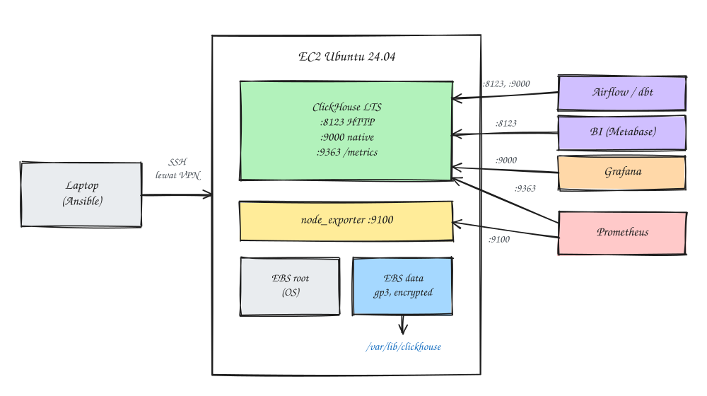
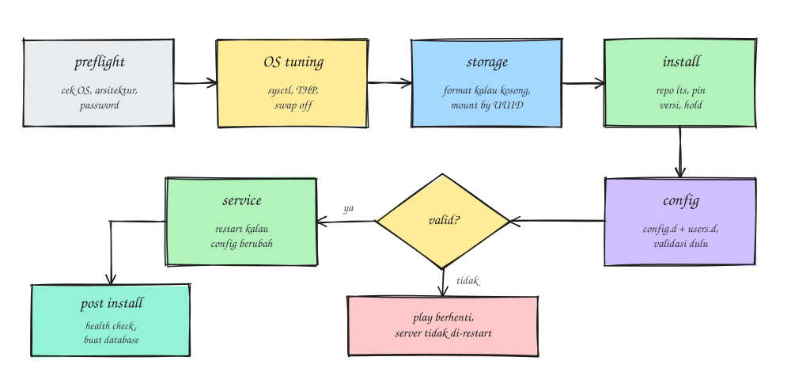
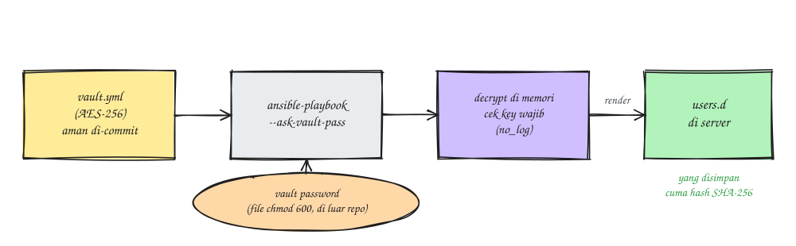
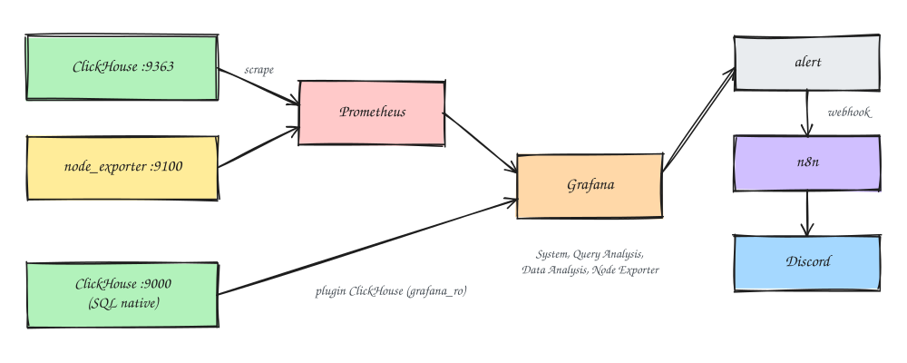

Data warehouse di PostgreSQL itu enak di awal, tapi begitu job dbt makin banyak dan tabelnya makin gemuk, query analitik mulai saling antre. Rencananya DWH dipindah ke **ClickHouse**, database kolumnar yang memang dibuat untuk query agregasi besar. Untuk tahap awal cukup **single node** di satu EC2, dan supaya bisa dibangun ulang kapan saja, semuanya saya tulis sebagai role Ansible.

Di tulisan ini saya rangkum role-nya, langkah dari nol sampai ClickHouse jalan, dan beberapa jebakan yang saya temui di jalan. Semua IP, ID, nama user, dan password di bawah cuma contoh, jadi sesuaikan dengan lingkunganmu.

## Gambaran besarnya



Yang dikerjakan role `clickhouse`, berurutan:

1. **preflight**: memastikan OS-nya Ubuntu 24.04, arsitektur didukung, dan semua password terisi (minimal 12 karakter).
2. **OS tuning**: sysctl, Transparent Huge Pages ke `madvise`, swap dimatikan.
3. **storage** (opsional): format dan mount EBS data ke `/var/lib/clickhouse`.
4. **install**: repo resmi ClickHouse channel `lts`, versi bisa di-pin, paket di-`hold`.
5. **config**: file override di `config.d/` dan `users.d/`, divalidasi sebelum restart.
6. **service** dan **post install**: health check, cek user `default` tanpa password ditolak, lalu membuat database.



## Kenapa native, bukan container?

Sempat kepikiran pakai Docker, tapi untuk kasus ini saya pilih install native lewat paket `.deb`:

- Satu EC2 khusus untuk satu service, jadi keunggulan utama container (isolasi dan banyak service di satu host) nggak terpakai.
- Tuning OS seperti sysctl, THP, swap, dan mount disk tetap harus dilakukan di host. Kalau pakai container pun bagian Ansible ini tetap ada.
- Di container kamu harus mengatur sendiri `ulimit nofile`, capability (`SYS_NICE`, `IPC_LOCK`, `NET_ADMIN`), dan volume untuk data serta config. Paket `.deb` sudah membawa unit systemd dengan setting yang benar.
- Operasional harian lebih gampang: `systemctl status`, log di `/var/log/clickhouse-server/`, dan upgrade cukup ganti satu variabel.

Container tetap berguna untuk development di laptop, misalnya mencoba model dbt sebelum masuk production.

## Spesifikasi instance dan disk

Awalnya saya mau pakai 2 vCPU / 4 GB biar hemat. Bisa jalan, tapi 4 GB itu batas bawah. Dengan `max_server_memory_usage_to_ram_ratio: 0.9`, ClickHouse cuma punya sekitar 3,6 GB, dan sebagian sudah dipakai cache, background merge, dan system log. Job dbt yang isinya JOIN dan GROUP BY besar bakal sering kena `MEMORY_LIMIT_EXCEEDED`.

Akhirnya pakai **2 vCPU / 8 GB**. Untuk CPU, 2 core masih oke di awal karena yang lebih menentukan itu RAM. Kalau di AWS, pilihan yang masuk akal:

| Instance | Spek | Catatan |
|---|---|---|
| `t4g.large` | 2 vCPU / 8 GB | Hemat, cocok kalau job-nya batch dan CPU lebih sering idle |
| `m7g.large` / `m6g.large` | 2 vCPU / 8 GB | CPU tidak burstable, performa stabil |
| `r7g.large` | 2 vCPU / 16 GB | Kalau ternyata banyak JOIN berat |

Instance berakhiran `g` itu **Graviton (ARM)**. ClickHouse mendukung ARM64 secara resmi (Graviton2 ke atas), dan role ini otomatis memilih repo `arm64` atau `amd64` dari fakta arsitektur Ansible. Yang perlu diingat cuma satu: waktu launch, pilih AMI Ubuntu 24.04 yang **64-bit (Arm)**.

Untuk disk, ClickHouse menyimpan data secara kolumnar dan terkompresi, jadi biasanya **3 sampai 10 kali lebih kecil** dari ukuran di PostgreSQL (`pg_database_size` juga sudah termasuk index dan bloat). Sisakan juga ruang kosong untuk background merge, idealnya disk terisi maksimal sekitar 50 sampai 60%. Ukuran EBS bisa diperbesar nanti tanpa downtime, tapi **tidak bisa dikecilkan**, jadi lebih aman mulai dari ukuran yang wajar. Saya akhirnya pakai gp3 500 GB supaya lega untuk beberapa tahun.

## Menyiapkan EBS data lewat AWS Console

Lakukan ini **sebelum** menjalankan Ansible pertama kali.

1. **EC2 → Instances**, pilih instance, catat **Availability Zone**-nya. Volume hanya bisa di-attach ke instance di AZ yang sama.
2. **EC2 → Elastic Block Store → Volumes → Create volume**: tipe **gp3**, ukuran sesuai kebutuhan, IOPS 3000 dan throughput 125 MiB/s (default), AZ sama dengan instance, centang **Encryption**, beri tag `Name = clickhouse-data`.
3. Setelah status **Available**, pilih volume → **Actions → Attach volume** → pilih instance, device `/dev/sdf`.

Volume yang di-attach dengan cara ini tidak ikut terhapus waktu instance di-terminate. Untuk disk data, justru itu yang kita mau.

Lalu masuk ke server dan cari path device yang stabil. Di instance Nitro, `/dev/sdf` muncul sebagai `/dev/nvme1n1`, tapi nama ini bisa berubah setelah reboot. Jadi yang dipakai path `by-id`:

```bash
lsblk -o NAME,SIZE,FSTYPE,MOUNTPOINT
ls -l /dev/disk/by-id/ | grep Elastic_Block_Store | grep -v part
# nvme-Amazon_Elastic_Block_Store_vol0abc123def4567890 -> ../../nvme1n1

sudo lsblk -f /dev/nvme1n1     # kolom FSTYPE harus kosong
ls /var/lib/clickhouse          # harus "No such file or directory"
```

Nama by-id itu adalah volume ID **tanpa tanda strip** (`vol-0abc...` jadi `vol0abc...`). Pilih yang tanpa akhiran `_1`. **Jangan format atau mount manual**, biar Ansible yang mengerjakan.

## Struktur proyek

```
ansible-clickhouse-deployment/
├── ansible.cfg
├── requirements.yml          # ansible.posix, community.general
├── site.yml
├── inventory/
│   ├── hosts.ini
│   └── group_vars/clickhouse/
│       ├── main.yml
│       ├── connection.yml
│       ├── secrets.yml
│       ├── vault.yml.example
│       └── vault.yml         # di-encrypt ansible-vault
└── roles/clickhouse/
    ├── defaults/main.yml
    ├── handlers/main.yml
    ├── tasks/
    │   ├── preflight.yml  os_tuning.yml  storage.yml  install.yml
    │   ├── configure.yml  firewall.yml   service.yml  node_exporter.yml
    │   └── post_install.yml
    └── templates/
        ├── clickhouse-thp.service.j2
        ├── config.d/ansible-server.xml.j2
        └── users.d/ansible-users.xml.j2
```

`ansible.cfg` di root project yang menunjuk ke `inventory/hosts.ini`. Karena itu **selalu jalankan perintah Ansible dari root project**. Kalau dari dalam folder `inventory/`, kamu bakal dapat `No inventory was parsed` dan grup `clickhouse` nggak ketemu.

## Inventory dan koneksi

Server ada di subnet private. Awalnya saya pakai SSH di dalam tunnel AWS SSM (port 22 tetap tertutup), tapi karena sudah ada akses VPN ke VPC, SSH biasa ke IP private ternyata lebih simpel:

```ini
# inventory/hosts.ini
[clickhouse]
clickhouse-01 ansible_host=10.0.1.10 ansible_user=ubuntu
```

```yaml
# inventory/group_vars/clickhouse/connection.yml
ansible_ssh_private_key_file: ~/.ssh/id_ed25519
ansible_ssh_common_args: -o StrictHostKeyChecking=accept-new

# Alternatif lewat SSM (tanpa VPN, tanpa port 22): isi ansible_host dengan Instance ID, lalu
# ansible_ssh_common_args: >-
#   -o ProxyCommand="aws ssm start-session --target %h
#   --document-name AWS-StartSSHSession --parameters portNumber=%p --region <region>"
```

Kalau mau jalur SSM, syaratnya `aws` CLI sudah login, `session-manager-plugin` terpasang, instance profile punya `AmazonSSMManagedInstanceCore`, dan public key kamu ada di `authorized_keys`. Ada juga connection plugin `amazon.aws.aws_ssm` yang sama sekali tanpa SSH, tapi butuh bucket S3 perantara dan biasanya lebih lambat.

## Tuning OS

ClickHouse punya beberapa saran untuk kernel. Role ini menulisnya ke `/etc/sysctl.d/60-clickhouse.conf`:

```yaml
clickhouse_sysctl:
  vm.swappiness: 1
  vm.max_map_count: 262144
  net.core.somaxconn: 4096
  kernel.task_delayacct: 1   # menghilangkan warning "Delay accounting is not enabled"
```

Transparent Huge Pages di-set ke `madvise` lewat unit systemd kecil yang jalan sebelum `clickhouse-server`, jadi tetap berlaku setelah reboot. Swap juga dimatikan.

## Disk data yang aman dijalankan ulang

Bagian storage sengaja dibuat hati-hati supaya nggak pernah memformat disk yang sudah ada isinya:

```yaml
- name: Create filesystem on data device (hanya jika belum ada filesystem)
  community.general.filesystem:
    dev: "{{ clickhouse_data_device }}"
    fstype: "{{ clickhouse_data_fstype }}"
    force: false

- name: Get UUID of data device
  ansible.builtin.command: blkid -s UUID -o value {{ clickhouse_data_device }}
  register: clickhouse_data_uuid
  changed_when: false

- name: Mount data device to {{ clickhouse_data_path }}
  ansible.posix.mount:
    path: "{{ clickhouse_data_path }}"
    src: "UUID={{ clickhouse_data_uuid.stdout }}"
    fstype: "{{ clickhouse_data_fstype }}"
    opts: defaults,noatime,nofail
    state: mounted
```

- `force: false` artinya filesystem hanya dibuat kalau device masih kosong.
- Mount pakai **UUID** di `/etc/fstab`, bukan nama device.
- `nofail` supaya server tetap bisa boot walaupun volume ter-detach.

Di preflight juga ada pengaman: kalau `/var/lib/clickhouse` ternyata **sudah berisi data** tapi belum di-mount ke EBS, play berhenti. Tanpa pengaman ini, mount akan menutupi data lama dan ClickHouse seolah kehilangan semua tabelnya.

Setelah tahap storage selesai, ext4 secara default menyisihkan 5% kapasitas untuk root. Untuk disk khusus data, itu bisa dikurangi ke 1% dan aman dijalankan walaupun disk sedang ter-mount:

```bash
sudo tune2fs -m 1 /dev/nvme1n1
```

## Instalasi dari repo LTS

```yaml
- name: Add ClickHouse apt repository
  ansible.builtin.deb822_repository:
    name: clickhouse
    types: deb
    uris: https://packages.clickhouse.com/deb
    suites: "{{ clickhouse_repo_channel }}"   # lts
    components: main
    architectures: "{{ clickhouse_apt_arch_map[ansible_facts['architecture']] }}"
    signed_by: /etc/apt/keyrings/clickhouse.asc

- name: Install ClickHouse packages
  ansible.builtin.apt:
    name: >-
      {{ clickhouse_packages
         if clickhouse_version | length == 0
         else clickhouse_packages | product(['=' ~ clickhouse_version]) | map('join') | list }}
    state: present
    allow_change_held_packages: true
  environment:
    DEBIAN_FRONTEND: noninteractive
  notify: restart clickhouse
```

Channel `lts` hanya berisi rilis LTS. ClickHouse merilis dua LTS per tahun (versi `.3` dan `.8`), masing-masing di-support sekitar setahun. Kalau `clickhouse_version` kosong, yang terpasang adalah LTS terbaru saat install pertama. Setelah jalan, **pin versinya** supaya server yang dibangun ulang dapat versi yang persis sama:

```bash
dpkg -l clickhouse-server | tail -1
```

```yaml
clickhouse_version: "26.8.x.y"   # isi dengan versi lengkap dari output di atas
```

Paket juga di-`hold` dengan `dpkg_selections`, jadi `apt upgrade` harian nggak ikut meng-upgrade ClickHouse diam-diam.

## Konfigurasi lewat override

Role ini **tidak menyentuh** `config.xml` dan `users.xml` bawaan paket. Semua perubahan ditaruh di `config.d/ansible-server.xml` dan `users.d/ansible-users.xml`, jadi upgrade paket tetap bersih. Isi override server antara lain:

- Port MySQL (9004), PostgreSQL (9005), dan interserver (9009) dimatikan dengan `remove="1"` karena nggak dipakai di single node.
- Endpoint Prometheus `/metrics` di port 9363.
- Log level diturunkan dari `trace` ke `information` supaya disk nggak boros.
- System log tables (`query_log`, `part_log`, `metric_log`, dan lainnya) diberi TTL 30 hari:

```xml
<query_log>
    <ttl>event_date + INTERVAL 30 DAY DELETE</ttl>
</query_log>
```

Sebelum restart, config divalidasi dua lapis: `xmllint` saat template ditulis, lalu `clickhouse extract-from-config` sebagai user `clickhouse` untuk membaca config yang sudah di-merge. Kalau ada yang rusak, play berhenti dan handler restart nggak pernah jalan, jadi server yang sedang hidup nggak ikut mati gara-gara salah ketik.

## User dan password dari Ansible Vault

User yang dibuat:

| User | Untuk | Akses |
|---|---|---|
| `default` | Bawaan | Diberi password, hanya dari localhost |
| `admin` | Admin | Full, plus `access_management` (bisa `CREATE USER` via SQL) |
| `etl` | Airflow / dbt | `GRANT ALL ON dwh.*` |
| `bi_readonly` | Metabase / Superset | Profile `readonly=2` |
| `grafana_ro` | Grafana | Read-only, boleh mengubah `max_execution_time` |

`readonly=2` dipakai untuk BI karena tool seperti Metabase perlu set setting per query, sementara `readonly=1` melarang itu. Satu hal penting: user yang **tidak diberi `grants`** akan dapat akses penuh, jadi selalu isi `grants` untuk user aplikasi.

Password disimpan di `vault.yml` yang di-encrypt dengan **ansible-vault**:

```yaml
# inventory/group_vars/clickhouse/vault.yml (sebelum di-encrypt)
vault_clickhouse_secrets:
  default_password: "<isi-password>"
  admin_username: "admin"
  admin_password: "<isi-password>"
  etl_password: "<isi-password>"
  bi_password: "<isi-password>"
  grafana_password: "<isi-password>"
```

```bash
cd inventory/group_vars/clickhouse
cp vault.yml.example vault.yml && vi vault.yml   # password bisa dari: openssl rand -base64 24
ansible-vault encrypt vault.yml
head -1 vault.yml                                # $ANSIBLE_VAULT;1.1;AES256
cd -
```



Cara kerjanya singkat saja: file YAML di-encrypt AES-256 dengan satu *vault password*. File hasil encrypt aman di-commit ke git, yang harus dijaga cuma vault password-nya. Saat playbook jalan, Ansible mendekripsi di memori, `site.yml` mengecek semua key wajib ada (dengan `no_log`), lalu template `users.d` di-render. Di server, ClickHouse **hanya menyimpan hash SHA-256**, bukan password aslinya.

Perintah yang sering dipakai:

```bash
ansible-vault view vault.yml     # lihat isi
ansible-vault edit vault.yml     # edit, otomatis di-encrypt lagi saat disimpan
ansible-vault rekey vault.yml    # ganti vault password
```

Supaya nggak mengetik vault password terus, simpan di file `chmod 600` di luar repo:

```bash
export ANSIBLE_VAULT_PASSWORD_FILE=~/.ansible/clickhouse.vault_pass
```

Role ini juga punya opsi mengambil secret dari **HashiCorp Vault** lewat collection `community.hashi_vault`. Cukup ganti `clickhouse_secrets_source: hashi_vault` kalau nanti butuh audit log atau Airflow perlu membaca kredensial yang sama langsung dari Vault.

## Deploy bertahap

```bash
ansible-galaxy collection install -r requirements.yml
ansible clickhouse -m ping --ask-vault-pass

# siapkan OS dan disk dulu
ansible-playbook site.yml --ask-vault-pass --tags preflight,os,storage
```

Cek di server:

```bash
df -h /var/lib/clickhouse      # /dev/nvme1n1 ter-mount di sini
grep clickhouse /etc/fstab     # UUID=... /var/lib/clickhouse ext4 defaults,noatime,nofail 0 0
```

Kalau sudah benar, jalankan semuanya:

```bash
ansible-playbook site.yml --ask-vault-pass
```

Di akhir play muncul pesan seperti `ClickHouse 26.8.x.x berjalan di clickhouse-01`. Jalankan playbook sekali lagi, hasilnya harus `changed=0`. Itu tanda role-nya idempotent.

## Jebakan yang saya temui

**`Attempting to decrypt but no vault secrets found`.** Setelah `vault.yml` di-encrypt, perintah apa pun, termasuk `ansible -m ping`, ikut memuat `group_vars/clickhouse/`. Jadi semua perintah butuh `--ask-vault-pass` atau `ANSIBLE_VAULT_PASSWORD_FILE`.

**Login `admin` ditolak, padahal deploy sukses.** Pesannya `AUTHENTICATION_FAILED`. Ada dua kemungkinan yang sering tertukar:

- Yang diketik adalah **vault password**, padahal yang diminta adalah `admin_password` di dalam `vault.yml`.
- `admin_username` di `vault.yml` sudah diganti ke nama lain, jadi user `admin` memang tidak ada.

Cek isinya dengan `ansible-vault view`, lalu login dengan nama dan password yang benar:

```bash
clickhouse-client --user <admin_username> --password
```

**Hati-hati saat menunjukkan isi vault.** Kalau isi `vault.yml` sempat terlihat di screenshot atau chat, anggap bocor dan ganti password-nya. Selagi belum ada aplikasi yang memakai, ini gampang:

```bash
ansible-vault edit inventory/group_vars/clickhouse/vault.yml
ansible-playbook site.yml --ask-vault-pass --tags config,post_install
```

ClickHouse membaca ulang `users.d` otomatis, jadi nggak perlu restart.

## Security Group

Karena akses SSH lewat VPN, port 22 hanya dibuka dari VPN. Sisanya pakai **SG ID sebagai source**, bukan CIDR, supaya rule tetap berlaku walaupun IP worker berubah:

| Port | Source | Untuk |
|---|---|---|
| 22 | SG/subnet VPN | Ansible |
| 8123 | SG Airflow/dbt, SG BI | HTTP interface (dbt-clickhouse, clickhouse-connect) |
| 9000 | SG Airflow/dbt, SG Grafana | Native protocol |
| 9363 | SG Prometheus | Metrik ClickHouse |
| 9100 | SG Prometheus | node_exporter |

**9363 dan 9100 itu beda.** 9100 untuk node_exporter (metrik OS), 9363 untuk endpoint Prometheus bawaan ClickHouse (query, merge, part, memori). Jangan dipindah ke 9100, nanti bentrok.

## Monitoring

ClickHouse sebenarnya sudah punya UI bawaan di port HTTP: `http://<ip>:8123/dashboard` untuk grafik monitoring dan `http://<ip>:8123/play` untuk SQL editor. Untuk jangka panjang dan alert, saya sambungkan ke Grafana:



- **Prometheus** scrape port 9363 dan 9100 untuk grafik kesehatan server dan alert.
- **Plugin resmi ClickHouse untuk Grafana** (`grafana-clickhouse-datasource`) query langsung ke ClickHouse dengan user `grafana_ro`. Plugin ini membawa dashboard siap pakai: *ClickHouse System Dashboards*, *Query Analysis* (query lambat dan boros memori), dan *Data Analysis* (ukuran tabel dan kompresi).
- Dashboard **Node Exporter Full** (ID 1860) untuk CPU, RAM, dan disk.

Setting data source di Grafana: server address IP ClickHouse, port `9000`, protocol **Native**, secure connection off (TLS belum diaktifkan), user `grafana_ro`, default database `dwh`. Kalau test gagal, bedakan dari pesannya: `timeout` berarti masalah SG atau network, `AUTHENTICATION_FAILED` berarti user, password, atau IP Grafana di luar network yang diizinkan.

Beberapa alert yang saya siapkan:

| Alert | PromQL | Kondisi |
|---|---|---|
| ClickHouse down | `up{job="clickhouse"}` | `== 0` selama 2m |
| Disk data hampir penuh | `1 - node_filesystem_avail_bytes{mountpoint="/var/lib/clickhouse"} / node_filesystem_size_bytes{mountpoint="/var/lib/clickhouse"}` | `> 0.8` |
| RAM hampir habis | `1 - node_memory_MemAvailable_bytes / node_memory_MemTotal_bytes` | `> 0.9` selama 5m |
| Banyak query gagal | `increase(ClickHouseProfileEvents_FailedQuery[5m])` | `> 10` |
| Terlalu banyak part | `ClickHouseAsyncMetrics_MaxPartCountForPartition` | `> 500` |

Nama metrik ClickHouse bisa beda antar versi, jadi cek dulu di server:

```bash
curl -s localhost:9363/metrics | grep -E '^ClickHouse(ProfileEvents_FailedQuery|AsyncMetrics_MaxPartCountForPartition) '
```

## Langkah berikutnya: migrasi dari PostgreSQL

ClickHouse sudah jalan, pekerjaan berikutnya memindahkan DWH. Singkatnya:

1. **Inventaris**: pisahkan tabel raw dan tabel hasil dbt. Tabel hasil dbt nggak perlu dicopy, cukup di-build ulang.
2. **Desain tabel**: tiap tabel butuh `ENGINE`, `ORDER BY`, dan biasanya `PARTITION BY`. Data append-only pakai `MergeTree`, data yang bisa berubah pakai `ReplacingMergeTree(updated_at)`. Untuk uang pakai `Decimal`, jangan Float.
3. **Copy data historis**: ClickHouse bisa menarik langsung dari Postgres dengan table function `postgresql()`. Untuk tabel besar, copy per bulan supaya RAM 8 GB nggak jebol.
4. **Pindahkan pipeline** ke adapter `dbt-clickhouse`. Waspadai `LEFT JOIN` yang menghasilkan `0` atau `''` alih-alih NULL (set `join_use_nulls = 1`), pembagian integer yang hasilnya desimal, dan `DISTINCT ON` yang nggak ada.
5. **Jalan paralel** satu sampai dua minggu, bandingkan jumlah baris dan total per hari, baru cutover.

Detailnya mungkin saya tulis terpisah kalau migrasinya sudah jalan.

## Yang saya pelajari

- **Pisahkan disk data dari awal.** Naik spek instance cukup stop, ganti instance type, start lagi, tanpa mengubah Ansible.
- **Override, jangan timpa.** `config.d/` dan `users.d/` bikin upgrade paket tetap aman.
- **Validasi sebelum restart.** Config rusak cukup bikin play gagal, bukan bikin server mati.
- **Pin versi setelah deploy pertama.** Channel `lts` bagus, tapi tanpa pin, server baru bisa dapat patch yang berbeda.
- **Backup belum termasuk di role ini.** Snapshot EBS harian lewat Data Lifecycle Manager itu awal yang bagus, tapi tetap perlu backup tingkat ClickHouse (misalnya `BACKUP DATABASE ... TO S3`) sebelum data production mulai masuk.
