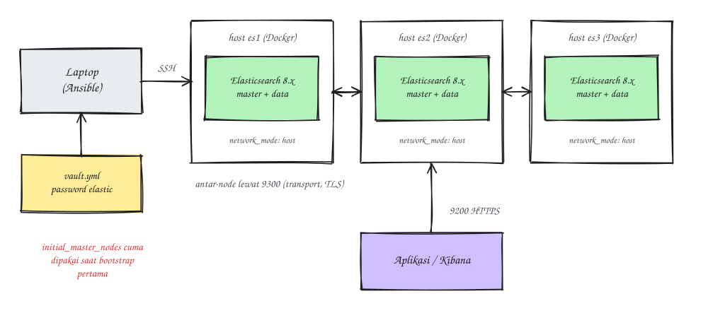

### Introduction
[Elasticsearch](https://www.elastic.co/elasticsearch) is a Lucene-based search engine and database that's often used for logs and search. Running a single Elasticsearch container for development takes one `docker run`. But a three-node production cluster is a different story: the host kernel settings have to be right, the nodes have to find each other, traffic between nodes has to be encrypted, and the cluster bootstrap has a trap that can make data "disappear" if you get it wrong (not something you want to experience in production).

In this post I'll share how I automate it with Ansible. Oh, and all the hostnames, IPs, and versions below are just examples, so adjust them to your setup.

### The Goal
- Three Elasticsearch 8.x nodes, one container per host. All three are master-eligible and data nodes at the same time.
- Containers use the official image, managed by Ansible through the `community.docker` collection.
- Security on: TLS on the transport layer (between nodes) and the HTTP layer (clients to the cluster).
- The `elastic` user's password lives in **Ansible Vault**.
- An **idempotent** playbook, with `cluster.initial_master_nodes` only used when the cluster is first formed.
- The playbook only finishes once the cluster is really `green`.

The architecture looks roughly like this:



### Requirements
- Three Linux servers (Ubuntu LTS in this example) with Docker installed, able to reach each other on ports 9200 and 9300.
- At least 4 GB of RAM per node for a lab, more for production.
- The Ansible collections used:

```
ansible-galaxy collection install community.docker community.crypto ansible.posix
```

### Project Layout
```
es-ansible/
├── inventory/
│   ├── hosts.yml
│   └── group_vars/
│       └── elasticsearch/
│           ├── main.yml
│           └── vault.yml        # encrypted with ansible-vault
├── roles/
│   └── elasticsearch/
│       ├── defaults/main.yml
│       ├── handlers/main.yml
│       └── tasks/
│           ├── main.yml
│           ├── host.yml         # sysctl, directories, ulimit
│           ├── certs.yml        # CA and node certificates
│           ├── container.yml
│           └── verify.yml
└── site.yml
```

### Steps
#### 1. Inventory and variables
```
# inventory/hosts.yml
all:
  children:
    elasticsearch:
      hosts:
        es-01: { ansible_host: 192.0.2.11 }
        es-02: { ansible_host: 192.0.2.12 }
        es-03: { ansible_host: 192.0.2.13 }
```

```
# inventory/group_vars/elasticsearch/main.yml
es_version: "8.15.0"
es_cluster_name: "logs-cluster"
es_heap: "2g"                       # at most ~50% of RAM, and below ~31g
es_data_dir: /srv/elasticsearch/data
es_certs_dir: /srv/elasticsearch/certs
es_elastic_password: "{{ vault_es_elastic_password }}"
```

```
# inventory/group_vars/elasticsearch/vault.yml (before encryption)
vault_es_elastic_password: "replace-with-a-long-password"
```

```
ansible-vault encrypt inventory/group_vars/elasticsearch/vault.yml
```

#### 2. Prepare the hosts
Elasticsearch has *bootstrap checks*. Once a node binds to a non-loopback address, it **refuses to start** if certain host settings aren't right. The one people hit most is `vm.max_map_count`.

```
# roles/elasticsearch/tasks/host.yml
- name: Set vm.max_map_count
  ansible.posix.sysctl:
    name: vm.max_map_count
    value: "262144"
    state: present
    sysctl_set: true

- name: Turn off swap for this boot
  ansible.builtin.command: swapoff -a
  when: ansible_swaptotal_mb > 0
  changed_when: true

- name: Create the data and certificate directories
  ansible.builtin.file:
    path: "{{ item }}"
    state: directory
    owner: "1000"
    group: "0"
    mode: "0750"
  loop:
    - "{{ es_data_dir }}"
    - "{{ es_certs_dir }}"
```

The `1000:0` owner isn't random: the Elasticsearch process in the official image runs as UID 1000 with GID 0. If the bind-mounted directories are owned by root, the container crashes right away with an `AccessDeniedException`.

As for swap, `swapoff -a` only lasts until the next reboot. To make it permanent, remove the swap entry from `/etc/fstab`. The other option is `bootstrap.memory_lock: true` (in the container section below).

#### 3. Create the TLS certificates
Elasticsearch 8 can actually generate its own certificates on first start, but that mechanism is designed for a single node that then *enrolls* other nodes by hand. For a cluster built with Ansible, I prefer to create my own CA once on the control machine, then issue a certificate per node. It's all done with `community.crypto`, so it stays idempotent.

```
# roles/elasticsearch/tasks/certs.yml
- name: Create the CA (once, on the control machine)
  delegate_to: localhost
  run_once: true
  become: false
  block:
    - name: CA private key
      community.crypto.openssl_privatekey:
        path: "{{ playbook_dir }}/pki/ca.key"

    - name: CA CSR
      community.crypto.openssl_csr_pipe:
        privatekey_path: "{{ playbook_dir }}/pki/ca.key"
        common_name: "{{ es_cluster_name }}-ca"
        basic_constraints: ["CA:TRUE"]
        basic_constraints_critical: true
        key_usage: [keyCertSign, cRLSign]
      register: ca_csr
      changed_when: false

    - name: CA certificate
      community.crypto.x509_certificate:
        path: "{{ playbook_dir }}/pki/ca.crt"
        csr_content: "{{ ca_csr.csr }}"
        privatekey_path: "{{ playbook_dir }}/pki/ca.key"
        provider: selfsigned
        selfsigned_not_after: "+3650d"

- name: Per-node certificates (created on the control machine)
  delegate_to: localhost
  become: false
  block:
    - name: Node private key
      community.crypto.openssl_privatekey:
        path: "{{ playbook_dir }}/pki/{{ inventory_hostname }}.key"

    - name: Node CSR
      community.crypto.openssl_csr_pipe:
        privatekey_path: "{{ playbook_dir }}/pki/{{ inventory_hostname }}.key"
        common_name: "{{ inventory_hostname }}"
        subject_alt_name:
          - "DNS:{{ inventory_hostname }}"
          - "DNS:localhost"
          - "IP:{{ ansible_host }}"
          - "IP:127.0.0.1"
        extended_key_usage: [serverAuth, clientAuth]
      register: node_csr
      changed_when: false

    - name: Node certificate signed by the CA
      community.crypto.x509_certificate:
        path: "{{ playbook_dir }}/pki/{{ inventory_hostname }}.crt"
        csr_content: "{{ node_csr.csr }}"
        provider: ownca
        ownca_path: "{{ playbook_dir }}/pki/ca.crt"
        ownca_privatekey_path: "{{ playbook_dir }}/pki/ca.key"
        ownca_not_after: "+825d"

- name: Copy the certificates to the node
  ansible.builtin.copy:
    src: "{{ playbook_dir }}/pki/{{ item.src }}"
    dest: "{{ es_certs_dir }}/{{ item.dest }}"
    owner: "1000"
    group: "0"
    mode: "{{ item.mode }}"
  loop:
    - { src: "ca.crt", dest: "ca.crt", mode: "0644" }
    - { src: "{{ inventory_hostname }}.crt", dest: "node.crt", mode: "0644" }
    - { src: "{{ inventory_hostname }}.key", dest: "node.key", mode: "0600" }
  notify: Restart elasticsearch
```

The `pki/` directory holds the CA's private key, so **don't commit it** (add it to `.gitignore`), or encrypt it with Vault too.

#### 4. Run the container (watch out for the cluster bootstrap trap)
When the cluster is formed **for the first time**, the nodes need to know the initial master candidates through `cluster.initial_master_nodes`. Once the cluster has formed, that setting **must be removed**. If you leave it in, and one day a node's data gets wiped and that node restarts, it can form a brand new cluster on its own, with a different password and state (truly scary if it happens in production).

The trick: check whether the data directory already holds cluster state. If it doesn't, this is the first bootstrap.

```
# roles/elasticsearch/tasks/container.yml
- name: Check whether the node has already joined a cluster
  ansible.builtin.stat:
    path: "{{ es_data_dir }}/_state"
  register: es_state

- name: Decide whether this is the first bootstrap
  ansible.builtin.set_fact:
    es_bootstrap: >-
      {{ groups['elasticsearch']
         | map('extract', hostvars, ['es_state', 'stat', 'exists'])
         | select | list | length == 0 }}

- name: Run the Elasticsearch container
  community.docker.docker_container:
    name: elasticsearch
    image: "docker.elastic.co/elasticsearch/elasticsearch:{{ es_version }}"
    restart_policy: unless-stopped
    network_mode: host
    ulimits:
      - "memlock:-1:-1"
      - "nofile:65535:65535"
    volumes:
      - "{{ es_data_dir }}:/usr/share/elasticsearch/data"
      - "{{ es_certs_dir }}:/usr/share/elasticsearch/config/certs:ro"
    env: "{{ es_env | combine(es_bootstrap_env if es_bootstrap else {}) }}"
  vars:
    es_env:
      cluster.name: "{{ es_cluster_name }}"
      node.name: "{{ inventory_hostname }}"
      network.host: "0.0.0.0"
      network.publish_host: "{{ ansible_host }}"
      discovery.seed_hosts: "{{ groups['elasticsearch'] | map('extract', hostvars, 'ansible_host') | join(',') }}"
      bootstrap.memory_lock: "true"
      ES_JAVA_OPTS: "-Xms{{ es_heap }} -Xmx{{ es_heap }}"
      ELASTIC_PASSWORD: "{{ es_elastic_password }}"
      xpack.security.enabled: "true"
      xpack.security.transport.ssl.enabled: "true"
      xpack.security.transport.ssl.verification_mode: "certificate"
      xpack.security.transport.ssl.key: "certs/node.key"
      xpack.security.transport.ssl.certificate: "certs/node.crt"
      xpack.security.transport.ssl.certificate_authorities: "certs/ca.crt"
      xpack.security.http.ssl.enabled: "true"
      xpack.security.http.ssl.key: "certs/node.key"
      xpack.security.http.ssl.certificate: "certs/node.crt"
      xpack.security.http.ssl.certificate_authorities: "certs/ca.crt"
    es_bootstrap_env:
      cluster.initial_master_nodes: "{{ groups['elasticsearch'] | join(',') }}"
  no_log: true
```

A few notes:
- **`network_mode: host`** makes ports 9200 and 9300 use the host's IP directly. That way the `network.publish_host` announced to other nodes is the reachable host IP, not Docker's internal bridge IP. This is the most common source of trouble with container-based Elasticsearch clusters.
- The **heap** is set to the same value for `-Xms` and `-Xmx`, at most about half of RAM. The rest goes to the filesystem cache, which Lucene really needs.
- **`ELASTIC_PASSWORD`** is only used when the keystore is first created. Changing this variable later doesn't change the existing password; use the `_security/user/elastic/_password` API for that.
- **`no_log: true`** keeps the password out of Ansible's output, including when a task fails.
- Deciding `es_bootstrap` looks at **all** nodes: if even one node already has state, the cluster has formed before, and `initial_master_nodes` isn't set on any node.

#### 5. Wait until the cluster is green
Without this step, the playbook "succeeds" even though the cluster may not be healthy.

```
# roles/elasticsearch/tasks/verify.yml
- name: Wait for the cluster to be green
  ansible.builtin.uri:
    url: "https://{{ ansible_host }}:9200/_cluster/health?wait_for_status=green&timeout=50s"
    user: elastic
    password: "{{ es_elastic_password }}"
    force_basic_auth: true
    ca_path: "{{ es_certs_dir }}/ca.crt"
    return_content: true
  register: health
  until: health.status == 200 and health.json.status == 'green'
  retries: 12
  delay: 10
  run_once: true
  no_log: true

- name: Show a cluster summary
  ansible.builtin.debug:
    msg: "{{ health.json.cluster_name }}: {{ health.json.status }}, {{ health.json.number_of_nodes }} nodes"
  run_once: true
```

The restart handler is simple:

```
# roles/elasticsearch/handlers/main.yml
- name: Restart elasticsearch
  ansible.builtin.command: docker restart elasticsearch
```

#### 6. Run the playbook
```
# site.yml
- name: Elasticsearch cluster
  hosts: elasticsearch
  become: true
  roles:
    - elasticsearch
```

```
# roles/elasticsearch/tasks/main.yml
- ansible.builtin.import_tasks: host.yml
- ansible.builtin.import_tasks: certs.yml
- ansible.builtin.import_tasks: container.yml
- ansible.builtin.meta: flush_handlers   # restart first if certificates changed, then verify
- ansible.builtin.import_tasks: verify.yml
```

```
ansible-playbook -i inventory/hosts.yml site.yml --ask-vault-pass
```

Then check by hand from one of the nodes:

```
curl --cacert /srv/elasticsearch/certs/ca.crt -u elastic \
  "https://localhost:9200/_cat/nodes?v"
```

If it worked, you'll see three node rows, one of them marked `*` in the `master` column.

Voilà, the Elasticsearch cluster is up.

### Upgrading Without Downtime
Since the version is controlled by `es_version`, upgrading is just a matter of changing that variable. But don't let Ansible restart all three nodes at once. Run the playbook with `serial: 1`, so nodes are replaced one at a time and each node only moves on once the cluster is green again:

```
- name: Rolling upgrade
  hosts: elasticsearch
  become: true
  serial: 1
  roles:
    - elasticsearch
```

For clusters with lots of data, add a step that disables shard allocation (`cluster.routing.allocation.enable: primaries`) before the restart and re-enables it afterwards, following the *rolling upgrade* guide in Elastic's docs.

### A Few Things I Learned
- **Bootstrap checks are your friend.** A `max virtual memory areas vm.max_map_count [65530] is too low` error in the log means the sysctl task hasn't run, not that the image is broken.
- **Don't leave `cluster.initial_master_nodes` in permanently.** It's the one setting here that can split your cluster silently.
- **The publish host must be an IP the other nodes can reach.** In Docker bridge mode without extra setup, nodes announce the container IP and fail to find each other.
- **Secrets in one place.** Passwords in Vault, the CA's private key outside the repository, and `no_log` on any task that touches them.

That's it, hope it helps.

References:
- [Install Elasticsearch with Docker](https://www.elastic.co/guide/en/elasticsearch/reference/current/docker.html)
- [Bootstrapping a cluster](https://www.elastic.co/guide/en/elasticsearch/reference/current/modules-discovery-bootstrap-cluster.html)
