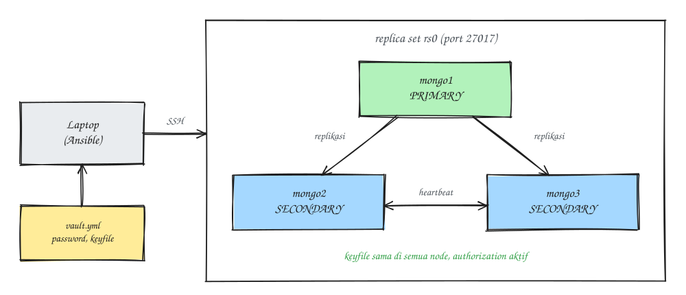

### Introduction
[MongoDB](https://www.mongodb.com/) is a fairly popular document-based NoSQL database, and where I work it's used a lot for production apps. Installing a single MongoDB server by hand is easy. But when you have to install a three-node replica set with exactly the same config, the same keyfile, authentication turned on, and something you can re-run any time without breaking a cluster that's already running, it's a different story (you could easily miss a node). In this post I'll share how I automate it with Ansible.

Oh, and all the hostnames, users, and values below are just examples, so adjust them to your setup.

### The Goal
- Three MongoDB nodes (one primary, two secondaries) in the replica set `rs0`.
- Internal authentication between nodes using a **keyfile**.
- `authorization` turned on, with one admin user.
- An **idempotent** playbook: run it as many times as you like and the result stays the same, and it never tries `rs.initiate()` again on a cluster that's already up.
- Secrets like passwords and the keyfile live in **Ansible Vault**, not in the repository as plain text.

The architecture looks roughly like this:



### Requirements
- Three Ubuntu LTS servers that can reach each other on port 27017 and resolve each other by hostname.
- Ansible on the control machine, plus the `community.mongodb` collection:

```
ansible-galaxy collection install community.mongodb
```

The modules in this collection need `pymongo` on the target nodes. Before installing, check which versions are supported in the collection's docs.

### Project Layout
```
mongodb-ansible/
├── inventory/
│   ├── hosts.yml
│   └── group_vars/
│       └── mongodb/
│           ├── main.yml
│           └── vault.yml        # encrypted with ansible-vault
├── roles/
│   └── mongodb/
│       ├── defaults/main.yml
│       ├── handlers/main.yml
│       ├── tasks/
│       │   ├── main.yml
│       │   ├── install.yml
│       │   ├── configure.yml
│       │   ├── replicaset.yml
│       │   └── users.yml
│       └── templates/mongod.conf.j2
└── site.yml
```

### Steps
#### 1. Fill in the inventory
```
# inventory/hosts.yml
all:
  children:
    mongodb:
      hosts:
        mongo-01:
        mongo-02:
        mongo-03:
```

The first node in the group is used to initialize the replica set, and I give it a higher priority so it's the one elected primary. I list the members in `group_vars` so they're easy to read:

```
# inventory/group_vars/mongodb/main.yml
mongodb_members:
  - host: "mongo-01:27017"
    priority: 2
  - host: "mongo-02:27017"
  - host: "mongo-03:27017"
```

#### 2. Variables and secrets
```
# roles/mongodb/defaults/main.yml
mongodb_version: "8.0"
mongodb_user: mongodb
mongodb_port: 27017
mongodb_bind_ip: "127.0.0.1,{{ ansible_default_ipv4.address }}"
mongodb_dbpath: /var/lib/mongodb
mongodb_replset_name: rs0
mongodb_keyfile_path: /etc/mongodb/keyfile
mongodb_admin_user: admin
```

The keyfile and the admin password go into Vault. You only need to generate the keyfile contents once:

```
openssl rand -base64 756
```

Then put them in `vault.yml` and encrypt it:

```
# inventory/group_vars/mongodb/vault.yml (before encryption)
mongodb_admin_password: "replace-with-a-strong-password"
mongodb_keyfile_content: |
  <output of openssl rand -base64 756>
```

```
ansible-vault encrypt inventory/group_vars/mongodb/vault.yml
```

#### 3. Installation
```
# roles/mongodb/tasks/install.yml
- name: Install the MongoDB repository GPG key
  ansible.builtin.get_url:
    url: "https://pgp.mongodb.com/server-{{ mongodb_version }}.asc"
    dest: "/usr/share/keyrings/mongodb-server-{{ mongodb_version }}.asc"
    mode: "0644"

- name: Add the MongoDB repository
  ansible.builtin.apt_repository:
    repo: >-
      deb [ arch=amd64,arm64 signed-by=/usr/share/keyrings/mongodb-server-{{ mongodb_version }}.asc ]
      https://repo.mongodb.org/apt/ubuntu {{ ansible_distribution_release }}/mongodb-org/{{ mongodb_version }} multiverse
    filename: "mongodb-org-{{ mongodb_version }}"
    state: present

- name: Install MongoDB and pymongo
  ansible.builtin.apt:
    name:
      - mongodb-org
      - python3-pymongo
    state: present
    update_cache: true
```

#### 4. Config and keyfile
```
# roles/mongodb/templates/mongod.conf.j2
storage:
  dbPath: {{ mongodb_dbpath }}

systemLog:
  destination: file
  logAppend: true
  path: /var/log/mongodb/mongod.log

net:
  port: {{ mongodb_port }}
  bindIp: {{ mongodb_bind_ip }}

processManagement:
  timeZoneInfo: /usr/share/zoneinfo

security:
  authorization: enabled
  keyFile: {{ mongodb_keyfile_path }}

replication:
  replSetName: {{ mongodb_replset_name }}
```

```
# roles/mongodb/tasks/configure.yml
- name: Create the keyfile directory
  ansible.builtin.file:
    path: "{{ mongodb_keyfile_path | dirname }}"
    state: directory
    owner: "{{ mongodb_user }}"
    group: "{{ mongodb_user }}"
    mode: "0700"

- name: Install the replica set keyfile
  ansible.builtin.copy:
    content: "{{ mongodb_keyfile_content }}"
    dest: "{{ mongodb_keyfile_path }}"
    owner: "{{ mongodb_user }}"
    group: "{{ mongodb_user }}"
    mode: "0400"
  no_log: true
  notify: Restart mongod

- name: Write mongod.conf
  ansible.builtin.template:
    src: mongod.conf.j2
    dest: /etc/mongod.conf
    owner: root
    group: root
    mode: "0644"
  notify: Restart mongod
```

```
# roles/mongodb/handlers/main.yml
- name: Restart mongod
  ansible.builtin.systemd_service:
    name: mongod
    state: restarted
```

Note: the keyfile must be **exactly the same** on every node and readable only by the `mongodb` user. If its permissions are too loose, `mongod` refuses to start.

#### 5. Idempotent replica set initialization
This is the part that most often makes the playbook fail on the second run (seriously annoying). As soon as the admin user exists, the *localhost exception* closes, so commands that used to work without logging in now ask for credentials. The trick is to check the status with `db.hello()`. It doesn't need authentication and returns `setName` once the replica set is active.

```
# roles/mongodb/tasks/replicaset.yml
- name: Check whether the replica set is already initialized
  ansible.builtin.command: >-
    mongosh --quiet --port {{ mongodb_port }}
    --eval "db.hello().setName || ''"
  register: mongodb_rs_check
  changed_when: false
  run_once: true

- name: Initialize the replica set
  community.mongodb.mongodb_replicaset:
    login_host: localhost
    login_port: "{{ mongodb_port }}"
    replica_set: "{{ mongodb_replset_name }}"
    members: "{{ mongodb_members }}"
  when: mongodb_rs_check.stdout | trim == ''
  run_once: true

- name: Wait for the first node to become primary
  ansible.builtin.command: >-
    mongosh --quiet --port {{ mongodb_port }}
    --eval "db.hello().isWritablePrimary"
  register: mongodb_primary_check
  until: mongodb_primary_check.stdout | trim == 'true'
  retries: 30
  delay: 5
  changed_when: false
  run_once: true
```

`run_once` without `delegate_to` runs on the first host in the play, which is `mongo-01`. Conveniently, that's also the member I gave priority 2 in `mongodb_members`.

#### 6. Create the admin user
```
# roles/mongodb/tasks/users.yml
- name: Create the admin user
  community.mongodb.mongodb_user:
    login_host: localhost
    login_port: "{{ mongodb_port }}"
    login_user: "{{ mongodb_admin_user }}"
    login_password: "{{ mongodb_admin_password }}"
    create_for_localhost_exception: /root/.mongodb_admin_created
    replica_set: "{{ mongodb_replset_name }}"
    database: admin
    name: "{{ mongodb_admin_user }}"
    password: "{{ mongodb_admin_password }}"
    roles:
      - root
    update_password: on_create
    state: present
  run_once: true
  no_log: true
```

The `create_for_localhost_exception` option creates the first user through the localhost exception, then writes a marker file. On later runs, the module logs in normally with `login_user` and `login_password`.

#### 7. Put it all together
```
# roles/mongodb/tasks/main.yml
- name: Install
  ansible.builtin.import_tasks: install.yml

- name: Configure
  ansible.builtin.import_tasks: configure.yml

- name: Apply config changes before moving on
  ansible.builtin.meta: flush_handlers

- name: Make sure mongod is running
  ansible.builtin.systemd_service:
    name: mongod
    state: started
    enabled: true

- name: Replica set
  ansible.builtin.import_tasks: replicaset.yml

- name: Users
  ansible.builtin.import_tasks: users.yml
```

```
# site.yml
- name: Deploy MongoDB replica set
  hosts: mongodb
  become: true
  roles:
    - mongodb
```

Now just run the playbook:

```
ansible-playbook -i inventory/hosts.yml site.yml --ask-vault-pass
```

#### 8. Verify
```
mongosh "mongodb://mongo-01:27017,mongo-02:27017,mongo-03:27017/?replicaSet=rs0&authSource=admin" \
  -u admin -p --eval "rs.status().members.map(m => m.name + ' ' + m.stateStr)"
```

If it worked, you'll see one `PRIMARY` and two `SECONDARY`. After that, run the playbook once more; every task should come back `ok` with nothing `changed`.

Voilà, the replica set is up.

### A Few Things I Learned
- **Never commit the keyfile or passwords** as plain text. Use Ansible Vault (or a secret manager) from day one.
- **Idempotency has to be tested**, not just assumed. Run the playbook twice in a test environment and make sure the second run is clean.
- **Restrict network access.** Point `bindIp` at the private interface only, then open port 27017 in the firewall just for the replica set members and the apps that actually need it.
- **Try a failover.** Shut down the primary in a test environment, then make sure the app can still write once the election is done.

Next up is how to install a [Prometheus exporter with Ansible](/en/posts/ansible-prometheus-exporter/) so a cluster like this can be monitored ~

That's it, hope it helps.

References:
- [MongoDB Replication](https://www.mongodb.com/docs/manual/replication/)
- [community.mongodb collection](https://galaxy.ansible.com/ui/repo/published/community/mongodb/)
