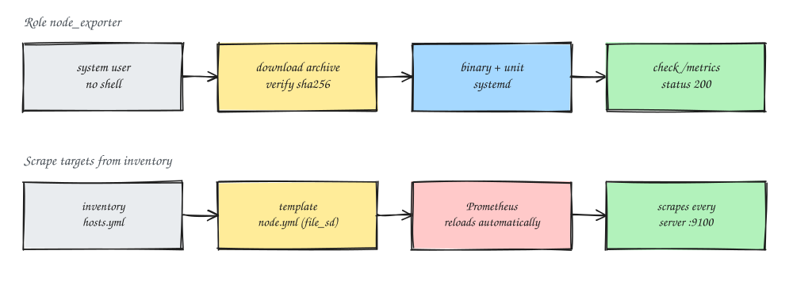

### Introduction
Monitoring is a must once you're running production servers. And monitoring that's nice to use starts with consistent metrics across every server. I used to install `node_exporter` by hand, one server at a time, and ended up with different versions, different flags, or one that I forgot to enable so it died after a reboot (that actually happened, and I only noticed when the dashboard had a hole in it). So in this post I'll share a simple Ansible role for installing Prometheus exporters so the result is always the same.

The example uses `node_exporter`, but the pattern also works for other single-binary exporters, like the MongoDB, MySQL, or HAProxy exporters.

### Principles I Stick To
- **The version is pinned** in a variable, not "latest".
- **The checksum is verified** before the binary is installed.
- **It runs as a dedicated user with no shell**, not root.
- **It's managed by systemd**, so it comes back on its own after a reboot.
- **It's not exposed publicly.** The exporter port is only reachable from the Prometheus server.

Roughly, the flow looks like this:



### Requirements
- Ansible on your laptop or a control server
- Linux servers with systemd
- A Prometheus server that's already running

### Role Layout
````
roles/node_exporter/
├── defaults/main.yml
├── handlers/main.yml
├── tasks/main.yml
└── templates/node_exporter.service.j2
````

### Steps
1. Create the default variables
```
vim roles/node_exporter/defaults/main.yml

............
node_exporter_version: "1.9.1"
node_exporter_arch: amd64
node_exporter_user: node_exporter
node_exporter_bin: /usr/local/bin/node_exporter
node_exporter_listen_address: "{{ ansible_default_ipv4.address }}:9100"
node_exporter_extra_flags:
  - --collector.systemd
```

When you want to upgrade, check the latest version on the official releases page and change `node_exporter_version` by hand. That way upgrades are always deliberate, never a surprise.

2. Create the tasks
```
vim roles/node_exporter/tasks/main.yml

............
- name: Create a system user for node_exporter
  ansible.builtin.user:
    name: "{{ node_exporter_user }}"
    system: true
    shell: /usr/sbin/nologin
    create_home: false

- name: Download the node_exporter archive with checksum verification
  ansible.builtin.get_url:
    url: "https://github.com/prometheus/node_exporter/releases/download/v{{ node_exporter_version }}/node_exporter-{{ node_exporter_version }}.linux-{{ node_exporter_arch }}.tar.gz"
    dest: "/tmp/node_exporter-{{ node_exporter_version }}.tar.gz"
    checksum: "sha256:https://github.com/prometheus/node_exporter/releases/download/v{{ node_exporter_version }}/sha256sums.txt"
    mode: "0644"

- name: Extract the archive
  ansible.builtin.unarchive:
    src: "/tmp/node_exporter-{{ node_exporter_version }}.tar.gz"
    dest: /tmp
    remote_src: true
    creates: "/tmp/node_exporter-{{ node_exporter_version }}.linux-{{ node_exporter_arch }}/node_exporter"

- name: Install the node_exporter binary
  ansible.builtin.copy:
    src: "/tmp/node_exporter-{{ node_exporter_version }}.linux-{{ node_exporter_arch }}/node_exporter"
    dest: "{{ node_exporter_bin }}"
    remote_src: true
    owner: root
    group: root
    mode: "0755"
  notify: Restart node_exporter

- name: Install the systemd unit
  ansible.builtin.template:
    src: node_exporter.service.j2
    dest: /etc/systemd/system/node_exporter.service
    owner: root
    group: root
    mode: "0644"
  notify: Restart node_exporter

- name: Enable and start node_exporter
  ansible.builtin.systemd_service:
    name: node_exporter
    state: started
    enabled: true
    daemon_reload: true

- name: Apply the restart if anything changed
  ansible.builtin.meta: flush_handlers

- name: Make sure the metrics endpoint responds
  ansible.builtin.uri:
    url: "http://{{ node_exporter_listen_address }}/metrics"
    status_code: 200
  register: node_exporter_metrics
  until: node_exporter_metrics.status == 200
  retries: 5
  delay: 3
```

3. Create the systemd unit template
```
vim roles/node_exporter/templates/node_exporter.service.j2

............
[Unit]
Description=Prometheus Node Exporter
Wants=network-online.target
After=network-online.target

[Service]
User={{ node_exporter_user }}
Group={{ node_exporter_user }}
Type=simple
ExecStart={{ node_exporter_bin }} \
  --web.listen-address={{ node_exporter_listen_address }} \
  {{ flag }}

Restart=on-failure
NoNewPrivileges=true
ProtectSystem=strict
ProtectHome=true
PrivateTmp=true

[Install]
WantedBy=multi-user.target
```

Hardening options like `ProtectSystem` and `NoNewPrivileges` are easy to add, and they go a long way toward limiting the damage if the exporter ever has a vulnerability.

4. Create the handler
```
vim roles/node_exporter/handlers/main.yml

............
- name: Restart node_exporter
  ansible.builtin.systemd_service:
    name: node_exporter
    state: restarted
    daemon_reload: true
```

5. Create the playbook
```
vim monitoring.yml

............
- name: Install node_exporter
  hosts: all
  become: true
  roles:
    - node_exporter
```
6. Run the playbook
```
ansible-playbook -i inventory/hosts.yml monitoring.yml
```
If it works, the last task, "Make sure the metrics endpoint responds", comes back `ok`. You can also check by hand from the Prometheus server
```
curl -s http://<server-ip>:9100/metrics | head
```

### Scrape Targets From the Inventory
So I don't have to write the Prometheus target list by hand, I generate it from the same inventory.
1. Create a template for `file_sd`
```
vim roles/prometheus_targets/templates/node.yml.j2

............
- targets:

    - "{{ hostvars[host]['ansible_default_ipv4']['address'] }}:9100"

  labels:
    job: node
```

2. Add it to `prometheus.yml`
```
vim /etc/prometheus/prometheus.yml

............
scrape_configs:
  - job_name: node
    file_sd_configs:
      - files:
          - /etc/prometheus/targets/node.yml
```

Prometheus re-reads `file_sd` files automatically, so when there's a new host you just add it to the inventory and run the playbook. Voilà, the new target gets scraped right away.

Note: this template needs facts from every host, so make sure fact gathering has run for all hosts in the same play.

### Security
- Open port 9100 in the firewall **only** for the Prometheus server's address.
- If the network isn't fully trusted, turn on TLS and basic auth with `--web.config.file`, which the official Prometheus exporters already support.
- Turn off collectors you don't use. Fewer metrics means less load and less information exposed.

### Alternative: The Official Collection
If you don't want to maintain your own role, the `prometheus.prometheus` collection on Ansible Galaxy already has roles for `node_exporter` and a few other exporters. Writing your own role is still worth it though: you understand what's happening behind the scenes, and you can reuse it for exporters that aren't in that collection yet.

This exporter pairs nicely with a [MongoDB replica set installed with Ansible](/en/posts/ansible-mongodb-replica-set/). Host metrics from `node_exporter`, database metrics from the MongoDB exporter, all installed from one automation repository.

That's it, hope it helps.

References:
- [node_exporter](https://github.com/prometheus/node_exporter)
- [Prometheus file-based service discovery](https://prometheus.io/docs/guides/file-sd/)
