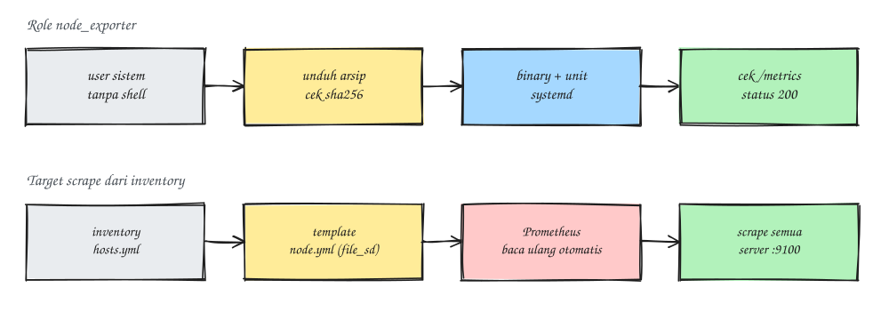

### Pendahuluan
Monitoring, ya hal yang wajib ada kalau sudah ngurus server production. Dan monitoring yang enak dipakai itu dimulai dari metrik yang konsisten di semua server. Dulu `node_exporter` saya pasang manual satu per satu, ujung - ujungnya versinya beda - beda, flag-nya beda, atau ada yang lupa di-enable sehingga mati setelah reboot (pernah kejadian, dan baru ketahuan waktu dashboard-nya bolong). Karena itu pada tulisan kali ini saya akan berbagi role Ansible sederhana untuk memasang exporter Prometheus supaya hasilnya selalu sama.

Contohnya pakai `node_exporter`, tapi polanya bisa dipakai juga untuk exporter lain yang bentuknya satu binary, misalnya exporter MongoDB, MySQL, atau HAProxy.

### Prinsip yang Saya Pegang
- **Versi dikunci** di variabel, bukan "latest".
- **Checksum dicek** dulu sebelum binary dipasang.
- **Jalan pakai user khusus tanpa shell**, bukan root.
- **Dikelola systemd**, jadi otomatis hidup lagi setelah reboot.
- **Gak terbuka ke publik.** Port exporter cuma bisa diakses server Prometheus.

Gambaran alurnya kurang lebih seperti ini:



### Kebutuhan
- Ansible di laptop atau server kontrol
- Server Linux dengan systemd
- Prometheus yang sudah jalan

### Struktur Role
````
roles/node_exporter/
├── defaults/main.yml
├── handlers/main.yml
├── tasks/main.yml
└── templates/node_exporter.service.j2
````

### Tahapan
1. Buat variabel default
```
vim roles/node_exporter/defaults/main.yml

............
node_exporter_version: "1.9.1"
node_exporter_arch: amd64
node_exporter_user: node_exporter
node_exporter_bin: /usr/local/bin/node_exporter
node_exporter_listen_address: "{{ ansible_default_ipv4.address }}:9100"
node_exporter_extra_flags:
  - --collector.systemd
```

Kalau mau upgrade, cek versi terbaru di halaman rilis resmi lalu ganti `node_exporter_version` secara manual. Jadi upgrade selalu disengaja, bukan kejutan.

2. Buat task-nya
```
vim roles/node_exporter/tasks/main.yml

............
- name: Buat user sistem untuk node_exporter
  ansible.builtin.user:
    name: "{{ node_exporter_user }}"
    system: true
    shell: /usr/sbin/nologin
    create_home: false

- name: Unduh arsip node_exporter dengan verifikasi checksum
  ansible.builtin.get_url:
    url: "https://github.com/prometheus/node_exporter/releases/download/v{{ node_exporter_version }}/node_exporter-{{ node_exporter_version }}.linux-{{ node_exporter_arch }}.tar.gz"
    dest: "/tmp/node_exporter-{{ node_exporter_version }}.tar.gz"
    checksum: "sha256:https://github.com/prometheus/node_exporter/releases/download/v{{ node_exporter_version }}/sha256sums.txt"
    mode: "0644"

- name: Ekstrak arsip
  ansible.builtin.unarchive:
    src: "/tmp/node_exporter-{{ node_exporter_version }}.tar.gz"
    dest: /tmp
    remote_src: true
    creates: "/tmp/node_exporter-{{ node_exporter_version }}.linux-{{ node_exporter_arch }}/node_exporter"

- name: Pasang binary node_exporter
  ansible.builtin.copy:
    src: "/tmp/node_exporter-{{ node_exporter_version }}.linux-{{ node_exporter_arch }}/node_exporter"
    dest: "{{ node_exporter_bin }}"
    remote_src: true
    owner: root
    group: root
    mode: "0755"
  notify: Restart node_exporter

- name: Pasang unit systemd
  ansible.builtin.template:
    src: node_exporter.service.j2
    dest: /etc/systemd/system/node_exporter.service
    owner: root
    group: root
    mode: "0644"
  notify: Restart node_exporter

- name: Aktifkan dan jalankan node_exporter
  ansible.builtin.systemd_service:
    name: node_exporter
    state: started
    enabled: true
    daemon_reload: true

- name: Terapkan restart bila ada perubahan
  ansible.builtin.meta: flush_handlers

- name: Pastikan endpoint metrics merespons
  ansible.builtin.uri:
    url: "http://{{ node_exporter_listen_address }}/metrics"
    status_code: 200
  register: node_exporter_metrics
  until: node_exporter_metrics.status == 200
  retries: 5
  delay: 3
```

3. Buat template unit systemd
```
vim roles/node_exporter/templates/node_exporter.service.j2

............
[Unit]
Description=Prometheus Node Exporter
Wants=network-online.target
After=network-online.target

[Service]
User={{ node_exporter_user }}
Group={{ node_exporter_user }}
Type=simple
ExecStart={{ node_exporter_bin }} \
  --web.listen-address={{ node_exporter_listen_address }} \
  {{ flag }}

Restart=on-failure
NoNewPrivileges=true
ProtectSystem=strict
ProtectHome=true
PrivateTmp=true

[Install]
WantedBy=multi-user.target
```

Opsi hardening seperti `ProtectSystem` dan `NoNewPrivileges` gampang ditambahkan, dan lumayan membantu membatasi dampaknya kalau suatu saat ada celah di exporter.

4. Buat handler
```
vim roles/node_exporter/handlers/main.yml

............
- name: Restart node_exporter
  ansible.builtin.systemd_service:
    name: node_exporter
    state: restarted
    daemon_reload: true
```

5. Buat playbook
```
vim monitoring.yml

............
- name: Pasang node_exporter
  hosts: all
  become: true
  roles:
    - node_exporter
```
6. Jalankan playbook
```
ansible-playbook -i inventory/hosts.yml monitoring.yml
```
Kalau berhasil, task terakhir "Pastikan endpoint metrics merespons" akan `ok`. Bisa juga dicek manual dari server Prometheus
```
curl -s http://<ip-server>:9100/metrics | head
```

### Target Scrape dari Inventory
Supaya daftar target Prometheus gak perlu ditulis manual satu - satu, saya generate dari inventory yang sama.
1. Buat template untuk `file_sd`
```
vim roles/prometheus_targets/templates/node.yml.j2

............
- targets:

    - "{{ hostvars[host]['ansible_default_ipv4']['address'] }}:9100"

  labels:
    job: node
```

2. Tambahkan di `prometheus.yml`
```
vim /etc/prometheus/prometheus.yml

............
scrape_configs:
  - job_name: node
    file_sd_configs:
      - files:
          - /etc/prometheus/targets/node.yml
```

Prometheus otomatis membaca ulang file `file_sd`, jadi kalau ada host baru tinggal tambahkan ke inventory lalu jalankan playbook. Voila, target baru langsung ke-scrape.

Catatan: template ini butuh fakta dari semua host, jadi pastikan fact gathering sudah jalan untuk semua host di play yang sama.

### Keamanan
- Buka port 9100 di firewall **hanya** untuk alamat server Prometheus.
- Kalau jaringannya gak sepenuhnya bisa dipercaya, aktifkan TLS dan basic auth lewat `--web.config.file`, yang sudah didukung exporter resmi Prometheus.
- Matikan collector yang gak dipakai. Makin sedikit metrik, makin ringan bebannya dan makin sedikit informasi yang terekspos.

### Alternatif: Collection Resmi
Kalau gak mau repot ngurus role sendiri, collection `prometheus.prometheus` di Ansible Galaxy sudah punya role untuk `node_exporter` dan beberapa exporter lain. Tapi bikin role sendiri tetap ada gunanya: kita jadi paham apa yang terjadi di balik layar, dan bisa dipakai untuk exporter yang belum ada di collection itu.

Exporter ini cocok dipasangkan dengan [MongoDB replica set yang dipasang pakai Ansible](/posts/ansible-mongodb-replica-set/). Metrik host dari `node_exporter`, metrik database dari exporter MongoDB, dan semuanya dipasang dari satu repository otomasi.

Sekian, semoga membantu.

Referensi:
- [node_exporter](https://github.com/prometheus/node_exporter)
- [Prometheus file-based service discovery](https://prometheus.io/docs/guides/file-sd/)
