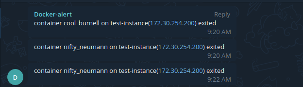

### Introduction
Containers are a pretty popular term these days, and I use them both for app development and in production. But over the past few days my team ran into a problem: every day or two, all the containers on the production VM would suddenly stop. After digging in, it turned out the Docker daemon was restarting on its own (seriously annoying). And the DevOps team's mistake was not adding the `restart: always` parameter in production, so when the Docker daemon restarted, the containers didn't come back automatically. Even worse, the clients found out before the DevOps team did. So in this post I'll share a little tip, with help from [Mustapha](https://instagram.com/topahadzi), for monitoring Docker containers and sending an alert to Telegram when a container dies (exited).

### Requirements
- Docker
- A Telegram bot
- Cron

### Steps
1. Set up a Telegram bot to send the alert messages to the team. You can follow the guide at this [link](https://core.telegram.org/bots#create-a-new-bot)
2. Create the alert script,
```
vim script-alert.sh


............
#!/bin/sh
PATH=/usr/local/sbin:/usr/local/bin:/sbin:/bin:/usr/sbin:/usr/bin
export IPVM=$(/sbin/ifconfig ens3 | grep -i mask | awk '{print $2}')
vm=$(hostname)
list_of_containers=$(sudo docker ps -a | awk '{if(NR>1) print $NF}')
containers=`docker ps -f status=running --format "{{.Names}}"`
for i in $list_of_containers
do
  if echo $containers |grep  $i
    then  echo "$i online "
    else curl -X POST -H 'Content-Type: application/json' -d '{"chat_id": "[CHATID]", "text": "'"container $i on $vm($IPVM) exited"'", "disable_notification": true}'  https://api.telegram.org/bot[YOUR_BOT_TOKEN]/sendMessage > /dev/null
  fi 
    
done

exit 0
```
3. Create a cron job that checks every minute
```
crontab -e 

*/1 * * * *     /bin/sh /home/ubuntu/script-alert.sh
```
When a container dies, the bot sends an alert like this


Voilà, the Docker alert is done.

That's it, hope it helps
