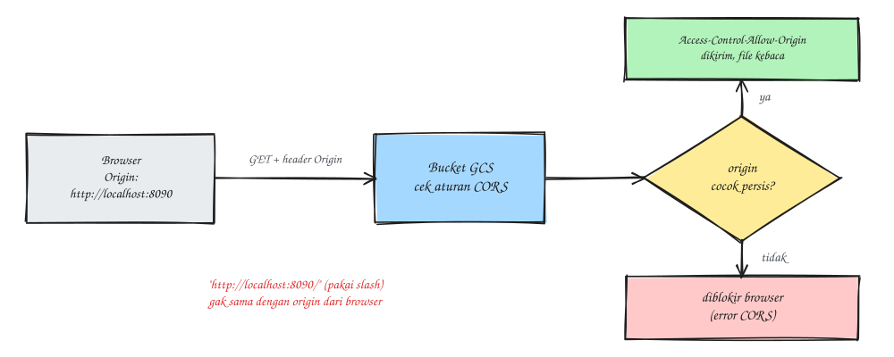

### Introduction
A few days ago the frontend team asked for something: their app (on `localhost` during development and on the production domain) needed to read files straight from a Google Cloud Storage bucket. Without CORS rules, the browser rejects the response with the classic `No 'Access-Control-Allow-Origin' header` error. In this post I'll share how to set up CORS on a GCS bucket, plus one small trap that had me confused for a bit.

The CORS rule we first wanted to apply looked roughly like this:
```
[
  {
    "origin": ["http://localhost:8090/", "https://example.com"],
    "method": ["GET"],
    "responseHeader": ["Content-Type"],
    "maxAgeSeconds": 3600
  }
]
```
Looks right at a glance, but there's a catch.

### The trap: a trailing slash in the origin
Look at `http://localhost:8090/`. The `Origin` header a browser sends **never** ends with a slash; it's always `http://localhost:8090`. GCS matches origins exactly, so with a slash at the end it will never match, and requests from localhost still get a CORS error even though the rule is "already in place" (seriously confusing).

So write the origin without the slash: `http://localhost:8090`.



### Option 1: the Console
- Cloud Storage > Buckets > select the bucket > edit the CORS configuration
````
List of allowed origins : http://localhost:8090, https://example.com
Specify methods : GET (add HEAD if the frontend also checks file metadata)
List of allowed response headers : Content-Type
Cache expiry time : 3600
SAVE
````
You don't need to tick **OPTIONS**, since GCS handles preflight automatically.

### Option 2: gcloud
You can do this from a local terminal or Cloud Shell (the `>_` icon at the top right of the Console).
1. Create a `cors.json` file
```
vim cors.json

............
[
  {
    "origin": ["http://localhost:8090", "https://example.com"],
    "method": ["GET"],
    "responseHeader": ["Content-Type"],
    "maxAgeSeconds": 3600
  }
]
```
2. Apply it to the bucket
```
gcloud storage buckets update gs://<bucket-name> --cors-file=cors.json
```
The result is the same as option 1, so pick either. If you keep your config in a repo, gcloud is nicer because `cors.json` can go through review too.

### Verify
Check the active configuration
```
gcloud storage buckets describe gs://<bucket-name> --format="default(cors_config)"
```
Or test it the way a browser would, by sending an `Origin` header
```
curl -sI -H "Origin: http://localhost:8090" \
  https://storage.googleapis.com/<bucket-name>/<object-path> | grep -i access-control
```
If it works, you'll see output like this:
````
access-control-allow-origin: http://localhost:8090
````
If that line doesn't show up, double-check how the origin is spelled (`http`/`https`, the port, and the trailing slash).

### CORS is not access permission
This is the part people often miss. CORS only controls whether **the browser is allowed to read** a cross-origin response; permission to access the file is a separate thing.

If the bucket uses *uniform bucket-level access* and *public access prevention* (the safe, recommended settings), requests from the frontend will still get a **403** even with correct CORS. The frontend needs one of these:
- A **signed URL**, created by the backend with a short expiry. This is the right choice for files that shouldn't be open to just anyone.
- **IAM `allUsers` with the Storage Object Viewer role**, if the bucket's contents really are public (static assets, for example). For this, public access prevention has to be turned off first, so make sure the bucket only holds public files.

My debugging order: a **403** means the problem is permissions (IAM or the signed URL). If the status is **200** but the browser still complains about CORS, only then is the problem in the CORS rule.

That's it, hope it helps.

References:
- [Cross-origin resource sharing (CORS) - Google Cloud Storage](https://cloud.google.com/storage/docs/cross-origin)
