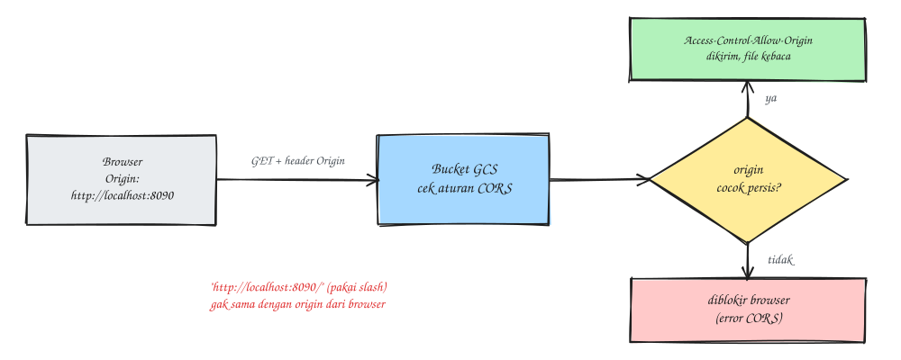

### Pendahuluan
Beberapa hari lalu ada request dari tim frontend, aplikasinya (di `localhost` waktu development dan di domain production) perlu baca file langsung dari bucket Google Cloud Storage. Tanpa aturan CORS, browser bakal menolak response-nya dengan error klasik `No 'Access-Control-Allow-Origin' header`. Pada tulisan kali ini saya akan berbagi cara mengatur CORS di bucket GCS, plus satu jebakan kecil yang sempat bikin bingung.

Aturan CORS yang awalnya mau dipasang kurang lebih seperti ini:
```
[
  {
    "origin": ["http://localhost:8090/", "https://example.com"],
    "method": ["GET"],
    "responseHeader": ["Content-Type"],
    "maxAgeSeconds": 3600
  }
]
```
Sekilas kelihatan benar, tapi ada jebakannya.

### Jebakan: trailing slash di origin
Perhatikan `http://localhost:8090/`. Header `Origin` yang dikirim browser itu **tidak pernah** diakhiri slash, isinya selalu `http://localhost:8090`. GCS mencocokkan origin secara persis, jadi kalau ada slash di belakang gak akan pernah cocok, dan request dari localhost tetap kena CORS error walaupun aturannya "sudah dipasang" (asli bikin bingung).

Jadi tulis origin tanpa slash: `http://localhost:8090`.



### Cara 1: lewat Console
- Cloud Storage > Buckets > pilih bucket > edit konfigurasi CORS
````
List of allowed origins : http://localhost:8090, https://example.com
Specify methods : GET (tambah HEAD kalau frontend juga cek metadata file)
List of allowed response headers : Content-Type
Cache expiry time : 3600
SAVE
````
Method **OPTIONS** gak perlu dicentang karena preflight sudah ditangani GCS otomatis.

### Cara 2: lewat gcloud
Bisa dari terminal lokal atau Cloud Shell (ikon `>_` di kanan atas Console).
1. Buat file `cors.json`
```
vim cors.json

............
[
  {
    "origin": ["http://localhost:8090", "https://example.com"],
    "method": ["GET"],
    "responseHeader": ["Content-Type"],
    "maxAgeSeconds": 3600
  }
]
```
2. Terapkan ke bucket
```
gcloud storage buckets update gs://<nama-bucket> --cors-file=cors.json
```
Hasilnya sama saja dengan cara 1, pilih salah satu. Kalau konfigurasinya disimpan di repo, cara gcloud lebih enak karena `cors.json` bisa ikut di-review.

### Verifikasi
Cek konfigurasi yang aktif
```
gcloud storage buckets describe gs://<nama-bucket> --format="default(cors_config)"
```
Atau tes langsung seperti browser dengan mengirim header `Origin`
```
curl -sI -H "Origin: http://localhost:8090" \
  https://storage.googleapis.com/<nama-bucket>/<path-object> | grep -i access-control
```
Jika berhasil akan menampilkan output seperti berikut:
````
access-control-allow-origin: http://localhost:8090
````
Kalau baris itu gak muncul, cek lagi ejaan origin-nya (`http`/`https`, port, dan trailing slash).

### CORS bukan izin akses
Nah ini yang sering kelewat. CORS cuma mengatur apakah **browser boleh membaca** response lintas origin, sedangkan izin untuk mengakses file-nya diatur terpisah.

Kalau bucket pakai *uniform bucket-level access* dan *public access prevention* (setelan yang aman dan memang disarankan), request dari frontend tetap akan dapat **403** walaupun CORS sudah benar. Frontend butuh salah satu dari ini:
- **Signed URL**, dibuat oleh backend dengan masa berlaku pendek. Ini pilihan yang tepat untuk file yang gak boleh diakses sembarang orang.
- **IAM `allUsers` dengan role Storage Object Viewer**, kalau isi bucket memang untuk publik (misalnya aset statis). Untuk ini public access prevention harus dimatikan dulu, jadi pastikan bucket-nya memang khusus file publik.

Urutan debugging yang saya pakai: kalau dapat **403** berarti masalahnya di izin (IAM atau signed URL). Kalau status-nya **200** tapi browser tetap protes soal CORS, baru masalahnya ada di aturan CORS.

Sekian, semoga membantu.

Referensi:
- [Cross-origin resource sharing (CORS) - Google Cloud Storage](https://cloud.google.com/storage/docs/cross-origin)
