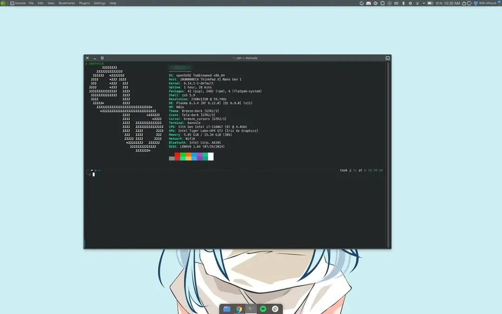

### Introduction
In the previous post, [A macOS-Style KDE Plasma on openSUSE Tumbleweed](/en/posts/kde-plasma-macos-style-opensuse-tumbleweed/), I covered how to rework Plasma to look like macOS and remove GNOME along the way. But I never explained **why** I finally switched. I used GNOME for quite a while, and I even went to [GNOME.Asia Summit](/en/posts/gnome-asia-summit-2022/) (so this isn't about hating GNOME).

So in this post I'll sum up what made me feel at home in KDE Plasma 6. Maybe it'll get those of you still on GNOME curious enough to try it.

For reference, here's my everyday Plasma desktop on a ThinkPad X1 Nano: a top panel with a global menu and system tray, a small dock at the bottom, and Konsole with the Breeze Dark theme.



### 1. The Basics Are There, No Extensions Needed
This is reason number one. On GNOME, a lot of things I consider basic need an extension first:
- **Tray icons** (Discord, Telegram, Nextcloud, etc.) don't show without the AppIndicator extension.
- **Minimize and maximize buttons** aren't there by default, only close. You have to turn them on in GNOME Tweaks.
- **Desktop icons** aren't there either; that needs an extension too.
- **Clipboard history** doesn't exist.

In Plasma all of this is there from the start. The system tray works, the window buttons are complete, you can put files on the desktop, and clipboard history is handled by **Klipper** (click the clipboard icon in the tray or press `Meta+V`).

The problem with GNOME extensions isn't just the hassle of installing them. Every time GNOME bumps a major version, extensions often aren't compatible yet and get disabled automatically. On Tumbleweed, a rolling release, this happens fairly often (seriously annoying when all your tray icons vanish after a `zypper dup`).

### 2. Almost Everything Is in System Settings
GNOME has a minimalist philosophy, so it deliberately keeps settings few. The rest lives in GNOME Tweaks or even has to go through `gsettings`/`dconf`.

In Plasma, almost everything is in **System Settings**: themes, fonts, animations, shortcuts, window behavior, all the way to desktop effects. There's a search box too, so you can just type `shortcut` or `font`.

The ones I use most:
- **Panels** can be moved to the top, bottom, left, or right, made floating, or you can add a second panel as a dock. That's what I used in the macOS post.
- **Shortcuts** can be changed for almost any action, including running your own commands.
- **Window Rules**: right-click the title bar > More Actions > Configure Special Window Settings. For example, the terminal always opens on the second monitor at a set size, or the chat app always goes to virtual desktop 2.

### 3. KDE Apps That Make You Faster
This rarely gets talked about, yet this is where Plasma really feels different.

**Dolphin** (file manager)
- `F3` for split view, two folders side by side. Moving files becomes super easy.
- `F4` for a terminal panel at the bottom that follows the folder you're in.
- You can open folders on a server with `sftp://user@host/path` straight from the address bar.

**Konsole** (terminal)
- Tabs and split terminals without tmux.
- Different profiles for different needs, like a red color scheme for production server sessions (so you don't type the wrong thing in the wrong place).

**Spectacle** (screenshots)
- Take a screenshot of a region, a window, or the full screen, then **annotate** it right away (arrows, boxes, text, blur). For writing docs or reporting bugs to the team, this helps a lot. GNOME's built-in screenshot tool doesn't have annotations yet.
- It can record the screen too.

**KRunner**
- Press `Alt+Space` and type anything: open apps, find files, calculate `2^10`, convert `10 km to mi`, or run a command. Like Spotlight on macOS.

**KDE Connect**
- Connect your Android phone to your laptop: phone notifications show on the desktop, files go both ways, a shared clipboard, even using the phone as a presentation remote. GNOME can do this too with GSConnect, but that's (again) an extension.

### 4. Change the Look However You Like
GNOME these days tends to limit theming, especially for libadwaita apps. In Plasma, changing the look is an official feature. Global Theme, Plasma Style, window decorations, icons, cursors, even the SDDM login screen can be changed from System Settings, and there's a **Get New...** button for downloading themes from the KDE store.

You saw the result in the previous post: Plasma can be made to look like macOS. You can make it look like Windows too, or stick with the default **Breeze** theme, which I think is already neat.

### 5. The GNOME Workflow Is Here Too
Lots of people stay on GNOME because of the Activities Overview and its touchpad gestures. Good news, Plasma 6 has them too:
- **Overview** (`Meta+W`) shows every window and virtual desktop, plus search.
- **Touchpad gestures**: swipe up with four fingers for Overview, left or right to switch virtual desktops.

So if you're used to how GNOME works, moving to Plasma doesn't mean starting from scratch.

### 6. Not as Heavy as People Think
KDE used to be known as heavy. These days, in my experience, day-to-day Plasma 6 feels light and isn't far off from GNOME. The exact numbers depend on what's running in the background, so take this as experience, not a benchmark.

### Summary
````
Feature                       GNOME                      KDE Plasma 6
----------------------------  -------------------------  ---------------------------
Tray icons                    AppIndicator extension     built in
Minimize / maximize buttons   enable in Tweaks           built in
Clipboard history             extension                  built in (Klipper)
Settings                      Settings + Tweaks + dconf  System Settings
Screenshot annotation         not yet                    built in (Spectacle)
Split view file manager       not yet                    built in (Dolphin, F3)
Android phone integration     GSConnect (extension)      KDE Connect
Theming                       limited                    official + Get New...
Overview + gestures           built in                   built in (Meta+W, 4 fingers)
````

### When Is GNOME Still the Better Fit?
To be fair, GNOME has its strengths too:
- **Consistent and tidy** out of the box. If you don't like tweaking things, GNOME is nice to use without touching anything.
- **Fewer choices** actually help you focus. In Plasma, there are so many settings that you can end up confusing yourself.
- **GNOME apps** (libadwaita) look uniform and modern.

So if you like a desktop that's "ready to go" and you rarely tinker, GNOME is still a good choice. But if you often get annoyed at installing extensions for small things, or you want a desktop that fits the way you work, Plasma is worth a try.

### How to Try It Without Removing GNOME
On openSUSE Tumbleweed, Plasma can be installed alongside GNOME:
```
sudo zypper in -t pattern kde kde_plasma
```
Log out, then pick the **Plasma (Wayland)** session on the login screen. Use it for a few days. Once you're sure about switching, move on to the [previous post](/en/posts/kde-plasma-macos-style-opensuse-tumbleweed/) to swap GDM for SDDM and remove GNOME safely.

That's it, hope it helps.

References:
- [KDE Plasma](https://kde.org/plasma-desktop/)
- [KDE Connect](https://kdeconnect.kde.org/)
- [GNOME Shell Extensions](https://extensions.gnome.org/)
- [openSUSE Wiki: KDE](https://en.opensuse.org/Portal:KDE)
