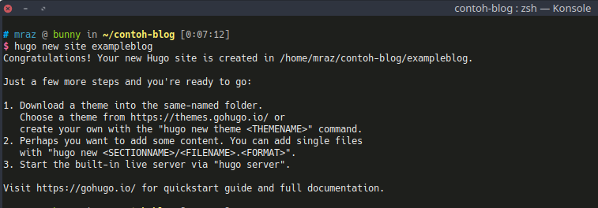
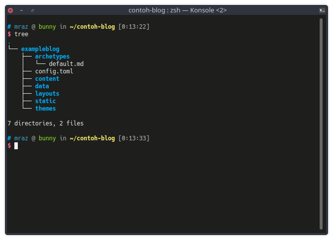
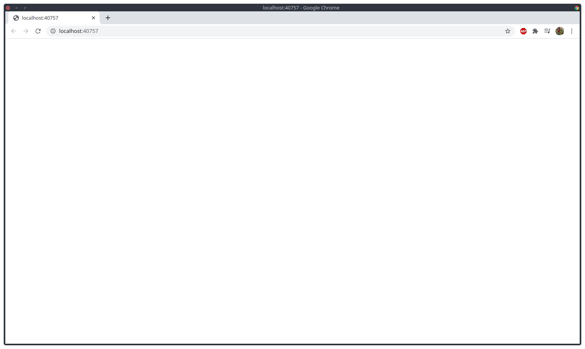

## Why Hugo?
You're probably asking this when you see this post: why Hugo? What's so great about it? There's WordPress, Blogger, and so on. Fair enough, but a static site like Hugo is just as powerful as those CMSes, and I had a few problems when I used WordPress:
1. The storage on my hosting was tiny (not rich yet, you know), so before uploading an image I had to think twice about things like file size.
2. Customizing the blog without internet was hard. Sure, sometimes you can just install LAMPP or XAMPP, but to me that started to feel like a hassle.
3. Hugo is practical. I tried Jekyll once but it was kind of meh, long story. Hugo is nice: fast to deploy and easy to learn, even if you don't know Go.
4. Paired with GitHub Pages, Hugo is fun: automatic builds with Travis CI or other tools. Basically just add -> commit -> push -> grab a coffee -> done.
5. Content in Hugo is written in MD (Markdown), which is super easy to learn, well documented, and has plenty of tutorials.

OK, on to the tutorial for building a site with Hugo.

## Building a Static Site with Hugo
Run the following command to create the blog, replacing [blog-name] with whatever name you want.
````
hugo new site [blog-name]
````
Here the example uses the blog name 'exampleblog'
````
hugo new site exampleblog
````
The output looks like this:

After creating the blog with that command, it creates a few directories like in the image below:

Once the "exampleblog" site is created, run the following command to see whether Hugo runs
````
hugo server -D
````
You'll see an empty page with nothing on it. Yep, that's right, because no theme has been applied to the site yet. Keep an eye on this blog, because this continues in part 2


Thanks.
