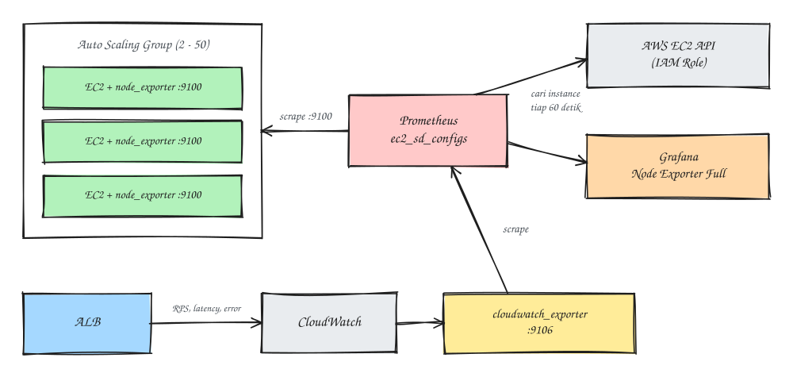

### Introduction
Prometheus is a monitoring tool I've used for a long time. Until now I'd been monitoring my EC2 servers with `static_configs`, in other words a list of IPs written by hand. For fixed servers that's still OK. The trouble started with an app running in an **Auto Scaling Group** (ASG) with a capacity of 2 to 50 instances. The IPs come and go with scaling, and there's no way I'm editing `prometheus.yml` every time the ASG scales out (I'd spend all day just managing IPs). In this post I'll share how I solved it.

The solution has three parts, and it looks roughly like this:



### Requirements
- A self-hosted Prometheus on EC2
- An Auto Scaling Group with a Launch Template
- Access to the AWS Console for IAM and Security Groups
- Grafana (optional, for dashboards)

### Steps
#### 1. Install node_exporter through User Data
Instances in an ASG are created from a **Launch Template**, so node_exporter has to be installed automatically when an instance first boots. It goes here:
- EC2 > Launch Templates > select the template > Actions > Modify template (Create new version) > Advanced details > User data

Add this block to your existing user data script:

```
#!/bin/bash
# --- Node Exporter for Prometheus ---
NODE_EXPORTER_VERSION="1.8.1"
cd /tmp
wget -q https://github.com/prometheus/node_exporter/releases/download/v${NODE_EXPORTER_VERSION}/node_exporter-${NODE_EXPORTER_VERSION}.linux-amd64.tar.gz
tar xzf node_exporter-${NODE_EXPORTER_VERSION}.linux-amd64.tar.gz
cp node_exporter-${NODE_EXPORTER_VERSION}.linux-amd64/node_exporter /usr/local/bin/
rm -rf node_exporter-${NODE_EXPORTER_VERSION}.linux-amd64*
useradd -rs /bin/false node_exporter

cat > /etc/systemd/system/node_exporter.service <<'NODEEOF'
[Unit]
Description=Node Exporter
After=network.target

[Service]
User=node_exporter
ExecStart=/usr/local/bin/node_exporter
Restart=on-failure

[Install]
WantedBy=multi-user.target
NODEEOF

systemctl daemon-reload
systemctl enable --now node_exporter
```

A few small but important things:
- **Put this block before the part that starts the app.** If the script has a `sudo -u <user> bash <<'EOF' ... EOF` section for deploying the app, node_exporter still has to be installed as root outside that block.
- **Use a different heredoc marker** (`NODEEOF`, not `EOF`) so it doesn't clash with other heredocs in the same script.
- After changing the template, open **Auto Scaling Group > Edit > Launch template version** and pick the latest version. Running instances don't change. User data only runs on an instance's first boot, so old instances need replacing (for example through an *instance refresh*) or a manual install.

> Don't put passwords or tokens in user data. Anyone with `ec2:DescribeInstanceAttribute` access can read it, and so can anything inside the instance through the metadata service. For secrets, use SSM Parameter Store or Secrets Manager.

#### 2. Add IAM permissions for Prometheus
Prometheus needs to ask AWS which instances are running. Add this policy to the IAM Role attached to the Prometheus EC2 instance:

```
{
  "Version": "2012-10-17",
  "Statement": [
    {
      "Effect": "Allow",
      "Action": [
        "ec2:DescribeInstances",
        "ec2:DescribeAvailabilityZones"
      ],
      "Resource": "*"
    }
  ]
}
```

Use an IAM Role, not access keys written in the config. Prometheus picks up credentials from the instance profile automatically.

#### 3. Set up the Security Groups
| Where | Direction | Source / destination | Port |
|---|---|---|---|
| ASG instance SG | Inbound | Prometheus SG | 9100 |
| Prometheus SG | Outbound | ASG instance SG | 9100 |

Prometheus and the ASG also need to reach each other over the network: the same VPC, or through VPC peering / Transit Gateway.

#### 4. Add EC2 service discovery to prometheus.yml
Leave the jobs for fixed servers on `static_configs`. For the ASG, add a new job with `ec2_sd_configs`:

```
  - job_name: "app-asg"
    ec2_sd_configs:
      - region: ap-southeast-3
        port: 9100
        filters:
          - name: "tag:aws:autoscaling:groupName"
            values: ["app-asg"]
          - name: "instance-state-name"
            values: ["running"]

    relabel_configs:
      # Scrape over the private IP
      - source_labels: [__meta_ec2_private_ip]
        target_label: __address__
        replacement: "${1}:9100"

      # instance & nodename: instance ID + private IP, unique per EC2
      - source_labels: [__meta_ec2_instance_id, __meta_ec2_private_ip]
        separator: "_"
        target_label: instance
      - source_labels: [__meta_ec2_instance_id, __meta_ec2_private_ip]
        separator: "_"
        target_label: nodename

      # Extra labels
      - source_labels: [__meta_ec2_instance_id]
        target_label: instance_id
      - source_labels: [__meta_ec2_availability_zone]
        target_label: az
      - source_labels: [__meta_ec2_private_ip]
        target_label: private_ip
      - target_label: env
        replacement: production
      - target_label: asg
        replacement: app-asg
```

AWS automatically tags every instance in an ASG with `aws:autoscaling:groupName`, so the filter above catches all its members right away. Prometheus refreshes the target list periodically (every 60 seconds by default). New instances join automatically, terminated instances disappear automatically, and `prometheus.yml` never needs touching again.

##### Why label instances that way?
My first attempt used the `Name` tag as the `instance` and `nodename` label. The result: in the Grafana dashboard (Node Exporter Full) every instance merged into a single choice in the dropdown (wait, why only one?). The `Name` tag from the Launch Template has the **same** value for every instance in the ASG.

What's unique per instance is the instance ID and the private IP. Combining them gives labels like `i-0abc123def4567890_10.0.12.34`: you can tell straight away which instance it is, and the IP is easy to match while debugging.

If you'd rather have sequential names like `app-1`, `app-2`, Prometheus can't make them itself, because relabeling only reads metadata as-is. Your options: set a unique `Name` tag with a Lambda triggered by EventBridge's *EC2 Instance Launch Successful* event, or use the last IP octet as a suffix (`app-34`). For me, ID plus IP is the most practical, with no extra moving parts.

#### 5. Validate before reloading
A mistake I made (and it caused a bit of panic): I pasted the new job without the two-space indent, so `- job_name:` ended up outside `scrape_configs` and Prometheus failed to start. Get into the habit of checking with `promtool` first:

```
promtool check config /etc/prometheus/prometheus.yml
```

If it says `SUCCESS`, then reload:

```
sudo systemctl reload prometheus
# or, if Prometheus runs with --web.enable-lifecycle:
curl -X POST http://localhost:9090/-/reload
```

#### 6. Check the data is coming in
1. **Status > Targets** in the Prometheus UI. The `app-asg` job should show as many targets as the *desired capacity*, all **UP**.
2. Queries in the Graph tab:

   ```
   up{job="app-asg"}
   100 * (1 - avg by (instance) (rate(node_cpu_seconds_total{job="app-asg", mode="idle"}[5m])))
   node_memory_MemAvailable_bytes{job="app-asg"}
   ```

3. If something's off, go through it in this order:

| Symptom | Check |
|---|---|
| Targets don't show up at all | IAM Role (`ec2:DescribeInstances`), region, and the tag filter |
| Targets show up but DOWN | Security group port 9100, routing between subnets/VPCs |
| Targets UP but no metrics | `systemctl status node_exporter` on the instance, `curl http://<private-ip>:9100/metrics` from the Prometheus server |

### Bonus: RPS from the ALB through the CloudWatch Exporter
node_exporter only sees OS resources (CPU, RAM, disk, network). For **requests per second**, the source has to be the app or the load balancer. Since this app's traffic comes in through an ALB, the easiest way without changing code is to pull the ALB metrics from CloudWatch with [cloudwatch_exporter](https://github.com/prometheus/cloudwatch_exporter).

The ALB already sends its metrics to CloudWatch automatically, so there's nothing to set up on the CloudWatch side. All you need is the exporter and IAM permissions.

1. Install the exporter
```
sudo apt-get install -y default-jre
sudo mkdir -p /opt/cloudwatch_exporter
sudo wget -O /opt/cloudwatch_exporter/cloudwatch_exporter.jar \
  https://github.com/prometheus/cloudwatch_exporter/releases/download/v0.15.5/cloudwatch_exporter-0.15.5-jar-with-dependencies.jar
```

2. Pick only the metrics you need. Every metric means CloudWatch API calls that **cost money**, so I only take the four most useful ones. Save this as `/opt/cloudwatch_exporter/config.yml`:

```
region: ap-southeast-3

metrics:
  - aws_namespace: AWS/ApplicationELB
    aws_metric_name: RequestCount
    aws_dimensions: [LoadBalancer, TargetGroup]
    aws_statistics: [Sum]
    period_seconds: 60
    range_seconds: 600

  - aws_namespace: AWS/ApplicationELB
    aws_metric_name: TargetResponseTime
    aws_dimensions: [LoadBalancer, TargetGroup]
    aws_statistics: [Average]
    aws_extended_statistics: [p95, p99]
    period_seconds: 60
    range_seconds: 600

  - aws_namespace: AWS/ApplicationELB
    aws_metric_name: HTTPCode_Target_4XX_Count
    aws_dimensions: [LoadBalancer, TargetGroup]
    aws_statistics: [Sum]
    period_seconds: 60
    range_seconds: 600

  - aws_namespace: AWS/ApplicationELB
    aws_metric_name: HTTPCode_Target_5XX_Count
    aws_dimensions: [LoadBalancer, TargetGroup]
    aws_statistics: [Sum]
    period_seconds: 60
    range_seconds: 600
```

I skip `HealthyHostCount` and `ActiveConnectionCount` on purpose: the number of healthy instances is already visible from `up{job="app-asg"}`. If the account has lots of ALBs, narrow it down to the one you care about with `aws_dimension_select` so the exporter doesn't pull metrics for every load balancer.

3. Create a systemd service
```
# /etc/systemd/system/cloudwatch_exporter.service
[Unit]
Description=CloudWatch Exporter
After=network.target

[Service]
ExecStart=/usr/bin/java -jar /opt/cloudwatch_exporter/cloudwatch_exporter.jar 9106 /opt/cloudwatch_exporter/config.yml
Restart=on-failure
DynamicUser=yes

[Install]
WantedBy=multi-user.target
```

```
sudo systemctl daemon-reload
sudo systemctl enable --now cloudwatch_exporter
```

This exporter doesn't need root. `DynamicUser=yes` runs it as a temporary user.

4. Add these actions to the Prometheus IAM role's policy from earlier

```
"cloudwatch:GetMetricStatistics",
"cloudwatch:GetMetricData",
"cloudwatch:ListMetrics",
"tag:GetResources"
```

5. Add a job to Prometheus
```
  - job_name: "cloudwatch-alb"
    scrape_interval: 60s
    scrape_timeout: 50s
    static_configs:
      - targets: ["localhost:9106"]
        labels:
          env: production
```

The `scrape_interval: 60s` on this job matters. The exporter calls the CloudWatch API **on every scrape**, so if it follows the global 15-second interval, it costs four times as much with no fresher data. Besides, ALB metrics only have one-minute resolution anyway.

6. Query in Grafana. `RequestCount` with the `Sum` statistic and `period_seconds: 60` holds the number of requests **per minute**, not an ever-increasing counter. So don't use `rate()`, just divide by 60:

```
# RPS
aws_applicationelb_request_count_sum / 60

# Errors per second
aws_applicationelb_httpcode_target_5_xx_count_sum / 60

# Latency (seconds)
aws_applicationelb_target_response_time_average
aws_applicationelb_target_response_time_p95
```

You can check the exact metric names at `http://<prometheus-host>:9106/metrics`.

#### How much does it cost?
`GetMetricStatistics` costs about **$0.01 per 1,000 requests**. With four metrics, one ALB, one target group, and a scrape every 60 seconds:

```
4 metrics × 60 per hour × 24 hours × 30 days ≈ 172,800 requests/month ≈ $1.7/month
```

Plus a few `ListMetrics` calls to discover dimensions. Compare that with my first attempt: seven metrics scraped every 15 seconds, about $12/month. The cost also grows with the number of matching ALBs and target groups, so keep an eye on the CloudWatch bill in the first month.

If the instances use Nginx as a reverse proxy, `nginx-prometheus-exporter` is a totally free alternative. If you need RPS per endpoint, instrumenting the app itself (for example `prom-client` for Node.js) gives you the most detail.

Voilà, Prometheus now follows the ASG up and down on its own.

### Summary
| Need | Solution |
|---|---|
| node_exporter on new instances automatically | User data in the Launch Template |
| Targets that scale with the ASG | `ec2_sd_configs` filtered on the `aws:autoscaling:groupName` tag |
| Instances neatly separated in Grafana | `instance` label = instance ID + private IP |
| A safe config before reloading | `promtool check config` |
| RPS, latency, errors from the ALB | cloudwatch_exporter, 4 metrics, 60-second scrape |

That's it, hope it helps.

References:
- [Prometheus ec2_sd_config](https://prometheus.io/docs/prometheus/latest/configuration/configuration/#ec2_sd_config)
- [cloudwatch_exporter](https://github.com/prometheus/cloudwatch_exporter)
