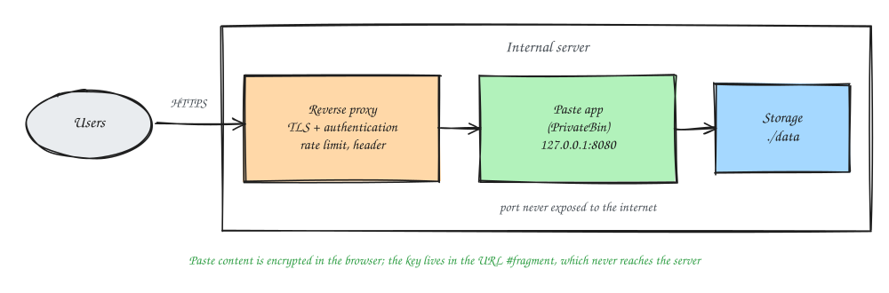

### Introduction
Pastebins are something almost every technical person has used. You need to share a piece of log, a config, or a stack trace quickly, so you just paste it into a public pastebin. Handy, but pretty risky. Logs often contain tokens, internal addresses, or user data. Once that lands on a public service, you no longer control who reads it or how long it's kept.

The way out is an **internal paste service**. Just as handy, but it runs on your own infrastructure and only the right people can reach it. In this post I'll share what to think about when designing one, plus a deployment approach that makes sense to me.

### Requirements
Before picking tools, I wrote down the requirements first:

| Requirement | Why |
|---|---|
| Only reachable from the internal network or after logging in | So the contents don't leak outside |
| Expiry per paste | Sensitive data doesn't pile up forever |
| *Burn after reading* option | Good for sharing one-time, temporary credentials |
| Encryption, ideally client-side | Even the server admin can't read the contents |
| Syntax highlighting | Logs and configs are easier to read |
| Size limits and rate limiting | Prevents abuse and full disks |
| Not indexed by search engines | So pastes never show up in search results |

### Build Your Own or Use an Existing One?
- **Use a mature open source app.** A popular one is [PrivateBin](https://privatebin.info/). Pastes are encrypted in the browser before they're sent to the server, and the decryption key lives in the `#fragment` part of the URL, which is never sent to the server. Expiry, burn after reading, and syntax highlighting are already there.
- **Build your own.** Makes sense if you have special needs, like integrating with internal SSO, audit logs, or an API you can call from scripts. The trade-off is that maintenance and security are all on you.

For most teams, my advice is to start with an existing app, then put authentication and house rules in front of it.

### Architecture


- The **reverse proxy** (Nginx, HAProxy, or Caddy) handles TLS, authentication, rate limiting, and security headers.
- The **paste app** only listens on `127.0.0.1` or a private network, never directly facing the internet.
- For **storage**, the filesystem is enough at small scale, or a database if you need replication.

### Steps
1. Create a `docker-compose.yml` file
```
vim docker-compose.yml

............
services:
  paste:
    image: privatebin/nginx-fpm-alpine:<pinned-version>
    restart: unless-stopped
    read_only: true
    ports:
      - "127.0.0.1:8080:8080"
    volumes:
      - ./data:/srv/data
      - ./conf.php:/srv/cfg/conf.php:ro
```
A few notes:
- **Pin the image version**, don't use `latest`, so upgrades are always on purpose and easy to roll back.
- `read_only: true` makes the container's filesystem read-only, except for the data volume.
- The port is only bound to `127.0.0.1`, so the only way in is through the reverse proxy.
- Make sure the `./data` directory is writable by the user the container runs as (check the image's docs).

2. Set safe defaults in `conf.php`, for example a short default expiry and a sensible paste size limit. Then run
```
docker compose up -d
```
3. Set up the reverse proxy and authentication. The simplest example with Nginx:
```
vim /etc/nginx/conf.d/paste.conf

............
server {
    listen 443 ssl;
    server_name paste.example.com;

    ssl_certificate     /etc/ssl/certs/paste.crt;
    ssl_certificate_key /etc/ssl/private/paste.key;

    # Simplest possible example. For bigger teams, swap this for SSO/OIDC.
    auth_basic           "Internal";
    auth_basic_user_file /etc/nginx/.htpasswd;

    add_header X-Robots-Tag "noindex, nofollow" always;
    add_header Referrer-Policy "no-referrer" always;

    client_max_body_size 2m;

    location / {
        proxy_pass http://127.0.0.1:8080;
        proxy_set_header Host $host;
        proxy_set_header X-Forwarded-For $proxy_add_x_forwarded_for;
        proxy_set_header X-Forwarded-Proto $scheme;
    }
}
```
4. Check the config, then reload Nginx
```
sudo nginx -t && sudo systemctl reload nginx
```

That `Referrer-Policy: no-referrer` header really matters. Without it, the full paste URL can be sent along as the referrer when someone clicks a link inside a paste.

If your company already has an identity provider, it's better to hand authentication to SSO through a proxy like oauth2-proxy. That way, when someone's account is disabled, their access goes away automatically too.

### Operations
- **Backups**: ask first, do these pastes even need backing up? For temporary data, the answer is often no.
- **Cleanup**: make sure expired pastes are really deleted from storage, not just hidden.
- **Monitoring**: keep an eye on disk usage and the error rate at the reverse proxy.
- **Updates**: regularly check for security releases of the app and its base image.

### The Most Important Part: Team Habits
Tools are only half the solution. The other half is getting the team used to the internal paste and not going back to public pastebins. What usually helps: a URL that's easy to remember, a UI that's just as comfortable as the public services, and a short reminder in the onboarding docs.

That's it, hope it helps.

References:
- [PrivateBin](https://privatebin.info/)
