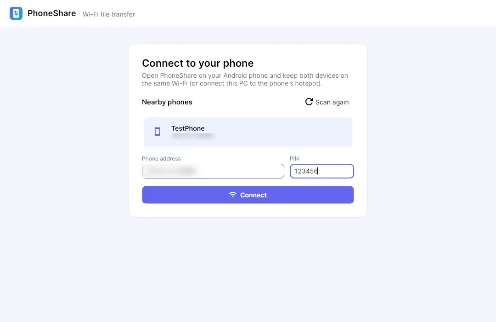
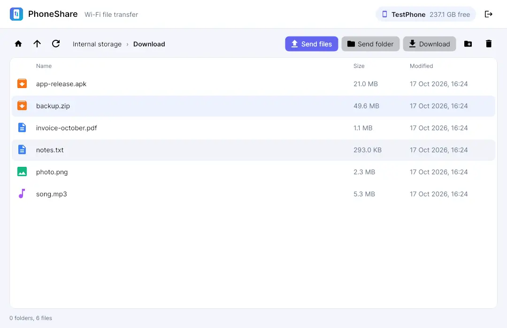
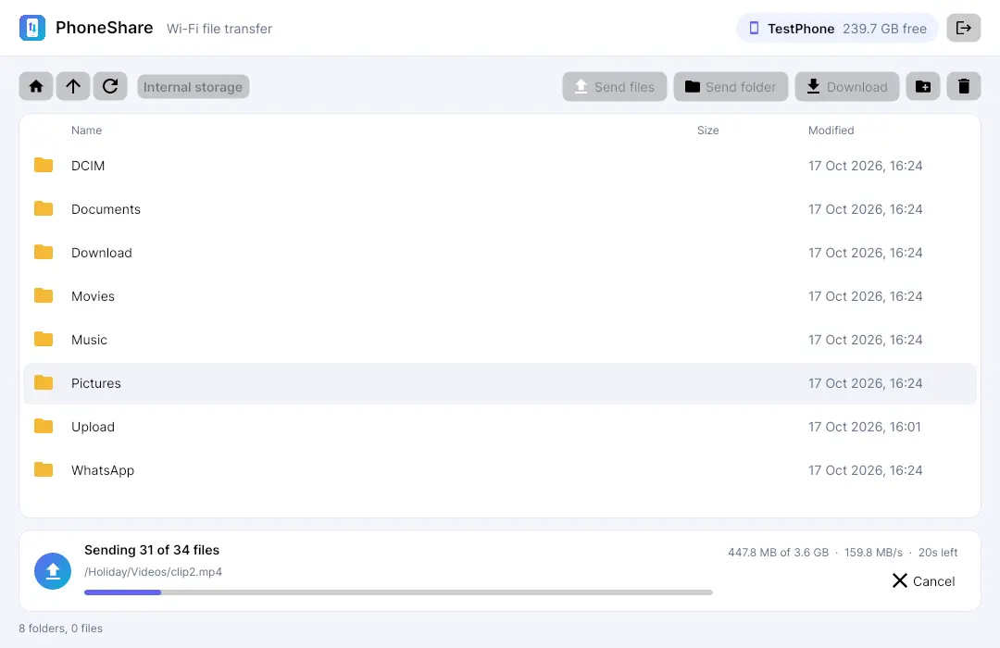

### Introduction
When you want to move files from your phone to your laptop, there are usually only two options: plug in a USB cable, or upload to the cloud and download again. USB cables on openSUSE can be a bit of a drama (MTP dropping out halfway through, who hasn't been there?). Uploading to the cloud doesn't make sense either when it's tens of GB, especially when the files are only moving from one side of the desk to the other.

But the phone and the laptop are already on the same Wi-Fi. So why not send things directly? That's how my side project **PhoneShare** was born.

This post isn't a tutorial, it's more me showing off the result a little 😁

### What is PhoneShare?
PhoneShare is a pair of apps: one on **Android** and one on the **PC**. Once they're connected, you can browse your phone from the PC, then send or pull files and folders in both directions, all over Wi-Fi.

The desktop app runs on **Windows** and **Linux**. For Linux there are `.rpm` and `.deb` packages (yes, I'm an openSUSE user, so `.rpm` was non-negotiable), and for Windows there's a `.exe` installer.

### Connecting the Phone

Open the app on the phone, open the app on the PC, and the phone shows up on its own under **Nearby phones**. No typing IP addresses by hand. So that not just anyone on the same Wi-Fi can peek into your phone, the connection has to be paired first with a **PIN** shown on the phone's screen.

If you're out and there's no Wi-Fi, the PC can also connect to the phone's hotspot.

### Browse Every Folder on the Phone

You can browse the phone like a regular file manager, not just the photos folder. `Download`, `Documents`, `WhatsApp`, they can all be opened. From here you can send a file or a whole folder to the phone, download to the PC, create new folders, or delete files you no longer need.

### Transfers That Don't Give Up Easily

This is the part I tinkered with the most, because my main use case really is moving big files and folders with hundreds of files in them. A few things that already work:

| Feature | Why it matters |
|---|---|
| **Parallel transfers** | Several files go at once, so a folder full of small files doesn't queue up one by one |
| **Resume** | Wi-Fi drops halfway? The transfer picks up from where it left off, not from zero |
| **Skip identical files** | Send the same folder again and files that already exist with the same contents are skipped |
| **Clear progress** | File count, size, speed, and estimated time remaining |

Resume is the feature I'm most grateful for. Before, sending a 4 GB video and having the Wi-Fi blink for a second meant starting all over again 😩

### The Look
Honestly, the first version was really stiff, gray buttons straight out of a 2000s app. Now it looks more modern, with icons per file type, breadcrumbs for folder navigation, and of course **dark mode**.

Under the hood, the desktop app is built with **.NET 8** and **Avalonia**, so the same code runs on Windows and Linux. Installers for each platform are built automatically by CI on every change.

### Wrapping Up
For now I'm the main user of PhoneShare, day to day, and so far it has replaced the USB cable on my desk. I've deliberately left out the technical details behind it here; maybe in a separate post.

That's it, hope it inspires you to build your own tools for everyday problems.
