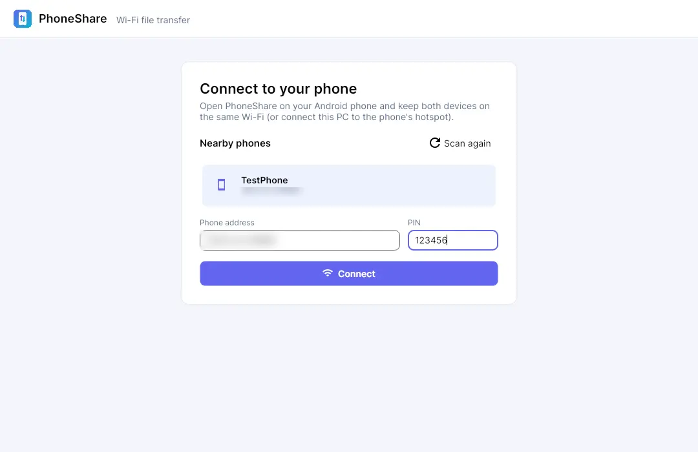
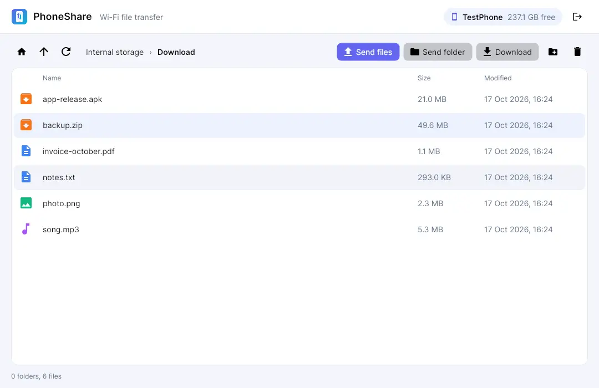
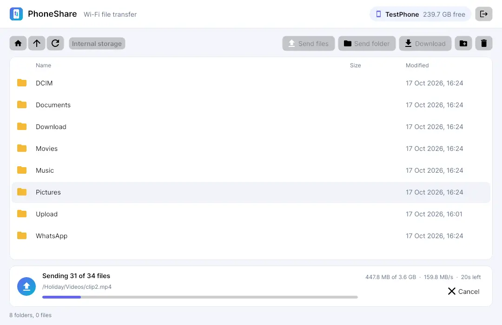

### Pendahuluan
Kalau mau mindahin file dari HP ke laptop, biasanya pilihannya cuma dua: colok kabel USB, atau upload dulu ke cloud lalu download lagi. Kabel USB di openSUSE kadang drama (MTP yang tiba - tiba putus di tengah jalan, siapa yang gak pernah?). Upload ke cloud juga gak masuk akal kalau ukurannya puluhan GB, apalagi file - nya cuma pindah dari meja ke meja.

Padahal HP dan laptop sudah ada di Wi-Fi yang sama. Jadi kenapa gak kirim langsung saja? Dari situ lahirlah proyek sampingan saya yang namanya **PhoneShare**.

Tulisan kali ini bukan tutorial ya, lebih ke pamer sedikit hasilnya 😁

### Apa itu PhoneShare?
PhoneShare adalah pasangan aplikasi: satu di **Android** dan satu lagi di **PC**. Begitu dua - duanya terhubung, kita bisa menjelajah isi HP dari PC, lalu kirim atau tarik file dan folder ke dua arah, semuanya lewat Wi-Fi.

Aplikasi desktop - nya jalan di **Windows** dan **Linux**. Untuk Linux sudah ada paket `.rpm` dan `.deb` (ya, saya pengguna openSUSE, jadi `.rpm` wajib hukumnya), sedangkan untuk Windows tinggal pakai installer `.exe`.

### Menyambungkan HP

Buka aplikasi di HP, buka aplikasi di PC, dan HP akan muncul sendiri di daftar **Nearby phones**. Gak perlu ketik alamat IP manual. Supaya gak sembarang orang di Wi-Fi yang sama bisa mengintip isi HP, koneksi harus dipasangkan dulu pakai **PIN** yang tampil di layar HP.

Kalau lagi di luar dan gak ada Wi-Fi, PC juga bisa nyambung ke hotspot HP.

### Jelajah Semua Folder di HP

Isi HP bisa dijelajahi seperti file manager biasa, gak cuma folder foto. `Download`, `Documents`, `WhatsApp`, semua bisa dibuka. Dari sini kita bisa kirim file atau satu folder utuh ke HP, download ke PC, bikin folder baru, atau hapus file yang sudah gak perlu.

### Transfer yang Gak Gampang Menyerah

Bagian ini yang paling banyak saya oprek, karena use case utama saya memang mindahin file besar dan folder yang isinya ratusan file. Beberapa hal yang sudah jalan:

| Fitur | Kenapa penting |
|---|---|
| **Transfer paralel** | Beberapa file dikirim sekaligus, jadi folder berisi banyak file kecil gak antre satu per satu |
| **Resume** | Wi-Fi putus di tengah jalan? Transfer lanjut dari posisi terakhir, gak mulai dari nol |
| **Skip file yang identik** | Kirim ulang folder yang sama, file yang sudah ada dan isinya sama dilewati |
| **Progress yang jelas** | Ada jumlah file, ukuran, kecepatan, dan estimasi sisa waktu |

Fitur resume ini yang paling saya syukuri. Sebelumnya, kirim video 4 GB lalu Wi-Fi kedip sedikit, ya sudah, ulang dari awal 😩

### Tampilan
Versi pertamanya jujur saja masih kaku banget, tombol - tombol abu - abu ala aplikasi tahun 2000-an. Sekarang tampilannya sudah lebih modern, ada ikon per jenis file, breadcrumb untuk navigasi folder, dan tentu saja **dark mode**.

Di balik layar, aplikasi desktop - nya dibangun dengan **.NET 8** dan **Avalonia**, jadi satu kode yang sama bisa jalan di Windows dan Linux. Installer untuk tiap platform dibuat otomatis lewat CI setiap ada perubahan.

### Penutup
Untuk sekarang PhoneShare masih saya pakai sendiri sehari - hari, dan sejauh ini sudah menggantikan kabel USB di meja saya. Detail teknis di balik layarnya sengaja belum saya ceritakan di sini, mungkin nanti di tulisan terpisah.

Sekian, semoga menginspirasi untuk bikin tools sendiri buat masalah sehari - hari.
