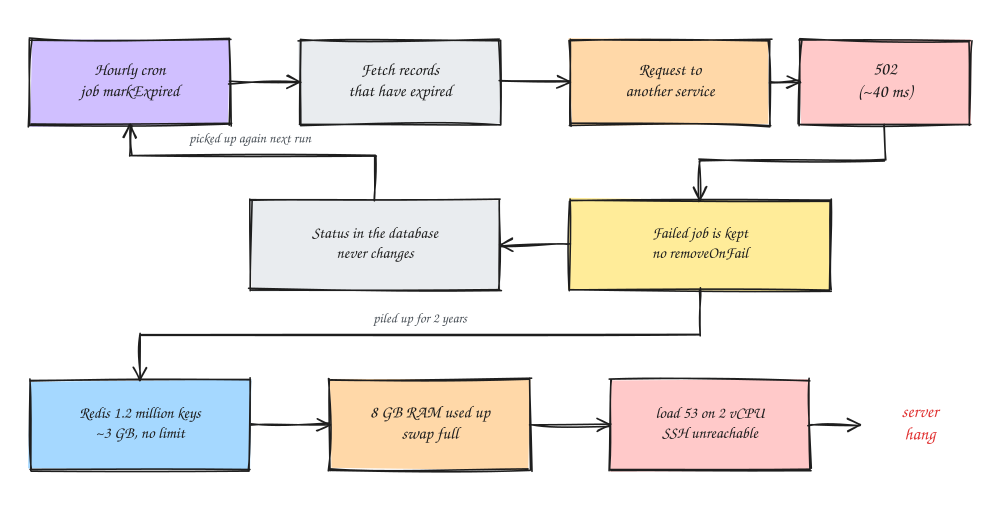

### Introduction
One afternoon, one of my dev servers on EC2 suddenly became unreachable; I couldn't even SSH in. My first guess was a full disk, since that had happened before (the story is in the [growing an EBS disk](/en/posts/resize-ebs-disk-ec2-without-downtime/) post). Wrong guess: after a few minutes I could get in again, and `htop` showed RAM almost exhausted.

The culprit was Redis. Redis on this dev box is used as a job queue for a Node.js app (the Bull library), and it turned out to hold **1.2 million keys**, nearly all of them failed jobs that had never been deleted, going back two years (seriously shocking). In this post I'll write down how I tracked it down and cleaned it up.

The server:
- EC2 with 2 vCPU, 8 GB RAM, 2 GB swap
- Redis 7.0 on the same host as the app
- A Node.js app using Bull v3 for job queues

### Symptoms
Once I got in, `htop` showed roughly this:

```
Mem  : 6.92G/7.69G
Swap : 1.48G/2.00G
Load average: 8.27 36.10 53.57
```

A 15-minute load average of **53** on a machine with only 2 vCPUs. That's the pattern of **memory pressure + swap thrashing**: RAM runs out, the system is busy shuffling data to swap, and sshd never gets a chance to respond. So the problem was RAM, not disk.

One small trap: in `htop` it first looked like `redis-server` showed up 5 times and added up to about 7 GB. That's because htop shows **threads**, but it's one process sharing the same memory. Press `Shift+H` to hide threads. Only then could I see Redis was really about **3 GB**, and the rest was other apps.

If the server really won't let you in, things to try: SSM Session Manager (it doesn't go through sshd), a reboot from the console, or, as a last resort, rescuing the volume onto another instance.

### Steps
1. Check Redis's memory
```
redis-cli INFO memory | grep -E 'used_memory_human|used_memory_rss_human|mem_fragmentation_ratio|maxmemory_human|maxmemory_policy'
redis-cli INFO keyspace
```
The result:
```
used_memory_human:2.96G
used_memory_rss_human:2.85G
maxmemory_human:0B
maxmemory_policy:noeviction
mem_fragmentation_ratio:0.96
# Keyspace
db0:keys=1200142,expires=104,avg_ttl=...
```
Three things jump out:
- `maxmemory` is 0, meaning **unlimited**, so Redis is allowed to eat RAM until there's none left.
- 1.2 million keys, and **only 104 have a TTL**. So almost all of them stay forever.
- `mem_fragmentation_ratio` below 1 means part of Redis's memory has already been swapped to disk. No wonder the server was crawling.

2. Find which keys take up the most
```
redis-cli --memkeys --memkeys-samples 100
```
This uses `SCAN`, so it's safe to run. The result showed that almost every key looked like `bull:<queue-name>:<id>`, which is a Bull job hash. Each key is small (2 to 20 KB), but multiply by a million and you get 3 GB.

To count keys per prefix:
```
redis-cli --scan --count 1000 | awk -F: '
  $1=="bull" {print "bull:"$2; next}
  {split($0,a,/[-_:]/); print a[1]}' | sort | uniq -c | sort -rn | head -25
```
One cron queue dominated; let's call it `cronExpire`. The `bull:cronExpire:failed` zset alone was 114 MB and held about **1.13 million failed jobs**, roughly 94% of all keys.

3. See why the jobs failed
```
ID=$(redis-cli ZREVRANGE bull:cronExpire:failed 0 0)
redis-cli HMGET bull:cronExpire:$ID failedReason attemptsMade
```
```
Request failed with status code 502
1
```
Then check when the first and last failures happened:
```
for r in "0 0" "-1 -1"; do
  S=$(redis-cli ZRANGE bull:cronExpire:failed $r WITHSCORES | tail -1)
  date -d @$((S/1000))
done
```
```
Thu Oct 10 18:00:01 UTC 2024
Fri Oct 16 05:00:08 UTC 2026
```
Yep, **failing nonstop for two years** and nobody noticed 🥲

`HGETALL` on a job also showed why they piled up:
- the job options only had `removeOnComplete: true`, **no `removeOnFail`**. Successful jobs get deleted right away; failed jobs are kept forever.
- this job (let's call it `markExpired`) marks expired data by calling another service. Since the request always returned 502, the status in the database never changed, so the same data got picked up again on the next run. Every hour, over and over.
- the 502 came back in ~40 ms (`finishedOn - processedOn`). That fast usually means the proxy rejected it immediately because the service behind it was down, not a timeout.



Note: be careful if you paste a job's `data` into team chat. It usually holds real data (names, amounts, links), so sharing just the `failedReason` is enough.

4. Confirm whether the library is Bull or BullMQ
```
redis-cli HGET bull:cronExpire:meta version
```
If it returns `bullmq:x.x.x`, it's BullMQ. In my case it was `(nil)`, and the `--memkeys` output earlier also showed 0 streams (BullMQ always creates a `bull:<queue>:events` stream), so the app was using **Bull v3**. This matters because the argument order of `clean()` differs between the two.

Oh, and `redis-cli -v` shows the Redis version, not the queue library's version. I mixed those up too at first.

5. Prepare a cleanup script

Don't just delete with `DEL bull:*`; it can break the queue structure (wait, active, repeat). Use the official `queue.clean()` function, which only removes `completed` and `failed` jobs, so jobs that are waiting or running aren't touched.
```
node -v && npm -v
sudo mkdir -p /opt/bullclean && sudo chown $USER /opt/bullclean
cd /opt/bullclean
npm init -y >/dev/null && npm i bull
```
```
vim /opt/bullclean/clean.js


............
const Queue = require('bull');
const redis = { host: '127.0.0.1', port: 6379 };
const GRACE_MS = Number(process.env.GRACE_HOURS || 24) * 3600 * 1000;

(async () => {
  for (const name of process.argv.slice(2)) {
    const q = new Queue(name, { redis });
    for (const type of ['completed', 'failed']) {
      let total = 0, n;
      do {
        // Bull: (grace, status, limit). For BullMQ: (grace, limit, status)
        n = (await q.clean(GRACE_MS, type, 5000)).length;
        total += n;
        if (n) process.stdout.write(`\r${name} ${type}: ${total}`);
      } while (n > 0);
      console.log(`\r${name} ${type}: ${total} removed`);
    }
    await q.close();
  }
  process.exit(0);
})();
```
`GRACE_HOURS` keeps the jobs from the last few hours, in case the backend team still needs them for debugging.

6. Test on a small queue first
```
cd /opt/bullclean
GRACE_HOURS=24 node clean.js email
```
If it works, you'll see output like this:
```
email completed: ... removed
email failed: ... removed
```

7. Clean the big queues

Open a second terminal tab to keep an eye on things:
```
watch -n5 "redis-cli INFO keyspace | grep db0; redis-cli INFO memory | grep used_memory_human"
```
Then in the first tab, start with the biggest queue. For `cronExpire` I only kept the last hour, since it was the same error over and over:
```
GRACE_HOURS=1 node clean.js cronExpire
```
```
cronExpire completed: 0 removed
cronExpire failed: 1134511 removed
```
It takes a few minutes for 1.1 million jobs. Then the other queues:
```
GRACE_HOURS=24 node clean.js pdf email notify export-file sync-account report
```
About 1.2 million jobs removed in total.

One tip: don't run `BGSAVE` before it's clean. It forks Redis, and with RAM nearly gone the server can go down again.

8. Give the memory back to the OS
```
redis-cli MEMORY PURGE
redis-cli INFO memory | grep -E 'used_memory_human|used_memory_rss_human'
redis-cli INFO keyspace
free -h
```
```
used_memory_human:19.41M
used_memory_rss_human:170.44M
db0:keys=2814,expires=120,avg_ttl=...
               total        used        free      shared  buff/cache   available
Mem:           7.7Gi       4.2Gi       2.8Gi       424Ki       1.0Gi       3.5Gi
Swap:          2.0Gi       2.0Gi        28Mi
```
Redis went from **2.96 GB to 19 MB**, and from 1.2 million keys to 2,814 🎉

Swap was still full because the pages that got swapped out hadn't come back to RAM yet. Since available RAM (3.5 GB) was now bigger than used swap (2 GB), it was safe to flush it:
```
sudo swapoff -a && sudo swapon -a
free -h
```

9. Set a memory limit on Redis

This is the most important part, so this can't hang the server again. Set it **after** Redis has shrunk; if you set it while Redis is still at 2.96 GB, every write gets rejected immediately and the app errors out.
```
redis-cli CONFIG SET maxmemory 2gb
redis-cli CONFIG GET maxmemory*
redis-cli CONFIG REWRITE
sudo grep -E '^maxmemory' /etc/redis/redis.conf
```
```
maxmemory 2gb
```
The policy stays `noeviction`. For a Redis that holds job queues, **don't use `allkeys-lru`**, because job keys can be evicted silently and jobs get lost. With `noeviction`, when it's full Redis rejects writes with an `OOM` error. The app logs errors, but the server stays alive and reachable over SSH. Much easier to notice.

If `CONFIG REWRITE` fails (for example, Redis runs without a config file), add it to `redis.conf` by hand:
```
maxmemory 2gb
maxmemory-policy noeviction
```

### What needs fixing in the app
The cleanup above is only a temporary fix. As long as the cron keeps getting 502s, failed jobs keep piling up (although at about 1,500 jobs a day, it takes over a year to hit 2 GB). What I reported to the backend team:
- Check whether the endpoint the `markExpired` job calls is still alive in dev. If the cron doesn't need to run in dev, just turn it off.
- Add `removeOnComplete` and `removeOnFail` to every queue, including repeat/cron jobs:
```
defaultJobOptions: {
  removeOnComplete: { age: 86400, count: 1000 },
  removeOnFail: { age: 604800, count: 1000 }
}
```
The `{ age, count }` form only exists in Bull 4.x and up. Older versions take a plain number, like `removeOnFail: 1000`.
- Give non-queue keys a TTL too. For example, a JWT blacklist where tokens are only valid for 10 minutes but are stored forever; `SET key 1 EX <exp - now>` is enough.
- Don't store big payloads (file contents) in job data. Put the file in object storage, and have the job carry just the key or URL.

On the DevOps side, worth adding:
- node_exporter alerts for memory above 85%, swap above 50%, and disk above 80%.
- redis_exporter to watch `redis_memory_used_bytes` and the key count. With these alerts, a two-year problem like this should get caught within days.
- Make sure Redis isn't exposed. On this server Redis listens on `0.0.0.0:6379`, so check the Security Group only opens that port to what needs it, and that `requirepass` is set.

Voilà, the dev server is back to normal and Redis has a limit now.

That's it, hope it helps.

### References
- [Bull: Queue#clean](https://github.com/OptimalBits/bull/blob/develop/REFERENCE.md#queueclean)
- [BullMQ: Auto-removal of jobs](https://docs.bullmq.io/guide/queues/auto-removal-of-jobs)
- [Redis: Key eviction (maxmemory)](https://redis.io/docs/latest/develop/reference/eviction/)
- [Redis: MEMORY PURGE](https://redis.io/docs/latest/commands/memory-purge/)
