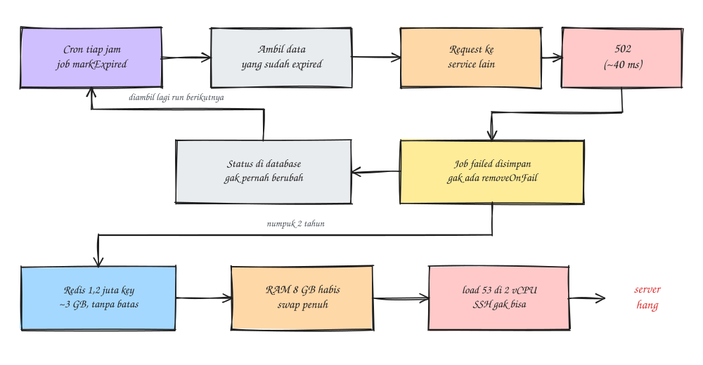

### Pendahuluan
Siang itu salah satu server dev saya di EC2 tiba-tiba gak bisa diakses, di-SSH pun gak bisa sama sekali. Dugaan pertama saya disk penuh, karena sebelumnya pernah kejadian (ceritanya ada di post [memperbesar disk EBS](/posts/resize-disk-ebs-ec2-tanpa-downtime/)). Ternyata salah, setelah beberapa menit server bisa dimasuki lagi dan `htop` menunjukkan RAM hampir habis.

Pelakunya Redis. Redis di dev ini dipakai untuk antrian job aplikasi Node.js (library Bull), dan isinya ternyata **1,2 juta key**, hampir semuanya job gagal yang gak pernah dihapus sejak dua tahun lalu (asli kaget). Di tulisan ini saya catat cara saya menelusuri dan membersihkannya.

Kondisi server:
- EC2 2 vCPU, RAM 8 GB, swap 2 GB
- Redis 7.0 di host yang sama dengan aplikasi
- Aplikasi Node.js pakai Bull v3 untuk antrian job

### Gejala
Begitu bisa masuk, `htop` menampilkan kira-kira seperti ini:

```
Mem  : 6.92G/7.69G
Swap : 1.48G/2.00G
Load average: 8.27 36.10 53.57
```

Load average 15 menit terakhir sampai **53** di mesin yang cuma 2 vCPU. Ini pola **memory pressure + swap thrashing**: RAM habis, sistem sibuk memindahkan data ke swap, dan sshd gak sempat merespons. Jadi masalahnya RAM, bukan disk.

Satu jebakan kecil: di `htop` awalnya kelihatan `redis-server` muncul 5 kali dan totalnya seperti 7 GB. Itu karena htop menampilkan **thread**, padahal itu satu proses yang berbagi memori yang sama. Tekan `Shift+H` untuk menyembunyikan thread. Setelah itu baru kelihatan Redis aslinya sekitar **3 GB**, sisanya aplikasi lain.

Kalau server benar-benar gak bisa dimasuki, jalur yang bisa dicoba: SSM Session Manager (gak lewat sshd), reboot dari console, atau terakhir rescue volume ke instance lain.

### Tahapan
1. Cek kondisi memori Redis
```
redis-cli INFO memory | grep -E 'used_memory_human|used_memory_rss_human|mem_fragmentation_ratio|maxmemory_human|maxmemory_policy'
redis-cli INFO keyspace
```
Hasilnya:
```
used_memory_human:2.96G
used_memory_rss_human:2.85G
maxmemory_human:0B
maxmemory_policy:noeviction
mem_fragmentation_ratio:0.96
# Keyspace
db0:keys=1200142,expires=104,avg_ttl=...
```
Ada tiga hal yang langsung kelihatan:
- `maxmemory` 0 alias **unlimited**, jadi Redis boleh makan RAM sampai habis.
- 1,2 juta key, dan **cuma 104 yang punya TTL**. Artinya hampir semuanya tinggal selamanya.
- `mem_fragmentation_ratio` di bawah 1, artinya sebagian memori Redis sudah ke-swap ke disk. Pantas servernya lemot parah.

2. Cari key mana yang paling banyak
```
redis-cli --memkeys --memkeys-samples 100
```
Perintah ini pakai `SCAN`, jadi aman dijalankan. Dari hasilnya kelihatan hampir semua key berbentuk `bull:<nama-queue>:<id>`, yaitu hash job Bull. Ukuran per key kecil (2 - 20 KB), tapi dikali sejuta ya jadi 3 GB.

Untuk menghitung key per prefix:
```
redis-cli --scan --count 1000 | awk -F: '
  $1=="bull" {print "bull:"$2; next}
  {split($0,a,/[-_:]/); print a[1]}' | sort | uniq -c | sort -rn | head -25
```
Hasilnya satu queue cron mendominasi, sebut saja `cronExpire`. Zset `bull:cronExpire:failed` saja ukurannya 114 MB, dan isinya sekitar **1,13 juta job gagal**, kira-kira 94% dari seluruh key.

3. Lihat kenapa job-nya gagal
```
ID=$(redis-cli ZREVRANGE bull:cronExpire:failed 0 0)
redis-cli HMGET bull:cronExpire:$ID failedReason attemptsMade
```
```
Request failed with status code 502
1
```
Lalu cek kapan gagal pertama dan terakhir:
```
for r in "0 0" "-1 -1"; do
  S=$(redis-cli ZRANGE bull:cronExpire:failed $r WITHSCORES | tail -1)
  date -d @$((S/1000))
done
```
```
Thu Oct 10 18:00:01 UTC 2024
Fri Oct 16 05:00:08 UTC 2026
```
Ya, **gagal terus sejak dua tahun lalu** dan gak ada yang sadar 🥲

Dari `HGETALL` job-nya ketemu juga penyebab kenapa bisa menumpuk:
- opsi job-nya cuma `removeOnComplete: true`, **tanpa `removeOnFail`**. Job sukses langsung dihapus, job gagal disimpan selamanya.
- job ini (sebut saja `markExpired`) tugasnya menandai data yang sudah expired dengan memanggil service lain. Karena request-nya selalu 502, status di database gak pernah berubah, jadi data yang sama diambil lagi di run berikutnya. Begitu terus tiap jam.
- 502-nya datang dalam ~40 ms (`finishedOn - processedOn`). Secepat itu biasanya berarti proxy langsung menolak karena service di belakangnya mati, bukan timeout.



Catatan: kalau kamu menempel isi `data` job ke chat tim, hati-hati. Biasanya isinya data asli (nama, nominal, link), jadi cukup kirim `failedReason`-nya saja.

4. Pastikan library-nya Bull atau BullMQ
```
redis-cli HGET bull:cronExpire:meta version
```
Kalau hasilnya `bullmq:x.x.x` berarti BullMQ. Di kasus saya hasilnya `(nil)`, dan `--memkeys` tadi juga menunjukkan 0 stream (BullMQ selalu bikin stream `bull:<queue>:events`), jadi aplikasinya pakai **Bull v3**. Ini penting karena urutan argumen `clean()` di keduanya beda.

Oh iya, `redis-cli -v` itu versi Redis-nya, bukan versi library antriannya. Saya sempat ketuker juga.

5. Siapkan script pembersih

Jangan hapus pakai `DEL bull:*` begitu saja, struktur queue (wait, active, repeat) bisa rusak. Pakai fungsi resmi `queue.clean()` yang cuma menghapus job `completed` dan `failed`, jadi job yang lagi antre atau jalan gak kesentuh.
```
node -v && npm -v
sudo mkdir -p /opt/bullclean && sudo chown $USER /opt/bullclean
cd /opt/bullclean
npm init -y >/dev/null && npm i bull
```
```
vim /opt/bullclean/clean.js


............
const Queue = require('bull');
const redis = { host: '127.0.0.1', port: 6379 };
const GRACE_MS = Number(process.env.GRACE_HOURS || 24) * 3600 * 1000;

(async () => {
  for (const name of process.argv.slice(2)) {
    const q = new Queue(name, { redis });
    for (const type of ['completed', 'failed']) {
      let total = 0, n;
      do {
        // Bull: (grace, status, limit). Kalau BullMQ: (grace, limit, status)
        n = (await q.clean(GRACE_MS, type, 5000)).length;
        total += n;
        if (n) process.stdout.write(`\r${name} ${type}: ${total}`);
      } while (n > 0);
      console.log(`\r${name} ${type}: ${total} dihapus`);
    }
    await q.close();
  }
  process.exit(0);
})();
```
`GRACE_HOURS` dipakai untuk menyisakan job beberapa jam terakhir, siapa tahu masih dibutuhkan tim backend untuk debug.

6. Tes dulu di queue kecil
```
cd /opt/bullclean
GRACE_HOURS=24 node clean.js email
```
Jika berhasil akan menampilkan output seperti berikut:
```
email completed: ... dihapus
email failed: ... dihapus
```

7. Bersihkan queue yang besar

Buka tab terminal kedua untuk memantau:
```
watch -n5 "redis-cli INFO keyspace | grep db0; redis-cli INFO memory | grep used_memory_human"
```
Lalu di tab pertama, mulai dari queue terbesar. Untuk `cronExpire` saya sisakan 1 jam terakhir saja karena isinya error yang sama berulang:
```
GRACE_HOURS=1 node clean.js cronExpire
```
```
cronExpire completed: 0 dihapus
cronExpire failed: 1134511 dihapus
```
Butuh beberapa menit untuk 1,1 juta job. Setelah itu queue lainnya:
```
GRACE_HOURS=24 node clean.js pdf email notify export-file sync-account report
```
Total sekitar 1,2 juta job terhapus.

Satu saran: jangan jalankan `BGSAVE` dulu sebelum bersih. Proses ini fork Redis, dan dengan RAM yang hampir habis server bisa down lagi.

8. Kembalikan memori ke OS
```
redis-cli MEMORY PURGE
redis-cli INFO memory | grep -E 'used_memory_human|used_memory_rss_human'
redis-cli INFO keyspace
free -h
```
```
used_memory_human:19.41M
used_memory_rss_human:170.44M
db0:keys=2814,expires=120,avg_ttl=...
               total        used        free      shared  buff/cache   available
Mem:           7.7Gi       4.2Gi       2.8Gi       424Ki       1.0Gi       3.5Gi
Swap:          2.0Gi       2.0Gi        28Mi
```
Redis turun dari **2,96 GB ke 19 MB**, dan key dari 1,2 juta ke 2.814 🎉

Swap masih penuh karena halaman yang tadi di-swap belum balik ke RAM. Karena RAM tersedia (3,5 GB) sudah lebih besar dari swap terpakai (2 GB), aman untuk dikosongkan:
```
sudo swapoff -a && sudo swapon -a
free -h
```

9. Pasang batas memori Redis

Ini yang paling penting supaya kejadian ini gak bikin server hang lagi. Pasang **setelah** Redis sudah turun, kalau dipasang saat Redis masih 2,96 GB semua write langsung ditolak dan aplikasi error.
```
redis-cli CONFIG SET maxmemory 2gb
redis-cli CONFIG GET maxmemory*
redis-cli CONFIG REWRITE
sudo grep -E '^maxmemory' /etc/redis/redis.conf
```
```
maxmemory 2gb
```
Policy-nya tetap `noeviction`. Untuk Redis yang isinya antrian job, **jangan pakai `allkeys-lru`**, karena key job bisa ikut terhapus diam-diam dan job hilang. Dengan `noeviction`, saat penuh Redis menolak write dengan error `OOM`. Aplikasinya yang error di log, tapi servernya tetap hidup dan bisa di-SSH. Jauh lebih gampang ketahuan.

Kalau `CONFIG REWRITE` gagal (misalnya Redis jalan tanpa file config), tambahkan manual di `redis.conf`:
```
maxmemory 2gb
maxmemory-policy noeviction
```

### Yang perlu dibenahi di aplikasi
Pembersihan di atas cuma obat sementara. Selama cron-nya masih 502, job gagal akan terus bertambah (walaupun dengan laju sekitar 1.500 job per hari, butuh lebih dari setahun untuk mentok di 2 GB). Yang saya laporkan ke tim backend:
- Cek endpoint yang dipanggil job `markExpired`, masih hidup di dev atau gak. Kalau cron-nya gak perlu jalan di dev, dimatikan saja.
- Tambahkan `removeOnComplete` dan `removeOnFail` di semua queue, termasuk job repeat/cron:
```
defaultJobOptions: {
  removeOnComplete: { age: 86400, count: 1000 },
  removeOnFail: { age: 604800, count: 1000 }
}
```
Bentuk `{ age, count }` hanya ada di Bull 4.x ke atas. Versi lebih lama pakai angka saja, misalnya `removeOnFail: 1000`.
- Key non-antrian juga diberi TTL. Contohnya blacklist JWT yang tokennya cuma berlaku 10 menit tapi disimpan permanen, cukup `SET key 1 EX <exp - now>`.
- Jangan simpan payload besar (isi file) di data job. Simpan file-nya di object storage, job cukup bawa key atau URL-nya.

Dari sisi DevOps, yang sebaiknya ditambahkan:
- Alert dari node_exporter kalau memory di atas 85%, swap di atas 50%, dan disk di atas 80%.
- redis_exporter untuk memantau `redis_memory_used_bytes` dan jumlah key. Dengan alert ini masalah dua tahun seperti tadi harusnya ketahuan dalam hitungan hari.
- Pastikan Redis gak terbuka ke luar. Di server ini Redis listen di `0.0.0.0:6379`, jadi cek Security Group hanya membuka port itu untuk yang perlu, dan `requirepass` sudah di-set.

Voila, server dev normal lagi dan Redis-nya sudah punya batas.

Sekian, semoga membantu.

### Referensi
- [Bull: Queue#clean](https://github.com/OptimalBits/bull/blob/develop/REFERENCE.md#queueclean)
- [BullMQ: Auto-removal of jobs](https://docs.bullmq.io/guide/queues/auto-removal-of-jobs)
- [Redis: Key eviction (maxmemory)](https://redis.io/docs/latest/develop/reference/eviction/)
- [Redis: MEMORY PURGE](https://redis.io/docs/latest/commands/memory-purge/)
