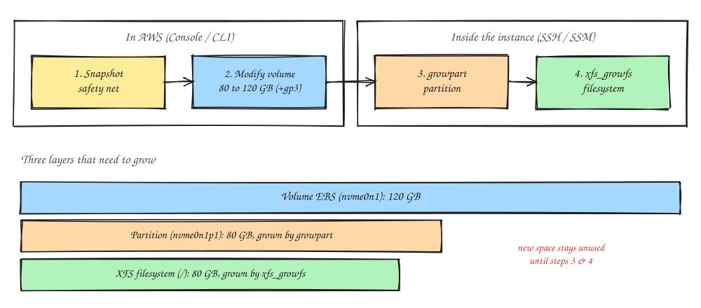

### Introduction
The root disk on one of my production MongoDB servers was 85% full (68 of 80 GB). Before it filled up and caused a panic, I grew it to 120 GB. Luckily on EC2 this can be done **online**, without a reboot and without stopping MongoDB.

One thing that often confuses people: after you change the volume size in the console, `df` still shows the old size. That's because there are three layers that need to grow, and AWS only takes care of the first one.



The example in this post uses Amazon Linux 2023 with an XFS root filesystem on `/dev/nvme0n1p1`.

### Requirements
- An EC2 instance with an EBS volume
- Access to the AWS Console (or AWS CLI)
- SSH or Session Manager access to the instance

### Steps
1. Check the starting point
```
df -hT
```
The output looks like this:
````
Filesystem       Type      Size  Used Avail Use% Mounted on
/dev/nvme0n1p1   xfs        80G   68G   13G  85% /
tmpfs            tmpfs     3.8G     0  3.8G   0% /tmp
/dev/nvme0n1p128 vfat       10M  1.4M  8.7M  14% /boot/efi
````
Two important things show up here: the filesystem type is **XFS** (which decides the resize command later), and `/tmp` is an empty tmpfs. The second one matters because `growpart` needs a bit of space in `/tmp`. If the root disk is already at 100% and `/tmp` lives on root, `growpart` can fail.

It's also worth checking what's eating the space first. If it turns out to be piled-up logs, adding disk only postpones the problem
```
sudo du -xh --max-depth=1 / | sort -rh | head -20
sudo du -xh --max-depth=1 /var/log | sort -rh | head
```

2. Take a snapshot first. This is production, so don't skip it.
   - EC2 > Instances > select the instance > Storage tab > click the root device's Volume ID > Actions > Create snapshot

Or with the CLI
```
aws ec2 create-snapshot --volume-id <volume-id> \
  --description "pre-resize $(date +%F)"
```
A volume's first snapshot is a full copy to S3, so it can take 15 to 40 minutes and sit in `pending` for a while. **You don't need to wait for `completed`.** EBS snapshots are point-in-time: once created, the data is locked in as of that moment. `pending` just means the transfer to S3 is still running in the background, and the resize doesn't interfere with a snapshot in progress.

Note: this snapshot is *crash*-consistent, not application-consistent. If you restore it, the result is the same as a server that lost power, and MongoDB will replay its journal on startup. If you need a truly clean snapshot of a standalone MongoDB, run `db.fsyncLock()` before the snapshot and `db.fsyncUnlock()` after.

3. Modify the volume
   - Volume page > Actions > Modify volume
````
Size : 120
Volume type : gp3
Modify > Confirm
````
Or with the CLI
```
aws ec2 modify-volume --volume-id <volume-id> --size 120

aws ec2 describe-volumes-modifications --volume-id <volume-id> \
  --query 'VolumesModifications[].{state:ModificationState,progress:Progress}'
```
Wait until the state becomes `optimizing` (in the console: `in-use - optimizing`). Once it's `optimizing`, the new capacity is usable; no need to wait for `completed`.

4. Log in to the instance and grow the partition. This part isn't in the console.
```
lsblk
```
What you're looking for: the `nvme0n1` disk is already 120G, but the `nvme0n1p1` partition is still 80G. If the disk itself is still 80G, the volume modification hasn't reached `optimizing` yet, so give it a moment.
```
sudo growpart /dev/nvme0n1 1
```
Note the **space** between the disk name and the number `1`. If it works, you'll see something like `CHANGED: partition=1 start=... old: size=... new: size=...`.

About the EFI partition `nvme0n1p128`: on Amazon Linux 2023 it sits at the start of the disk, so `p1` is still the last partition and `growpart` can use the free space right after it. If you want to be sure, `p1` should have the largest End sector
```
sudo sgdisk -p /dev/nvme0n1
```
If `growpart` says `NOCHANGE: partition 1 ... cannot be grown`, the OS hasn't seen the new size yet. Refresh it with the command below, then run `lsblk` again
```
sudo sh -c 'echo 1 > /sys/class/block/nvme0n1/device/rescan_controller'
```

5. Grow the filesystem. For XFS (the Amazon Linux default):
```
sudo xfs_growfs -d /
```
XFS can grow while **mounted**, which is what makes the whole thing downtime-free. If the filesystem is ext4, the command is:
```
sudo resize2fs /dev/nvme0n1p1
```

6. Verify
```
df -hT /
```
Now `/` is around 120G, and Use% drops from 85% to about 57%. MongoDB kept running the whole time.

Voilà, the disk is bigger with zero downtime.

### Switch to gp3 While You're at It?
If the volume is still **gp2**, it's a good idea to switch it to **gp3** in the same Modify form. Here's why:
1. **Performance.** gp2 gives IOPS based on size, 3 IOPS per GB. At 80 GB that's only 240 IOPS (even 120 GB is just 360), and the rest depends on burst credits that can run out. gp3 gives a flat **3000 IOPS and 125 MB/s** regardless of size. For a database whose data is much bigger than RAM, you'll feel this straight away in query latency.
2. **Price.** gp3 is about 20% cheaper per GB.

The switch is also online, with no reboot, and doesn't touch the data. The key is to **do it in the same single Modify**, because after a modification finishes the volume has a *cooldown* of about 6 hours before it can be changed again.

### Summary

| Step | Where | Command / menu |
|---|---|---|
| Snapshot | AWS | Actions > Create snapshot (no need to wait for `completed`) |
| Resize volume (+ gp3) | AWS | Actions > Modify volume, wait for `optimizing` |
| Grow the partition | Instance | `sudo growpart /dev/nvme0n1 1` |
| Grow the filesystem | Instance | `sudo xfs_growfs -d /` (XFS) or `resize2fs` (ext4) |
| Verify | Instance | `df -hT /` |

Finally, adding disk is a short-term fix. If what's growing is data (not logs), especially when it's already much bigger than RAM, keep an eye on the trend and also consider upsizing the instance or setting up data retention, so you're not repeating this every few months.

That's it, hope it helps.

References:
- [Extend the file system after resizing an EBS volume](https://docs.aws.amazon.com/ebs/latest/userguide/recognize-expanded-volume-linux.html)
