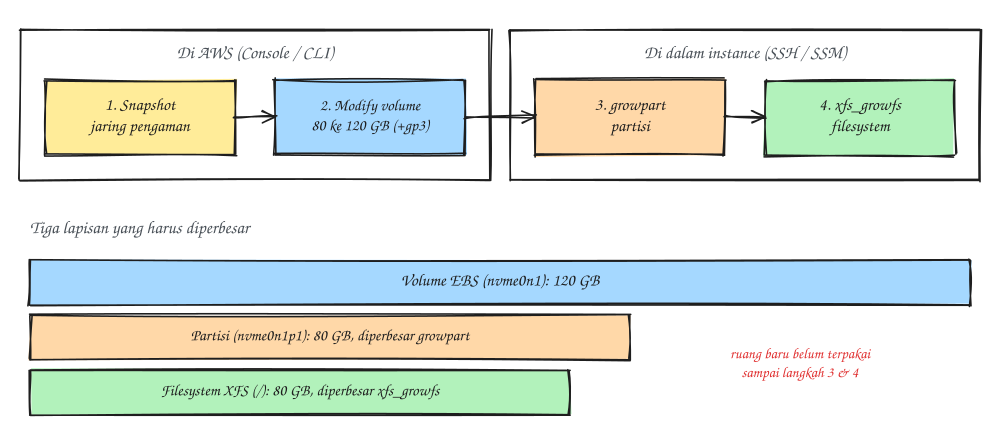

### Pendahuluan
Disk root salah satu server MongoDB production saya sudah terpakai 85% (68 dari 80 GB). Sebelum mentok dan bikin panik, saya perbesar jadi 120 GB. Untungnya di EC2 ini bisa dilakukan **online**, tanpa reboot dan tanpa stop MongoDB.

Satu hal yang sering bikin bingung: setelah ukuran volume diubah di console, `df` tetap menunjukkan ukuran lama. Itu karena ada tiga lapisan yang harus diperbesar, dan AWS cuma mengurus lapisan pertama.



Contoh di tulisan ini pakai Amazon Linux 2023 dengan root filesystem XFS di `/dev/nvme0n1p1`.

### Kebutuhan
- Instance EC2 dengan volume EBS
- Akses ke AWS Console (atau AWS CLI)
- Akses SSH atau Session Manager ke instance

### Tahapan
1. Cek kondisi awal
```
df -hT
```
Outputnya seperti berikut:
````
Filesystem       Type      Size  Used Avail Use% Mounted on
/dev/nvme0n1p1   xfs        80G   68G   13G  85% /
tmpfs            tmpfs     3.8G     0  3.8G   0% /tmp
/dev/nvme0n1p128 vfat       10M  1.4M  8.7M  14% /boot/efi
````
Dari sini kelihatan dua hal penting: tipe filesystem-nya **XFS** (menentukan perintah resize nanti), dan `/tmp` berupa tmpfs yang kosong. Yang kedua ini penting karena `growpart` butuh sedikit ruang di `/tmp`. Kalau disk root sudah 100% dan `/tmp` ikut di root, `growpart` bisa gagal.

Ada baiknya juga cek dulu apa yang makan tempat. Kalau ternyata log yang menumpuk, nambah disk cuma menunda masalah
```
sudo du -xh --max-depth=1 / | sort -rh | head -20
sudo du -xh --max-depth=1 /var/log | sort -rh | head
```

2. Buat snapshot dulu. Ini production, jadi jangan dilewati ya.
   - EC2 > Instances > pilih instance > tab Storage > klik Volume ID root device > Actions > Create snapshot

Atau lewat CLI
```
aws ec2 create-snapshot --volume-id <volume-id> \
  --description "pre-resize $(date +%F)"
```
Snapshot pertama sebuah volume itu full copy ke S3, jadi bisa makan 15 - 40 menit dan statusnya lama di `pending`. **Gak perlu nunggu sampai `completed`.** Snapshot EBS itu point-in-time, begitu dibuat kondisi datanya sudah terkunci pada saat itu. Status `pending` cuma berarti transfer ke S3 masih jalan di background, dan resize gak mengganggu snapshot yang sedang jalan.

Catatan: snapshot ini konsisten di level *crash*, bukan aplikasi. Kalau di-restore, hasilnya sama seperti server yang mati mendadak, dan MongoDB akan replay journal waktu start. Kalau butuh snapshot yang benar - benar bersih untuk MongoDB standalone, jalankan `db.fsyncLock()` sebelum snapshot dan `db.fsyncUnlock()` setelahnya.

3. Modify volume
   - Halaman volume > Actions > Modify volume
````
Size : 120
Volume type : gp3
Modify > Confirm
````
Atau lewat CLI
```
aws ec2 modify-volume --volume-id <volume-id> --size 120

aws ec2 describe-volumes-modifications --volume-id <volume-id> \
  --query 'VolumesModifications[].{state:ModificationState,progress:Progress}'
```
Tunggu sampai state jadi `optimizing` (di console: `in-use - optimizing`). Begitu masuk `optimizing`, kapasitas baru sudah bisa dipakai, gak perlu nunggu `completed`.

4. Masuk ke instance, lalu perbesar partisi. Bagian ini gak ada di console.
```
lsblk
```
Yang dicari: disk `nvme0n1` sudah 120G, tapi partisi `nvme0n1p1` masih 80G. Kalau disk-nya masih 80G juga, berarti modify volume belum sampai `optimizing`, tunggu sebentar.
```
sudo growpart /dev/nvme0n1 1
```
Perhatikan **spasi** antara nama disk dan angka `1`. Jika berhasil akan menampilkan output kurang lebih `CHANGED: partition=1 start=... old: size=... new: size=...`.

Soal partisi EFI `nvme0n1p128`: di Amazon Linux 2023 letaknya di awal disk, jadi `p1` tetap partisi terakhir dan `growpart` bisa langsung pakai ruang kosong di belakangnya. Kalau mau memastikan, `p1` seharusnya punya End sector paling besar
```
sudo sgdisk -p /dev/nvme0n1
```
Kalau `growpart` bilang `NOCHANGE: partition 1 ... cannot be grown`, OS belum melihat ukuran barunya. Refresh dulu dengan perintah berikut, lalu ulangi `lsblk`
```
sudo sh -c 'echo 1 > /sys/class/block/nvme0n1/device/rescan_controller'
```

5. Perbesar filesystem. Untuk XFS (default Amazon Linux):
```
sudo xfs_growfs -d /
```
XFS bisa di-grow dalam keadaan **mounted**, inilah yang bikin prosesnya tanpa downtime. Kalau filesystem-nya ext4, perintahnya:
```
sudo resize2fs /dev/nvme0n1p1
```

6. Verifikasi
```
df -hT /
```
Sekarang `/` sekitar 120G, dan Use% turun dari 85% ke sekitar 57%. MongoDB tetap jalan terus selama proses ini.

Voila, disk berhasil diperbesar tanpa downtime.

### Sekalian Pindah ke gp3?
Kalau volume-nya masih **gp2**, sebaiknya sekalian ganti ke **gp3** di form Modify yang sama. Alasannya:
1. **Performa.** gp2 kasih IOPS sesuai ukuran, 3 IOPS per GB. Di 80 GB itu cuma 240 IOPS (120 GB pun baru 360), sisanya tergantung burst credit yang bisa habis. gp3 kasih **3000 IOPS dan 125 MB/s** tetap, berapa pun ukurannya. Untuk database yang datanya jauh lebih besar dari RAM, ini langsung kerasa di latensi query.
2. **Harga.** gp3 sekitar 20% lebih murah per GB.

Pindahnya juga online, tanpa reboot, dan gak menyentuh data. Yang penting **lakukan dalam satu kali Modify yang sama**, karena setelah modify selesai volume kena *cooldown* sekitar 6 jam sebelum bisa diubah lagi.

### Ringkasan

| Langkah | Di mana | Perintah / menu |
|---|---|---|
| Snapshot | AWS | Actions > Create snapshot (gak perlu tunggu `completed`) |
| Resize volume (+ gp3) | AWS | Actions > Modify volume, tunggu `optimizing` |
| Perbesar partisi | Instance | `sudo growpart /dev/nvme0n1 1` |
| Perbesar filesystem | Instance | `sudo xfs_growfs -d /` (XFS) atau `resize2fs` (ext4) |
| Verifikasi | Instance | `df -hT /` |

Terakhir, nambah disk itu solusi jangka pendek. Kalau yang tumbuh itu data (bukan log), apalagi datanya sudah jauh lebih besar dari RAM, pantau trennya dan pertimbangkan juga upsize instance atau atur retensi data, biar gak mengulang langkah ini tiap beberapa bulan.

Sekian, semoga membantu.

Referensi:
- [Extend the file system after resizing an EBS volume](https://docs.aws.amazon.com/ebs/latest/userguide/recognize-expanded-volume-linux.html)
