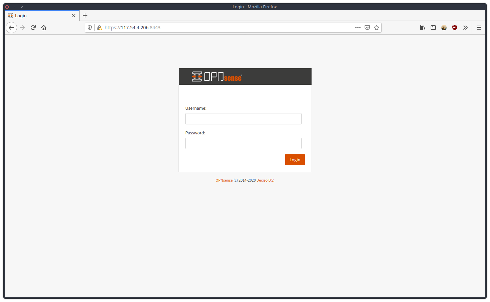

[OPNsense](https://opnsense.org/) is an open source, FreeBSD-based firewall project.



Here is how to configure HAProxy on OPNsense.

### 1. Firewall configuration for HAProxy
1. Create 2 port forwards in the firewall config
   - Firewall > NAT > Port Forward > + New Rule
````
Interface : LAN
TCP/IP Ver : IPv4
Protocol : TCP
Source : any
Destination port range : From - HTTP , to - HTTP 
Redirect target IP : #IPADDRESSOPNSENSE
Redirect target port : HTTP
SAVE

Interface : LAN
TCP/IP Ver : IPv4
Protocol : TCP
Source : any
Destination port range : From - HTTPS , to - HTTPS
Redirect target IP : #IPADDRESSOPNSENSE
Redirect target port : HTTP
SAVE

````
2. Create floating rules
    - Firewall > Rules Floating > + New Rule
````
Action : Pass
Interface : LAN
Direction : in 
TCP/IP ver : IPv4
Protocol : TCP 
Source : any 
Destination : Lan Address
Destination port range : From - HTTP , to - HTTP 

Action : Pass
Interface : LAN
Direction : in 
TCP/IP ver : IPv4
Protocol : TCP 
Source : any 
Destination : Lan Address
Destination port range : From - HTTPS , to - HTTPS
````
### 2. HAProxy configuration
- Service > HAProxy > Setting

#### Add a server
````
Real Servers > Real Servers > + add
Name : test-http
FQDN or IP  : #IPPUBLICSERVER
Port : 80
SAVE
````
#### Add a backend pool
````
Virtual Services > Backend Pool > + add
Name : test_http
Mode : Layer 7 
Servers : test-http
SAVE
````
#### Add conditions
````
Rules and Check > Conditions > + add
Name: test-http
Condition type : Host Matches
Host String : test-http
````
#### Add rules for the 443 frontend
````
Rules and Check > Rules > + add
Name : pass_https_test_http
Select Condition : test-http
Execute function : Use specified Backend Pool
Use backend pool : test_http
````
#### Add rules for the 80 frontend (to redirect traffic to https)
````
Rules and Check > Rules > + add 
Name : redirect_to_https_http
Select Condition : test-http
Execute function : http-request redirect
HTTP Redirect  : scheme https
````
#### Add a frontend for port 80
````
Virtual Services > Public Services > + add
Name : FrontEndHTTP
Listen address : 0.0.0.0:80
Select Rules : redirect_to_https_http
````
#### Add a frontend for port 443
````
Virtual Services > Public Services > + add
Name : FrontEndHTTPS
Listen address : 0.0.0.0:443
Enable SSL offloading : (✓)
Certificates : test-http # Make sure the certificate is already imported into OPNsense
Select Rules : pass_https_test_http
````
