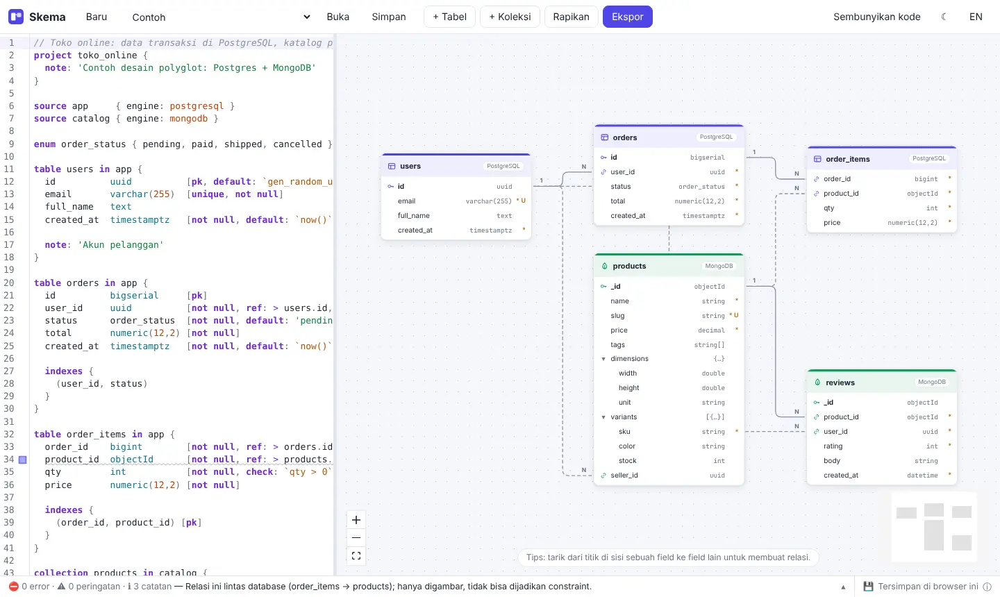
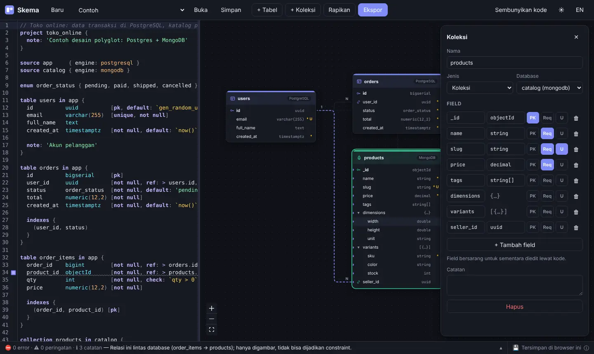
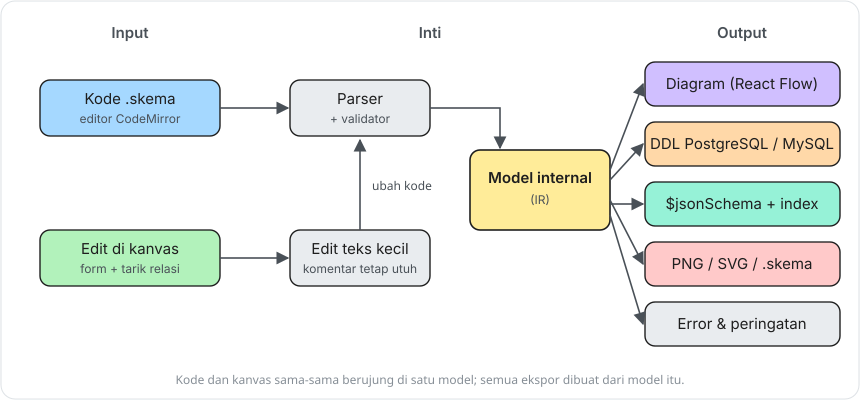
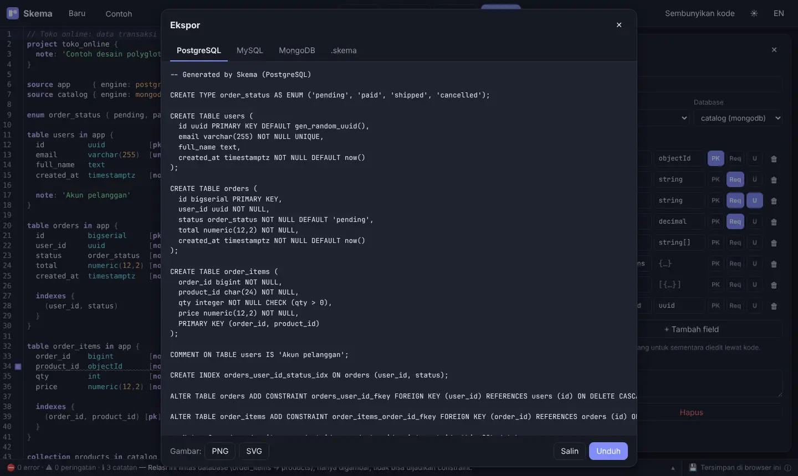
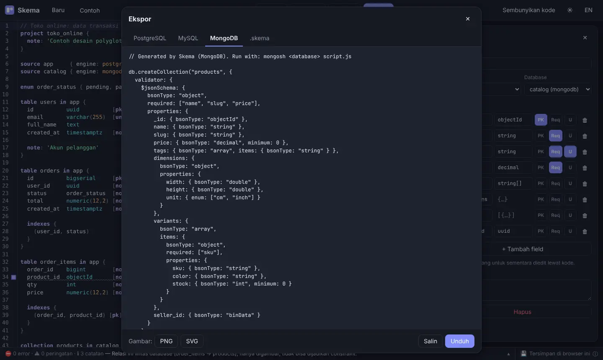

### Introduction
When I want to draw a database structure, I usually open dbdiagram.io. It's nice: just type and the diagram appears. The trouble starts when a project uses PostgreSQL **and** MongoDB at the same time. dbdiagram only understands SQL, so Mongo collections with nested objects and arrays of objects can't be drawn properly (they end up written by hand in notes, which is really not fun to read).

On top of that, some fairly important features are locked behind the paid plan. So I ended up building my own. It's called **Skema**, and the repo is `ddl-drawing`.

This post isn't a tutorial, it's more the story of the project and me showing off the result a little 😁

### What is Skema?
Skema is a tool for drawing and designing databases that runs in the browser. The idea is similar to dbdiagram.io, with a few differences:

| | dbdiagram.io | Skema |
|---|---|---|
| License | Closed source, with premium features | Open source (MIT), every feature free |
| Databases | SQL only | SQL **and** MongoDB, mixed in one diagram |
| Editing | Mainly through code | Through code **or** directly on the canvas, both in sync |
| Data | Stored on their servers | In your own browser, never sent anywhere |
| UI language | English | Indonesian and English |



In the example above, the `users`, `orders`, and `order_items` tables live in PostgreSQL, while `products` and `reviews` live in MongoDB. SQL cards are purple and Mongo cards are green, so you can see which database each one lives in. (The screenshots in this post use the Indonesian UI.)

### The Language
The syntax is deliberately similar to DBML (the language dbdiagram uses), so people who already use dbdiagram don't have to learn from scratch. What I added is a `source` block to say which database something lives in, and `collection` for MongoDB, complete with nested objects `{ }`, arrays `[]`, and arrays of objects `[{ }]`.

Here's an example:

```
source app     { engine: postgresql }
source catalog { engine: mongodb }

table users in app {
  id     uuid          [pk, default: `gen_random_uuid()`]
  email  varchar(255)  [unique, not null]
}

collection products in catalog {
  _id        objectId  [pk]
  name       string    [required]
  tags       string[]
  dimensions {
    width   double
    height  double
  }
  variants [{
    sku    string  [required]
    stock  int     [default: 0, min: 0]
  }]
  seller_id  uuid  [ref: > users.id]   // cross-database relation
}
```

Relations use the same symbols as DBML: `>` many-to-one, `<` one-to-many, `-` one-to-one, and `<>` many-to-many. For many-to-many, a join table is created automatically when exporting to SQL.

There are also **portable types** like `string`, `int`, `decimal`, `datetime`, `uuid`. These get translated for each database, so `string` becomes `text` in PostgreSQL, `varchar(255)` in MySQL, and `string` in MongoDB. That means one design can move from Postgres to MySQL without editing types one by one.

### Don't Want to Type? Edit on the Canvas
This is the part I think matters most. Not everyone enjoys writing syntax, especially non-developer teammates who still need to read the database design.



A few things you can do right on the canvas:
- **+ Tabel / + Koleksi** (+ Table / + Collection) to add a new entity.
- Click a card to rename it, add fields, set types, PK, required, unique, or delete. Renaming a table also updates every relation that points to it.
- Drag from the dot next to a field to another field to create a relation.
- Double-click a card's title to jump to its code.
- **Rapikan** (Tidy up) to rearrange the cards automatically.

Every edit on the canvas immediately changes the code on the left, and the other way around.

### Behind the Scenes
The part that gave me the biggest headache was that two-way sync. The easy way is to rewrite the whole code from scratch on every canvas edit. But then the comments and formatting the user wrote carefully would disappear (who wouldn't be annoyed by that).

So I set up the flow like this:



1. The `.skema` code is read by a parser and turned into a single **internal model** (IR).
2. Canvas edits don't rewrite all the code; they only change a small piece of text at the right spot. The result is parsed again, so it still goes through the same path.
3. Every output (diagram, DDL, Mongo script, images) is generated from that internal model.

I wrote the parser myself without a library, so its error messages could be friendly and in Indonesian. For example, a cross-database relation like `order_items.product_id` to `products._id` can't become a constraint, so Skema just draws it and adds a note in the bottom bar.

The stack:
- **TypeScript** for everything, in one pnpm monorepo
- `packages/core` holds the parser, validator, and generators, pure TypeScript with no UI, so it works in both the web app and the CLI
- **React** + **Vite** for the web app
- **CodeMirror 6** for the code editor (with syntax highlighting and autocomplete)
- **React Flow** for the canvas, **ELK.js** for auto-layout
- **Zustand** for state

### Export
Once the design is done, just click **Ekspor** (Export). The result can be copied or downloaded.



For MongoDB collections, the result is a `db.createCollection()` script with a `$jsonSchema` validator and indexes, ready to run with `mongosh`.



Available formats:
- **PostgreSQL** and **MySQL** DDL
- **MongoDB** script (`$jsonSchema` + `createIndex`)
- **PNG** and **SVG** images
- A `.skema` file with the card positions, nice to commit to Git

There's also a small CLI if you want to export without opening a browser, for example in a pipeline:

```
pnpm skema check  examples/toko-online.skema --lang id
pnpm skema export examples/toko-online.skema --to postgres
pnpm skema export examples/chat-app.skema --to mongodb -o schema.js
```

### Your Data Stays in Your Browser
Diagrams are saved automatically in the browser's local storage (localStorage); nothing is sent to a server. In the bottom right corner there's a **Saved in this browser** badge; click it for an explanation plus a button to save a backup to a `.skema` file. If the browser blocks storage (private mode, for example), Skema warns you so your work doesn't vanish when the tab closes.

Since the build output is just a static site, Skema can be hosted anywhere. I deploy it to Vercel.

### What Gave Me Headaches
A few things I ran into while testing before using it for real:
- **The Vercel deploy failed** with `STATIC_BUILD_NO_OUT_DIR`. It turned out the `vercel.json` I'd added myself had the wrong output path. The fix was to delete it, point Vercel's *Root Directory* at `apps/web`, and let Vercel detect Vite on its own.
- **An unclosed bracket** like `varchar(` made the parser "swallow" the rest of the file, so every table below it vanished from the diagram. Now the parser stops right there and the rest of the diagram still shows.
- **The toolbar on phones** got cut off. Now it's a single row you can scroll sideways.
- I swapped the browser's built-in popup (`confirm()`) for my own dialog, so it looks consistent and works with the keyboard.

### What's Next
There's still a lot I want to add:
- Import from SQL DDL and DBML, to make moving from dbdiagram easy
- Import from sample MongoDB JSON documents (schema guessed automatically)
- More dialects: SQLite, SQL Server, MariaDB
- Diffing two versions of a diagram into an `ALTER TABLE` migration script
- A design linter, for things like "this foreign key has no index" or "table without a primary key"

### Wrapping Up
The first version still focuses on the basics: draw, edit, and export. But for projects that mix PostgreSQL and MongoDB, it's already much nicer than writing notes by hand next to the diagram.

That's it, hope it inspires you to build your own tools for everyday problems.

### References
- [DBML, the language dbdiagram.io uses](https://dbml.dbdiagram.io/docs/)
- [MongoDB: Schema Validation with $jsonSchema](https://www.mongodb.com/docs/manual/core/schema-validation/)
- [React Flow](https://reactflow.dev/)
- [CodeMirror 6](https://codemirror.net/)
- [ELK.js](https://github.com/kieler/elkjs)
