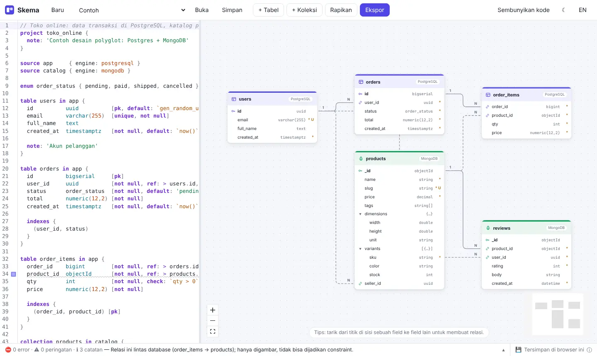
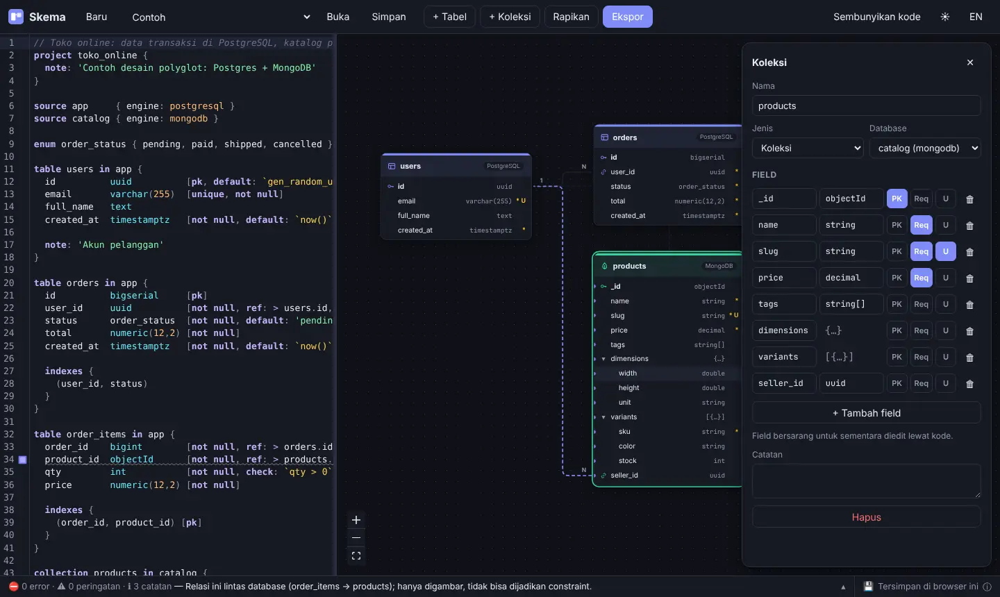
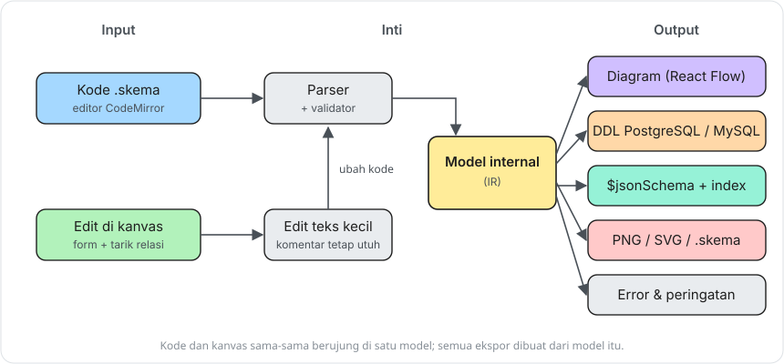
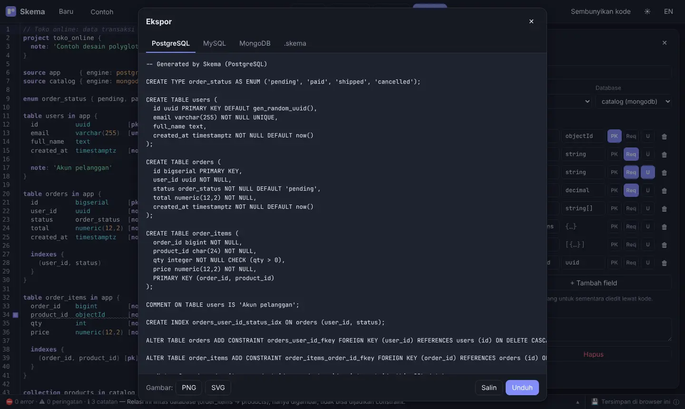
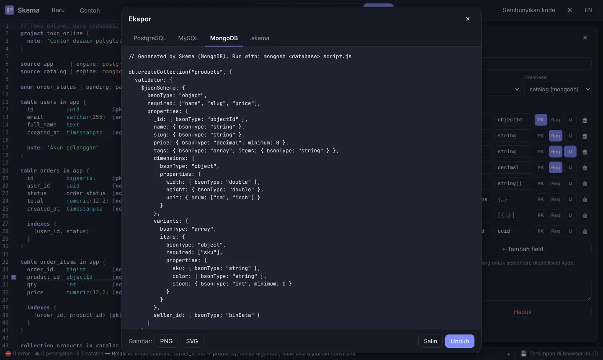

### Pendahuluan
Kalau mau gambar struktur database, biasanya saya buka dbdiagram.io. Enak sih, tinggal ketik, diagramnya langsung jadi. Masalahnya muncul waktu proyeknya pakai PostgreSQL **dan** MongoDB sekaligus. dbdiagram cuma ngerti SQL, jadi koleksi Mongo yang isinya objek bersarang dan array of object ya gak bisa digambar dengan benar (ujung - ujungnya ditulis manual di catatan, asli gak enak dibaca).

Belum lagi beberapa fitur yang lumayan penting dikunci di versi berbayar. Ya sudah, akhirnya saya bikin sendiri. Namanya **Skema**, nama repo - nya `ddl-drawing`.

Tulisan ini bukan tutorial, lebih ke cerita proyek dan pamer sedikit hasilnya 😁

### Apa itu Skema?
Skema adalah alat untuk menggambar dan mendesain database yang jalan di browser. Konsepnya mirip dbdiagram.io, bedanya:

| | dbdiagram.io | Skema |
|---|---|---|
| Lisensi | Closed source, ada fitur premium | Open source (MIT), semua fitur gratis |
| Database | SQL saja | SQL **dan** MongoDB, bisa dicampur dalam satu diagram |
| Cara edit | Utamanya lewat kode | Lewat kode **atau** langsung di kanvas, dua - duanya sinkron |
| Data | Disimpan di server mereka | Di browser sendiri, gak dikirim ke mana - mana |
| Bahasa UI | Inggris | Indonesia dan Inggris |



Di contoh di atas, tabel `users`, `orders`, dan `order_items` ada di PostgreSQL, sedangkan `products` dan `reviews` ada di MongoDB. Kartu SQL warnanya ungu, kartu Mongo hijau, jadi kelihatan mana yang tinggal di database mana.

### Bahasanya
Sintaksnya sengaja dibuat mirip DBML (bahasa yang dipakai dbdiagram), supaya yang sudah biasa pakai dbdiagram gak perlu belajar dari nol. Yang saya tambahkan adalah blok `source` untuk menentukan database - nya, dan `collection` untuk MongoDB lengkap dengan objek bersarang `{ }`, array `[]`, dan array of object `[{ }]`.

Contohnya seperti berikut:

```
source app     { engine: postgresql }
source catalog { engine: mongodb }

table users in app {
  id     uuid          [pk, default: `gen_random_uuid()`]
  email  varchar(255)  [unique, not null]
}

collection products in catalog {
  _id        objectId  [pk]
  name       string    [required]
  tags       string[]
  dimensions {
    width   double
    height  double
  }
  variants [{
    sku    string  [required]
    stock  int     [default: 0, min: 0]
  }]
  seller_id  uuid  [ref: > users.id]   // relasi lintas database
}
```

Relasinya pakai simbol yang sama dengan DBML: `>` many-to-one, `<` one-to-many, `-` one-to-one, dan `<>` many-to-many. Untuk many-to-many, waktu ekspor ke SQL otomatis dibuatkan tabel penghubung.

Ada juga **tipe portabel** seperti `string`, `int`, `decimal`, `datetime`, `uuid`. Tipe ini diterjemahkan sendiri sesuai database - nya, misalnya `string` jadi `text` di PostgreSQL, `varchar(255)` di MySQL, dan `string` di MongoDB. Jadi satu desain bisa dipindah dari Postgres ke MySQL tanpa ngedit tipe satu per satu.

### Gak Mau Ngetik? Edit di Kanvas Saja
Ini bagian yang menurut saya paling penting. Gak semua orang betah nulis sintaks, apalagi teman yang bukan developer tapi perlu ikut baca desain database - nya.



Beberapa hal yang bisa dilakukan langsung di kanvas:
- **+ Tabel / + Koleksi** untuk menambah entitas baru.
- Klik kartu untuk ganti nama, tambah field, atur tipe, PK, required, unique, atau hapus. Ganti nama tabel juga ikut memperbarui semua relasi yang menunjuk ke situ.
- Tarik dari titik di samping field ke field lain untuk bikin relasi.
- Klik dua kali judul kartu untuk lompat ke kodenya.
- **Rapikan** untuk menyusun ulang posisi kartu secara otomatis.

Setiap edit di kanvas langsung mengubah kode di sebelah kiri, dan sebaliknya.

### Di Balik Layar
Bagian yang paling bikin pusing justru sinkronisasi dua arah tadi. Cara gampangnya, setiap ada edit di kanvas, seluruh kode ditulis ulang dari nol. Tapi kalau begitu, komentar dan format yang sudah ditulis rapi oleh pengguna bakal hilang (siapa yang gak kesel coba).

Jadi alurnya saya buat seperti ini:



1. Kode `.skema` dibaca oleh parser, lalu diubah jadi satu **model internal** (IR).
2. Edit di kanvas gak menulis ulang semua kode, tapi cuma mengubah potongan teks kecil di posisi yang pas. Hasilnya diparse lagi, jadi tetap lewat jalur yang sama.
3. Semua keluaran (diagram, DDL, script Mongo, gambar) dibuat dari model internal itu.

Parser - nya saya tulis sendiri tanpa library, supaya pesan error - nya bisa dibuat ramah dan dalam bahasa Indonesia. Contohnya, relasi lintas database seperti `order_items.product_id` ke `products._id` gak bisa dijadikan constraint, jadi Skema cuma menggambarnya dan memberi catatan di bar bawah.

Stack - nya:
- **TypeScript** untuk semuanya, dalam satu monorepo pnpm
- `packages/core` berisi parser, validator, dan generator, murni TypeScript tanpa UI, jadi bisa dipakai di web dan CLI
- **React** + **Vite** untuk aplikasi web
- **CodeMirror 6** untuk editor kode (lengkap dengan syntax highlight dan autocomplete)
- **React Flow** untuk kanvas, **ELK.js** untuk auto-layout
- **Zustand** untuk state

### Ekspor
Setelah desain jadi, tinggal klik **Ekspor**. Hasilnya bisa disalin atau diunduh.



Untuk koleksi MongoDB, hasilnya berupa script `db.createCollection()` lengkap dengan validator `$jsonSchema` dan index, yang bisa langsung dijalankan pakai `mongosh`.



Format yang tersedia:
- DDL **PostgreSQL** dan **MySQL**
- Script **MongoDB** (`$jsonSchema` + `createIndex`)
- Gambar **PNG** dan **SVG**
- File `.skema` beserta posisi kartu, enak di-commit ke Git

Ada juga CLI kecil kalau mau ekspor tanpa buka browser, misalnya untuk dipakai di pipeline:

```
pnpm skema check  examples/toko-online.skema --lang id
pnpm skema export examples/toko-online.skema --to postgres
pnpm skema export examples/chat-app.skema --to mongodb -o schema.js
```

### Data Tetap di Browser Sendiri
Diagram tersimpan otomatis di penyimpanan lokal browser (localStorage), gak ada yang dikirim ke server. Di pojok kanan bawah ada tanda **Tersimpan di browser ini**, kalau diklik akan muncul penjelasan plus tombol untuk simpan cadangan ke file `.skema`. Kalau browser - nya memblokir penyimpanan (misalnya mode private), Skema akan kasih peringatan supaya kerjaan gak hilang begitu tab ditutup.

Karena hasil build - nya cuma situs statis, Skema bisa di-host di mana saja. Saya sendiri deploy ke Vercel.

### Yang Sempat Bikin Pusing
Beberapa hal yang ketemu waktu uji coba sebelum dipakai beneran:
- **Deploy Vercel gagal** dengan error `STATIC_BUILD_NO_OUT_DIR`. Ternyata gara - gara `vercel.json` yang saya tambahkan sendiri, path output - nya salah. Solusinya malah dihapus, lalu *Root Directory* di Vercel diarahkan ke `apps/web` dan biarkan Vercel mendeteksi Vite sendiri.
- **Kurung gak ditutup** seperti `varchar(` bikin parser "menelan" sisa file, jadi semua tabel di bawahnya hilang dari diagram. Sekarang parser berhenti di situ saja dan sisa diagram tetap tampil.
- **Toolbar di HP** kepotong. Sekarang jadi satu baris yang bisa digeser.
- Popup bawaan browser (`confirm()`) saya ganti dengan dialog sendiri, supaya tampilannya konsisten dan bisa dipakai pakai keyboard.

### Rencana Berikutnya
Masih banyak yang mau saya tambahkan:
- Impor dari SQL DDL dan DBML, supaya gampang pindah dari dbdiagram
- Impor dari sampel dokumen JSON MongoDB (skema ditebak otomatis)
- Dialek lain: SQLite, SQL Server, MariaDB
- Diff dua versi diagram jadi script migrasi `ALTER TABLE`
- Linter desain, misalnya "foreign key belum punya index" atau "tabel tanpa primary key"

### Penutup
Versi pertamanya masih fokus ke hal dasar: gambar, edit, dan ekspor. Tapi untuk proyek yang campur PostgreSQL dan MongoDB, ini sudah jauh lebih enak daripada nulis catatan manual di samping diagram.

Sekian, semoga menginspirasi untuk bikin tools sendiri buat masalah sehari - hari.

### Referensi
- [DBML, bahasa yang dipakai dbdiagram.io](https://dbml.dbdiagram.io/docs/)
- [MongoDB: Schema Validation dengan $jsonSchema](https://www.mongodb.com/docs/manual/core/schema-validation/)
- [React Flow](https://reactflow.dev/)
- [CodeMirror 6](https://codemirror.net/)
- [ELK.js](https://github.com/kieler/elkjs)
