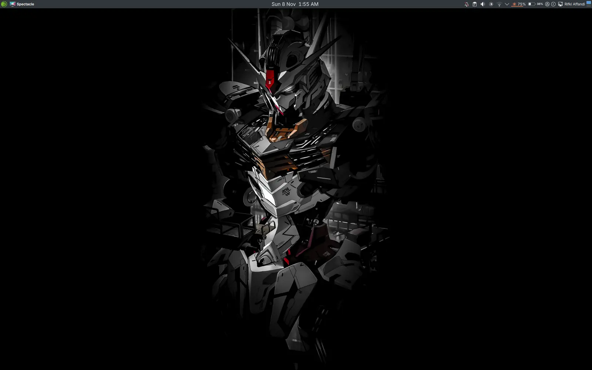

### Introduction
A while ago I wrote a script to rework Plasma into a macOS look-alike; the story is in [A macOS-Style KDE Plasma on openSUSE Tumbleweed](/en/posts/kde-plasma-macos-style-opensuse-tumbleweed/). The script is great for a one-shot run, but over time my desktop changed bit by bit (I can't stop tinkering). A few people also asked "what's that terminal?", so this time I'm writing the **manual** version, all the way down to the terminal style.

What we're recreating:
- Window buttons on the **left**, macOS style
- A **top panel** with a global menu, like the macOS menu bar
- A **dock** at the bottom
- A **zsh + Powerlevel10k** prompt with a **Monokai** theme

If you prefer the quick way, the script from the earlier post still works. This post is better if you want to know where every setting lives, or only want to take part of it (say, just the terminal style).

### Requirements
- KDE Plasma 6. I tested on **openSUSE Tumbleweed** with **Plasma 6.8 (Wayland)**. Other distros on Plasma 6 should work too; only the package names differ.
- An internet connection to clone the themes and fonts
- `sudo` access

### Overview
| Part | What I use |
|---|---|
| Plasma Style (panel) | **openSUSEdark** (ships with openSUSE). On other distros use **Breeze Dark** |
| App colors | Breeze Classic (light) |
| Window decorations | **WhiteSur-dark** (Aurorae), **close · minimize · maximize on the left** |
| Icons / cursor | Breeze / Breeze cursor 24 px |
| UI font | **Inter** 10 pt (window titles: Inter SemiBold 10) |
| Terminal font | **MesloLGS NF** 11 pt |
| Effects | Magic Lamp (macOS-style minimize animation) |
| Login screen (SDDM) | **WhiteSur-dark** |
| Terminal | **Tilix** + the Monokai color scheme |
| Shell | **zsh** + **oh-my-zsh** + **Powerlevel10k** (*lean* style, 2 lines) |
| Wallpaper | Mobile Suit Gundam 3840×2160 (search "mobile suit gundam 3840x2160" on a wallpaper site) |

Yes, the panels are dark but the app colors are light. That's on purpose: the top panel and dock look like macOS in dark mode, while app windows stay light and easy to read during the day.

### 1. Install the Ingredients
#### Packages
```
# openSUSE
sudo zypper in git sassc inter-fonts tilix zsh kvantum-manager

# Fedora:        sudo dnf install git sassc rsms-inter-fonts tilix zsh kvantum
# Arch:          sudo pacman -S git sassc inter-font tilix zsh kvantum
# Debian/Ubuntu: sudo apt install git sassc fonts-inter tilix zsh qt6-style-kvantum
```

#### The WhiteSur theme
This theme by [vinceliuice](https://github.com/vinceliuice/WhiteSur-kde) includes window decorations, a Plasma theme, SDDM, and Kvantum.
```
git clone --depth=1 https://github.com/vinceliuice/WhiteSur-kde.git
cd WhiteSur-kde
./install.sh            # Aurorae decorations, color scheme, Plasma theme, Kvantum
cd ..
```
For the login screen theme (optional), run the install script in the repo's `sddm/` folder with `sudo`. Check the repo's README first, because the script's location can change between versions. If it fails with a weird folder name, you've probably hit the same problem I did in the [earlier post](/en/posts/kde-plasma-macos-style-opensuse-tumbleweed/#1-the-sddm-theme-failed-to-install).

Optional, so GTK apps (Chrome, Thunderbird, etc.) match too:
```
git clone --depth=1 https://github.com/vinceliuice/WhiteSur-gtk-theme.git
WhiteSur-gtk-theme/install.sh
```

#### Panel widgets
Install them with **right-click the panel > Add Widgets > Get New Widgets**, or grab them from GitHub:

| Widget | What it does | Source |
|---|---|---|
| Application Title Bar | window buttons + title in the top panel | [antroids/application-title-bar](https://github.com/antroids/application-title-bar) |
| Window Title Fork | the active app's name | [psifidotos/applet-window-title](https://github.com/psifidotos/applet-window-title) |
| macOS Battery *(optional)* | a macOS-style battery icon | [rifkiaz/macos-battery-kde](https://github.com/rifkiaz/macos-battery-kde) |

The macOS Battery widget is my own; the story of building it is in [Building a macOS-Style Battery Widget for KDE Plasma 6](/en/posts/macos-battery-widget-kde-plasma-6/).

### 2. Set It Up in System Settings
Open **System Settings** and go through these one by one:
1. **Colors & Themes > Plasma Style** > `openSUSE Dark` (or `Breeze Dark`)
2. **Colors & Themes > Colors** > `Breeze Classic`
3. **Colors & Themes > Window Decorations** > `WhiteSur-dark`
   - **Titlebar Buttons** tab: put **Close, Minimize, Maximize on the left**, and leave the right side empty.
4. **Text & Fonts > Fonts** > every font `Inter 10pt`, window titles `Inter SemiBold 10pt`.
5. **Window Management > Desktop Effects** > turn on **Magic Lamp**, turn off *Squash*.
6. **Window Management > Task Switcher** > the `Compact` layout.
7. **Colors & Themes > Login Screen (SDDM)** > `WhiteSur-dark`.

### 3. Arrange the Panels
There are **two panels**: a bar at the top and a dock at the bottom.

#### Top panel (like the macOS menu bar)
Widget order from left to right:
```
[Application Launcher] | [Application Title Bar] [Window Title] [Global Menu]
      ── spacer ──   [Digital Clock]   ── spacer ──
[System Tray] [Battery] [Lock/Logout] [Display Config] [User Switcher] [Pager]
```
- **Application Title Bar**: in its settings, pick the *Close, Minimize, Maximize* elements, the `ChromeOS-dark` button theme, and *Disabled mode* = **Hide** (the buttons disappear when there's no active window).
- **Global Menu** (`appmenu`) shows the app's File/Edit/… menus in the panel, just like macOS.
- The panel is **not floating**.

#### Bottom dock
```
[Icons-only Task Manager] | [Trash]
```
```
Width      : Fit content (width follows the number of icons, centered)
Height     : 48 px
Visibility : Dodge Windows
Floating   : off
```

### 4. Terminal Style
This is the part people ask about most.

#### 4a. The MesloLGS NF font
This font is a must, because Powerlevel10k's icons need a *patched* font (a Nerd Font). Without it, the prompt fills up with weird boxes.
```
mkdir -p ~/.local/share/fonts && cd ~/.local/share/fonts
for f in Regular Bold Italic "Bold Italic"; do
  curl -fLO "https://github.com/romkatv/powerlevel10k-media/raw/master/MesloLGS%20NF%20${f// /%20}.ttf"
done
fc-cache -f
```

#### 4b. zsh + oh-my-zsh + Powerlevel10k + plugins
```
# oh-my-zsh
sh -c "$(curl -fsSL https://raw.githubusercontent.com/ohmyzsh/ohmyzsh/master/tools/install.sh)"

ZSH_CUSTOM=${ZSH_CUSTOM:-~/.oh-my-zsh/custom}
git clone --depth=1 https://github.com/romkatv/powerlevel10k.git          $ZSH_CUSTOM/themes/powerlevel10k
git clone --depth=1 https://github.com/zsh-users/zsh-autosuggestions      $ZSH_CUSTOM/plugins/zsh-autosuggestions
git clone --depth=1 https://github.com/zsh-users/zsh-syntax-highlighting  $ZSH_CUSTOM/plugins/zsh-syntax-highlighting

# enable the theme & plugins in ~/.zshrc
sed -i 's|^ZSH_THEME=.*|ZSH_THEME="powerlevel10k/powerlevel10k"|' ~/.zshrc
sed -i 's|^plugins=.*|plugins=(git zsh-autosuggestions zsh-syntax-highlighting)|' ~/.zshrc

chsh -s "$(which zsh)"   # make zsh the default shell
```
Note: the oh-my-zsh installer usually drops you straight into zsh when it's done. If that happens, type `exit` first and then carry on with the next commands, or run the installer as `RUNZSH=no sh -c "..."` so it doesn't switch shells halfway.

Open a new terminal. The `p10k configure` wizard shows up automatically (or run it yourself). The answers I use:

| Question | Answer |
|---|---|
| Prompt Style | **Lean** |
| Character Set | **Unicode** |
| Show current time? | **24-hour format** |
| Prompt Height | **Two lines** |
| Prompt Connection | **Dotted** |
| Prompt Frame | **Left** |
| Connection & Frame Color | **Light** |
| Prompt Spacing | **Sparse** |
| Icons | **Many icons** |
| Prompt Flow | **Fluent** |
| Enable Transient Prompt? | **Yes** |
| Instant Prompt Mode | **Verbose** |

*Transient Prompt* is my favorite: the two-line prompt only shows on the active line, while earlier commands collapse into a single line. So the history on screen stays tidy.

#### 4c. Tilix with the Monokai scheme
Use this command to get exactly the same colors (MesloLGS NF 11 font, `#272822` background):
```
dconf load /com/gexperts/Tilix/ <<'EOF'
[/]
prompt-on-close=true

[profiles/2b7c4080-0ddd-46c5-8f23-563fd3ba789d]
visible-name='Default'
use-system-font=false
font='MesloLGS NF 11'
use-theme-colors=false
background-color='#272822'
foreground-color='#F8F8F2'
palette=['#272822', '#F92672', '#A6E22E', '#F4BF75', '#66D9EF', '#AE81FF', '#A1EFE4', '#F8F8F2', '#75715E', '#F92672', '#A6E22E', '#F4BF75', '#66D9EF', '#AE81FF', '#A1EFE4', '#F9F8F5']
EOF

dconf write /com/gexperts/Tilix/profiles/list "['2b7c4080-0ddd-46c5-8f23-563fd3ba789d']"
dconf write /com/gexperts/Tilix/profiles/default "'2b7c4080-0ddd-46c5-8f23-563fd3ba789d'"
```
The commands above overwrite your existing Tilix profiles. If you already have your own, back them up first with `dconf dump /com/gexperts/Tilix/ > tilix-backup.dconf`.

If you use **Konsole**: *Settings > Edit Current Profile > Appearance*, pick the **Monokai** color scheme (available under *Get New…*) and the **MesloLGS NF 11** font.

### 5. Finishing Touches
- **Wallpaper**: right-click the desktop > *Configure Desktop and Wallpaper*. Use the same image for the **Lock Screen** (*System Settings > Screen Locking > Appearance*).
- Log out and back in so the panels, fonts, and window decorations show up properly.

Voilà, your desktop and terminal now look like mine. Here's the final result on my laptop: a dark top panel with the launcher, the active app's name, the clock in the middle, and the system tray (including the macOS Battery widget) on the right, with a dark Gundam wallpaper.



Have fun! 🎨

That's it, hope it helps.

References:
- [WhiteSur KDE](https://github.com/vinceliuice/WhiteSur-kde)
- [WhiteSur GTK Theme](https://github.com/vinceliuice/WhiteSur-gtk-theme)
- [Application Title Bar](https://github.com/antroids/application-title-bar)
- [Powerlevel10k](https://github.com/romkatv/powerlevel10k)
- [oh-my-zsh](https://github.com/ohmyzsh/ohmyzsh)
- [zsh-autosuggestions](https://github.com/zsh-users/zsh-autosuggestions) and [zsh-syntax-highlighting](https://github.com/zsh-users/zsh-syntax-highlighting)
