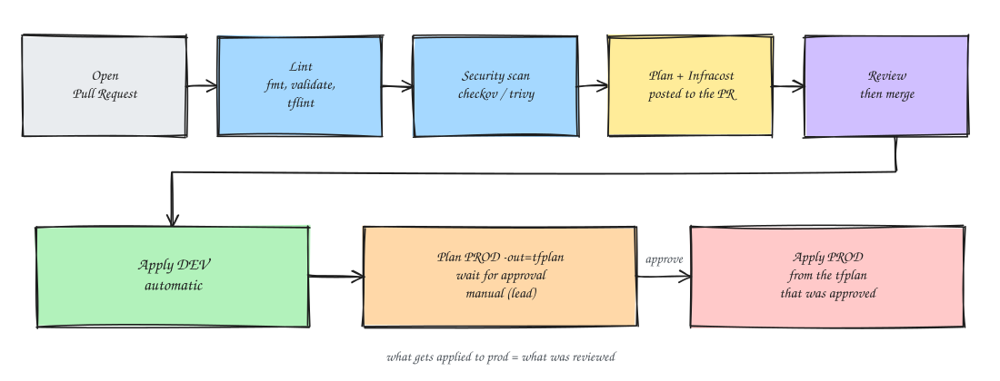

### Introduction
Bismillah. This is the first post in a series on Terraform across multiple AWS accounts; think of it as the *muqoddimah*, the opening.

Here's the story: where I work there are 2 AWS accounts, one for **dev** and one for **production**. The problem is that almost every resource in both was created by hand in the console (ClickOps, as the cool kids call it). It was nice at first, just click around and it's done. But over time the downsides started to show: dev and prod settings drifted apart with nobody knowing why, there was no record of who changed what, and rebuilding an environment meant trying to remember everything from scratch (a real headache).

So the plan is to move all the infra to [Terraform](https://developer.hashicorp.com/terraform). Before getting into the technical bits, in this post I want to sketch out what the end state looks like, what the ground rules are, and what order the migration goes in. The details of each part will come in later posts.

Oh, and every role, bucket, and resource name here is just an example, so adjust them to your setup.

### The Topology
The end state looks roughly like this:


The key points:
1. Just **1 infra repo** with a single `main` branch. Environments are separated by folder, not by branch.
2. Terraform may only be applied from **Jenkins**, not from anyone's laptop.
3. Jenkins doesn't use static access keys. Its agent uses an instance profile, then `sts:AssumeRole` into the terraform role in each account.
4. Each account has **its own state bucket**. Dev state lives in the dev account, prod state in the prod account. So if something goes wrong in dev, prod isn't affected.
5. State is split by layer: `network`, `data`, `compute`, and `observability`. An error in one layer doesn't lock everything.

Roughly what's in each layer:

| Layer | Contents |
|---|---|
| network | VPC, subnets, NAT, security groups, VPC endpoints, VPN |
| data | RDS PostgreSQL, ElastiCache Redis, MSK, S3 |
| compute | EC2/ASG, ALB, Lambda, app IAM |
| observability | Prometheus/Grafana, CloudWatch alarms, SES |

Outputs shared between layers (like the VPC ID the data layer needs) go through SSM Parameter Store.

The only difference between dev and prod is variable values. Dev uses small instances, a single AZ, minimal backups, and can be destroyed any time. Prod uses Multi-AZ, `deletion_protection`, `prevent_destroy`, backups + PITR, and console access for humans is read-only.

### Repo Layout
The repo looks roughly like this
```
infra/                    (1 branch: main)
├── modules/              # reusable, pinned with git tags
│   ├── vpc/
│   ├── alb/
│   ├── ec2-service/
│   ├── rds-postgres/
│   ├── elasticache-redis/
│   ├── msk/
│   └── iam-baseline/
├── live/
│   ├── bootstrap/        # state bucket, KMS, terraform role
│   ├── dev/
│   │   ├── network/
│   │   ├── data/
│   │   │   ├── backend.tf
│   │   │   ├── main.tf   # calls modules/
│   │   │   ├── variables.tf
│   │   │   ├── terraform.tfvars
│   │   │   └── versions.tf
│   │   ├── compute/
│   │   └── observability/
│   └── prod/             # exactly the same layout as dev
│       ├── network/
│       ├── data/
│       ├── compute/
│       └── observability/
├── .pre-commit-config.yaml
├── .tflint.hcl
└── Jenkinsfile
```
The `live/bootstrap` folder is a bit special. It holds the state bucket, KMS key, and terraform role, so it can't use the S3 backend from the start (the bucket doesn't exist yet). Instead, it's applied once by hand per account with local state, and once the bucket exists the state is moved to S3
```
terraform init -migrate-state
```

### The Jenkins Pipeline
Every change has to go through a Pull Request. The flow looks like this:



1. Lint with `terraform fmt -check`, `terraform validate`, and `tflint`.
2. IaC security scan with `checkov` or `trivy config`.
3. `terraform plan` only runs for stacks whose files changed. The plan output plus a cost estimate from Infracost is posted to the PR, so reviewers can see exactly what will change.
4. Once reviewed and merged, dev is applied automatically.
5. For prod, the plan is saved to a file first
```
terraform plan -out=tfplan
```
After a lead approves it manually, that same `tfplan` file is what gets applied
```
terraform apply tfplan
```
So what goes into prod is guaranteed to be exactly what was reviewed.

### Best Practices
These are the ground rules I stick to. Each one gets a deeper look later in the series.

**State & Locking**
- 1 state bucket per account, with versioning + SSE-KMS + block public access. The bucket policy only allows the terraform role.
- For locking, `use_lockfile = true` is enough (native S3, Terraform 1.11 and up). No more DynamoDB.
- Never edit state by hand. To move resources, use a `moved {}` block or `terraform state mv`.

**Structure & Modules**
- Environments are folders, not branches and not workspaces.
- Modules in `modules/` are pinned with git tags, like `?ref=v1.4.0`. Bump the version in dev first, and only in prod once it's safe.
- Dev and prod should only differ in `terraform.tfvars`; don't copy-paste code.
- Pin `required_version` and `required_providers`, and commit `.terraform.lock.hcl`.

**Security & IAM**
- The dev role can't assume the prod role. Ideally, prod jobs use a separate agent or credentials.
- Don't put RDS passwords in tfvars; use `manage_master_user_password` so it's stored in Secrets Manager.
- Mark secret outputs `sensitive = true`. But still treat the state as secret, because it can contain passwords.

**Workflow & CI/CD**
- Apply only from Jenkins; prod console access is read-only.
- Set up pre-commit: `terraform fmt`, `validate`, `tflint`, and `terraform-docs`.

**Conventions & Tagging**
- Use `default_tags` in the provider: `Project`, `Environment`, `Service`, `Owner`, `ManagedBy=terraform`. Tidy tags make Cost Explorer per environment and per service accurate.
- Consistent naming, like `<env>-<service>-<resource>`, e.g. `prod-api-alb`.
- `prevent_destroy` + `deletion_protection` for RDS, MSK, and data buckets in prod.
- Variables get a `type`, `description`, and `validation`.

**Drift & Cost**
- A nightly scheduled Jenkins job runs `terraform plan -detailed-exitcode`. If something changed outside Terraform, send an alert to the channel.
- Regularly review resources that don't have the `ManagedBy=terraform` tag yet.

### Migrating Away from ClickOps
This is the most challenging part. The infra is already running and in use, so deleting it and rebuilding isn't an option. The way to do it is **import**: resources keep running as normal, and Terraform just "adopts" them into its state.


1. **Prepare.** Apply `live/bootstrap`, set up the Jenkins pipeline in plan-only mode first, turn on CloudTrail / AWS Config so manual changes still get recorded, and agree on a change freeze for resources being migrated.
2. **Inventory.** List every resource per account (AWS Resource Explorer, Tag Editor, Cost Explorer) and track them in a sheet: resource, ID, target stack, owner, and risk. Orphaned resources nobody uses are better deleted than imported.
3. **Import & generate.** Write an `import {}` block, then have Terraform draft the code for you
```
vim live/prod/data/imports.tf
```
```
import {
  to = aws_db_instance.postgres
  id = "prod-postgres"   # DB identifier
}
```
```
terraform plan -generate-config-out=generated.tf
```
The result is still a rough draft, with lots of hardcoded IDs and default attributes.
4. **Refactor into modules.** Move it into `modules/`, replace hardcoded IDs with references or variables, then change the import address to `module.rds.aws_db_instance.this`. The `-generate-config-out` option only works for addresses in the root module, which is why you generate first and refactor after.
5. **Check the plan.** This is the most important checkpoint. The plan must be **zero diff**, containing only imports
````
Plan: 1 to import, 0 to add, 0 to change, 0 to destroy.
````
If there's still an update, replace, or destroy, don't apply; go back and fix the code. Attributes that really are managed outside Terraform can go into `lifecycle { ignore_changes = [...] }`.
6. **Apply through Jenkins.** The resource goes into state, and the infra itself doesn't change at all. The `import` block can be removed once it succeeds.
7. **Lock down.** The prod console becomes read-only for humans, drift detection runs nightly, and new resources must go through Terraform from day one.

Import order is by layer: `network`, `data`, `compute`, then `observability`. Within each layer, dev goes first until the module is proven zero diff, and only then is the same module used for prod. For the pilot, start with low-risk resources in dev, like security groups, IAM roles, or S3 buckets that don't hold data.

### Traps to Watch For
A few things that often surprise people during import:
- Force-new attributes (RDS identifier, subnet CIDR, security group name) that differ even slightly turn the plan into a **replace**. Don't apply; make the code match the real state first.
- Older EC2 instances usually have an AMI and `user_data` that differ from what's in the code. Use `lifecycle { ignore_changes = [ami, user_data] }`.
- A resource may only be owned by one state. Never import the same resource into two stacks.
- Pick one style for security group rules, inline or separate rule resources, and don't mix them.
- Secrets like RDS passwords or Redis auth tokens end up in state. That's why the state bucket has to be encrypted with restricted access.
- If there's an emergency change through the console during the migration, write it down, then sync it into the code in the next PR.

### What's Next
The plan is for this series to continue with:
1. Bootstrap: the state bucket, KMS, and terraform role in each account
2. Module structure and per-layer backends
3. A Jenkinsfile for plan, approval, and apply
4. Importing existing resources in practice, starting with the network layer

Stay tuned for the next post ~

That's it, hope it helps.

References:
- [Terraform: Import](https://developer.hashicorp.com/terraform/language/import)
- [Terraform: Generating configuration](https://developer.hashicorp.com/terraform/language/import/generating-configuration)
- [Terraform: S3 backend](https://developer.hashicorp.com/terraform/language/backend/s3)
- [AWS: Multi-account strategy](https://docs.aws.amazon.com/whitepapers/latest/organizing-your-aws-environment/organizing-your-aws-environment.html)
