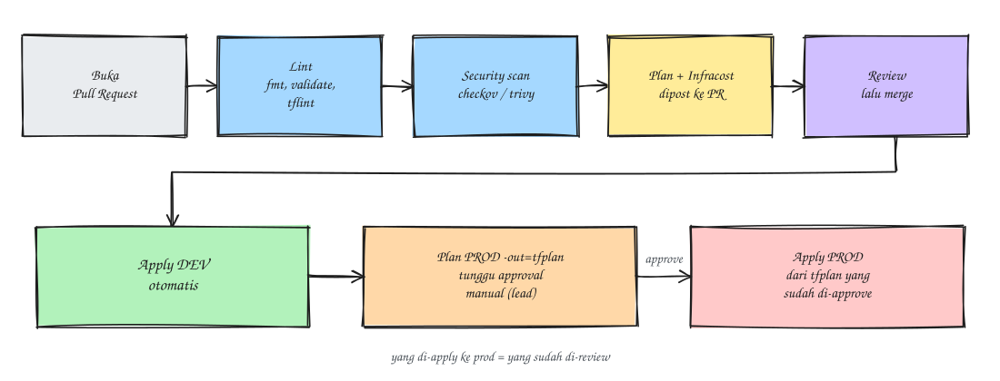

### Pendahuluan
Bismillah. Ini tulisan pertama dari seri Terraform multi akun AWS, anggap saja muqoddimah atau pembukaannya dulu.

Ceritanya di tempat saya ada 2 akun AWS, satu untuk **dev** dan satu untuk **production**. Masalahnya, hampir semua resource di dua akun itu dibuat manual lewat console (istilah kerennya ClickOps). Awalnya sih enak, tinggal klik - klik jadi. Tapi lama - lama mulai kerasa gak enaknya: setting dev dan prod beda - beda tanpa ada yang tahu kenapa, gak ada catatan siapa ganti apa, dan kalau mau bikin ulang satu environment ya harus ingat - ingat lagi dari nol (asli bikin pusing).

Karena itu rencananya semua infra mau dipindah ke [Terraform](https://developer.hashicorp.com/terraform). Sebelum masuk ke teknisnya, di tulisan ini saya mau gambarkan dulu bentuk akhirnya seperti apa, aturan mainnya apa saja, dan urutan migrasinya bagaimana. Detail tiap bagian akan dibahas di tulisan - tulisan berikutnya.

Oh ya, semua nama role, bucket, dan resource di sini cuma contoh ya, silakan disesuaikan.

### Gambaran Topologi
Kurang lebih bentuk akhirnya seperti ini:


Poin pentingnya:
1. Cukup **1 repo infra** dengan 1 branch `main`. Environment dibedakan lewat folder, bukan lewat branch.
2. Terraform cuma boleh di-apply dari **Jenkins**, bukan dari laptop masing - masing.
3. Jenkins gak pakai access key statis. Agent-nya pakai instance profile, lalu `sts:AssumeRole` ke role terraform di tiap akun.
4. Tiap akun punya **bucket state sendiri**. State dev ada di akun dev, state prod ada di akun prod. Jadi kalau ada yang salah di dev, prod gak ikut kena.
5. State dipecah per layer: `network`, `data`, `compute`, dan `observability`. Satu layer error gak bikin semua ikut ke-lock.

Isi tiap layer kira - kira begini:

| Layer | Isi |
|---|---|
| network | VPC, subnet, NAT, security group, VPC endpoint, VPN |
| data | RDS PostgreSQL, ElastiCache Redis, MSK, S3 |
| compute | EC2/ASG, ALB, Lambda, IAM aplikasi |
| observability | Prometheus/Grafana, CloudWatch alarm, SES |

Output antar layer (misalnya ID VPC yang dibutuhkan layer data) dibagi lewat SSM Parameter Store.

Bedanya dev dan prod cuma di nilai variabel. Dev pakai instance kecil, single AZ, backup minimal, dan boleh di-destroy kapan saja. Prod pakai Multi-AZ, `deletion_protection`, `prevent_destroy`, backup + PITR, dan akses console untuk manusia cuma read-only.

### Struktur Repo
Struktur repo-nya kurang lebih seperti ini
```
infra/                    (1 branch: main)
├── modules/              # reusable, dipin pakai git tag
│   ├── vpc/
│   ├── alb/
│   ├── ec2-service/
│   ├── rds-postgres/
│   ├── elasticache-redis/
│   ├── msk/
│   └── iam-baseline/
├── live/
│   ├── bootstrap/        # bucket state, KMS, role terraform
│   ├── dev/
│   │   ├── network/
│   │   ├── data/
│   │   │   ├── backend.tf
│   │   │   ├── main.tf   # panggil modules/
│   │   │   ├── variables.tf
│   │   │   ├── terraform.tfvars
│   │   │   └── versions.tf
│   │   ├── compute/
│   │   └── observability/
│   └── prod/             # strukturnya sama persis dengan dev
│       ├── network/
│       ├── data/
│       ├── compute/
│       └── observability/
├── .pre-commit-config.yaml
├── .tflint.hcl
└── Jenkinsfile
```
Folder `live/bootstrap` ini agak spesial. Isinya bucket state, KMS key, dan role terraform, jadi gak bisa pakai backend S3 dari awal (bucket-nya kan belum ada). Caranya di-apply sekali secara manual per akun pakai state lokal, setelah bucket jadi baru state-nya dipindah ke S3
```
terraform init -migrate-state
```

### Pipeline Jenkins
Semua perubahan wajib lewat Pull Request. Alurnya seperti ini:



1. Lint pakai `terraform fmt -check`, `terraform validate`, dan `tflint`.
2. Security scan IaC pakai `checkov` atau `trivy config`.
3. `terraform plan` dijalankan cuma untuk stack yang file-nya berubah. Hasil plan plus estimasi biaya dari Infracost dipost ke PR, jadi reviewer bisa lihat langsung apa yang bakal berubah.
4. Setelah di-review dan di-merge, dev langsung di-apply otomatis.
5. Untuk prod, plan disimpan dulu ke file
```
terraform plan -out=tfplan
```
Setelah di-approve manual sama lead, yang di-apply adalah file `tfplan` itu juga
```
terraform apply tfplan
```
Jadi yang masuk ke prod dijamin sama persis dengan yang sudah di-review.

### Best Practice
Ini aturan main yang saya pegang. Masing - masing nanti dibahas lebih dalam di seri ini.

**State & Locking**
- 1 bucket state per akun, versioning + SSE-KMS + block public access. Bucket policy cuma izinkan role terraform.
- Locking cukup pakai `use_lockfile = true` (S3 native, Terraform 1.11 ke atas). Gak perlu DynamoDB lagi.
- Jangan edit state manual. Kalau mau pindah resource pakai blok `moved {}` atau `terraform state mv`.

**Struktur & Modul**
- Environment itu folder, bukan branch dan bukan workspace.
- Modul di `modules/` dipin pakai git tag, misalnya `?ref=v1.4.0`. Naikkan versinya di dev dulu, kalau aman baru prod.
- Beda dev dan prod cukup di `terraform.tfvars`, jangan copy - paste kode.
- Pin `required_version` dan `required_providers`, lalu commit `.terraform.lock.hcl`.

**Keamanan & IAM**
- Role dev gak bisa assume role prod. Idealnya job prod pakai agent atau credential terpisah.
- Password RDS jangan ditaruh di tfvars, pakai `manage_master_user_password` biar disimpan di Secrets Manager.
- Output yang rahasia diberi `sensitive = true`. Tapi tetap anggap state itu rahasia, karena isinya bisa ada password.

**Workflow & CI/CD**
- Apply cuma dari Jenkins, akses console prod read-only.
- Pasang pre-commit: `terraform fmt`, `validate`, `tflint`, dan `terraform-docs`.

**Konvensi & Tagging**
- Pakai `default_tags` di provider: `Project`, `Environment`, `Service`, `Owner`, `ManagedBy=terraform`. Tag yang rapi bikin Cost Explorer per environment dan per service jadi akurat.
- Penamaan konsisten, misalnya `<env>-<service>-<resource>` seperti `prod-api-alb`.
- `prevent_destroy` + `deletion_protection` untuk RDS, MSK, dan bucket data di prod.
- Variable diberi `type`, `description`, dan `validation`.

**Drift & Biaya**
- Job Jenkins terjadwal tiap malam menjalankan `terraform plan -detailed-exitcode`. Kalau ada perubahan di luar Terraform, kirim alert ke channel.
- Review berkala resource yang belum punya tag `ManagedBy=terraform`.

### Alur Migrasi dari ClickOps
Nah ini bagian yang paling menantang. Infra-nya sudah jalan dan dipakai, jadi gak mungkin dihapus lalu dibikin ulang. Caranya pakai **import**: resource tetap jalan seperti biasa, Terraform cuma "mengadopsi" resource itu ke dalam state.


1. **Persiapan.** Apply `live/bootstrap`, siapkan pipeline Jenkins mode plan-only dulu, nyalakan CloudTrail / AWS Config biar perubahan manual tetap tercatat, dan sepakati change freeze untuk resource yang lagi dimigrasi.
2. **Inventaris.** List semua resource per akun (AWS Resource Explorer, Tag Editor, Cost Explorer), catat di sheet: resource, ID, stack tujuan, owner, dan risikonya. Resource yatim yang gak kepakai mending dihapus, jangan di-import.
3. **Import & generate.** Tulis blok `import {}` lalu minta Terraform bikinkan draft kodenya
```
vim live/prod/data/imports.tf
```
```
import {
  to = aws_db_instance.postgres
  id = "prod-postgres"   # DB identifier
}
```
```
terraform plan -generate-config-out=generated.tf
```
Hasilnya masih draft kasar, banyak ID hardcode dan atribut default.
4. **Refactor ke module.** Pindahkan ke `modules/`, ganti ID hardcode jadi reference atau variable, lalu ubah alamat import-nya jadi `module.rds.aws_db_instance.this`. Opsi `-generate-config-out` cuma jalan untuk alamat di root module, makanya urutannya generate dulu baru refactor.
5. **Cek plan.** Ini titik paling penting. Plan harus **zero diff**, isinya cuma import
````
Plan: 1 to import, 0 to add, 0 to change, 0 to destroy.
````
Kalau masih ada update, replace, atau destroy, jangan di-apply, balik lagi perbaiki kodenya. Atribut yang memang diatur di luar Terraform boleh dimasukkan ke `lifecycle { ignore_changes = [...] }`.
6. **Apply via Jenkins.** Resource masuk state, infra-nya sendiri gak berubah sama sekali. Blok `import` boleh dihapus setelah sukses.
7. **Lock-down.** Console prod jadi read-only untuk manusia, drift detection jalan tiap malam, dan resource baru wajib lewat Terraform sejak hari pertama.

Urutan importnya per layer: `network`, `data`, `compute`, lalu `observability`. Di tiap layer, dev dulu sampai modulnya terbukti zero diff, baru modul yang sama dipakai untuk prod. Untuk pilot, mulai dari resource yang low-risk di dev seperti security group, IAM role, atau bucket S3 yang bukan data.

### Jebakan yang Perlu Diwaspadai
Beberapa hal yang sering bikin kaget waktu import:
- Atribut yang sifatnya force-new (identifier RDS, CIDR subnet, nama security group) beda sedikit saja, plan langsung jadi **replace**. Jangan apply, samakan dulu kodenya dengan kondisi asli.
- EC2 lama biasanya AMI dan `user_data`-nya sudah beda dengan yang ada di kode. Pakai `lifecycle { ignore_changes = [ami, user_data] }`.
- Satu resource cuma boleh dimiliki satu state. Jangan sampai resource yang sama di-import ke dua stack.
- Rule security group pilih satu gaya saja, inline atau resource rule terpisah, jangan dicampur.
- Secret seperti password RDS atau auth token Redis ikut tersimpan di state. Makanya bucket state harus terenkripsi dan aksesnya dibatasi.
- Kalau ada perubahan darurat lewat console selama migrasi, catat, lalu sinkronkan ke kode di PR berikutnya.

### Selanjutnya
Rencananya seri ini akan berlanjut ke:
1. Bootstrap: bucket state, KMS, dan role terraform di tiap akun
2. Struktur modul dan backend per layer
3. Jenkinsfile untuk plan, approval, dan apply
4. Praktik import resource existing, mulai dari layer network

Nantikan tulisan berikutnya ya ~

Sekian, semoga membantu.

Referensi:
- [Terraform: Import](https://developer.hashicorp.com/terraform/language/import)
- [Terraform: Generating configuration](https://developer.hashicorp.com/terraform/language/import/generating-configuration)
- [Terraform: S3 backend](https://developer.hashicorp.com/terraform/language/backend/s3)
- [AWS: Multi-account strategy](https://docs.aws.amazon.com/whitepapers/latest/organizing-your-aws-environment/organizing-your-aws-environment.html)
