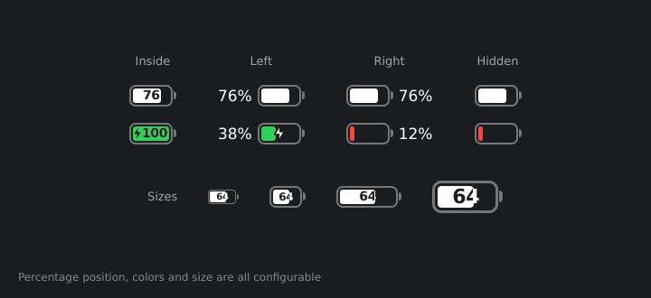
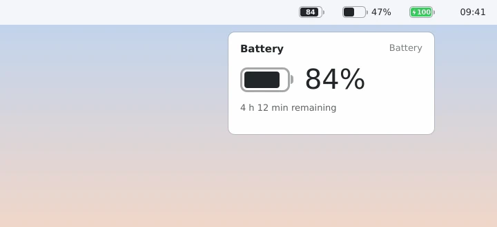

### Introduction
After making Plasma on my laptop look like macOS (the story is in [A macOS-Style KDE Plasma on openSUSE Tumbleweed](/en/posts/kde-plasma-macos-style-opensuse-tumbleweed/)), one small thing kept bugging me every time I glanced at the top panel: the battery icon. Plasma's built-in battery widget works, but it looks nothing like the slim macOS battery with the percentage inside it.

Rather than keep being bugged by it, I just built my own. The result is **[macOS Battery](https://github.com/rifkiaz/macos-battery-kde)**, a battery widget for KDE Plasma 6 that mimics the macOS look.

")

*The images in this post are previews. Fonts and colors follow your own Plasma theme.*

### Features
- **macOS-style battery icon**: a thin outline, a small terminal on the right, and a fill that follows the battery level.
- **Choose where the percentage goes**: **inside** the battery (the newer macOS style, where the number is "cut" by the filled part), to the **left**, to the **right**, or hidden.
- **Adjustable size**: battery height, battery width, and the size of the percentage text, plus a reset button for when you overdo it.
- **Status colors**: green while charging, red when the battery is low (the threshold is configurable, 20% by default), and a **lightning** icon while charging.
- **Popup**: click the icon to see a big percentage, the time remaining ("2 h 10 min remaining") or time until full, the power source, and a list of **other devices** with batteries, like wireless mice and keyboards.
- Works on horizontal and vertical panels as well as the desktop, and follows Plasma's light or dark theme.





### Compatibility
- **KDE Plasma 6.0 and up**. It doesn't work on Plasma 5.
- The widget is pure QML, with no C++ to compile. So it works on any distro that's on Plasma 6. I use it on **openSUSE Tumbleweed**, and **openSUSE Leap 16** is on Plasma 6 too. Fedora KDE, Arch, KDE neon, Kubuntu, and Debian 13 should also be fine.
- Battery data comes from Plasma's `powermanagement` engine (through `org.kde.plasma.plasma5support`), the same source the built-in battery widget uses. So there are no extra packages to install.

Note: openSUSE Leap 15.x is still on Plasma 5, so this widget needs Leap 16 or Tumbleweed.

### Installation
#### From the `.plasmoid` file
The easiest way. The `.plasmoid` file is on the [Releases](https://github.com/rifkiaz/macos-battery-kde/releases/latest) page, built automatically by GitHub Actions for every new version tag.
1. Download `macos-battery-<version>.plasmoid` from the Releases page.
2. Right-click the desktop or panel and choose **Add Widgets…**
3. Click **Get New…** then **Install Widget From Local File…**, and pick the `.plasmoid` file.
4. Find **macOS Battery** in the widget list and drag it to the panel.

Or from the terminal
```
kpackagetool6 --type Plasma/Applet --install macos-battery-1.1.2.plasmoid
```
If you've installed an earlier version before, swap `--install` for `--upgrade`, then reload Plasma
```
systemctl --user restart plasma-plasmashell
```

#### From source
```
git clone https://github.com/rifkiaz/macos-battery-kde.git
cd macos-battery-kde
./install.sh
```
`install.sh` upgrades automatically if the widget is already installed. If `kpackagetool6` isn't there yet, on openSUSE install it first
```
sudo zypper install kf6-kpackage
```

#### Removing it
```
kpackagetool6 --type Plasma/Applet --remove com.github.rifkiaz.macosbattery
```

### Settings
Right-click the widget and choose **Configure macOS Battery…**. You'll find:
- **Percentage**: Hidden, Left of the battery, Inside the battery, or Right of the battery
- **Percentage text size**: the percentage text size when it's on the left or right (50–200%)
- **Battery height**: battery height relative to the panel's automatic size (50–250%)
- **Battery width**: battery width as a percentage of its height (140–350%, default 215%)
- **Colors** and **Low battery level**: green while charging, red when low, and where "low" starts
- **Popup**: whether to show other devices

Tip: so you don't end up with two battery icons in the panel, hide Plasma's built-in one. Right-click the System Tray, **Configure**, **Entries**, then set **Power and Battery** to *Disabled* or *Always hidden*.

### The Story Behind the Lightning Icon
The first public release was **v1.1.0**, which already had adjustable sizes and the left or right percentage option. Once I used it on my own laptop, the lightning icon turned out small and a bit blurry, even though it looked fine in the preview. Fixing it took two releases:

1. **v1.1.1**: the lightning outline used to be drawn **on top of** the bolt, so it "ate" the bolt and made it look skinny. Now the outline is drawn **behind** it, the outline width scales with the icon, the bolt is bigger, and rendering moved to `Shape.CurveRenderer` (instead of a multisample layer) so it stays sharp on HiDPI screens.
2. **v1.1.2**: on some machines the bolt was still tiny. The cause: the bolt shape was designed in a 10×16 box and scaled up with `ShapePath.scale`, and it turns out not every Qt renderer respects that property. So the bolt was still drawn at 10×16 pixels, much smaller than the battery. The fix was to compute every point of the bolt directly from the item's size:
```
readonly property real sx: width / 10
readonly property real sy: height / 16
// ...
PathLine { x: root.points[1][0] * root.sx; y: root.points[1][1] * root.sy }
```
A bit longer, but the result is the same on every renderer.

The lesson: when you build a Plasma widget, don't just trust `plasmoidviewer`. Try it on a real panel, and if you can, on a screen with a different scale factor.

### KDE Store
So it can be installed straight from the **Get New Widgets** dialog without downloading files by hand, I'm submitting this widget to [store.kde.org](https://store.kde.org) under **Plasma 6 Extensions**. Once it's live, just search for "macOS Battery" in that dialog, and future updates will show up as notifications there.

In the meantime, use the `.plasmoid` file from the Releases page. If you find a bug or have a feature idea, open an issue on [GitHub](https://github.com/rifkiaz/macos-battery-kde/issues).

That's it, hope it helps.

References:
- [macOS Battery on GitHub](https://github.com/rifkiaz/macos-battery-kde)
- [KDE Developer: Plasma Widget Tutorial](https://develop.kde.org/docs/plasma/widget/)
- [Qt Quick Shapes](https://doc.qt.io/qt-6/qtquick-shapes-example.html)
