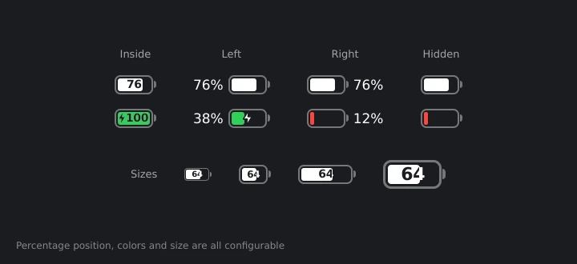
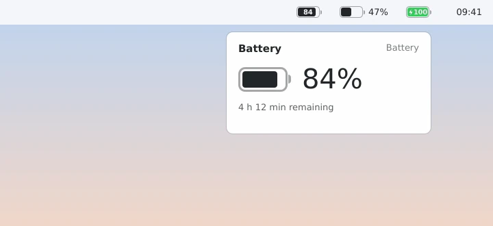

### Pendahuluan
Setelah Plasma di laptop saya dibuat mirip macOS (ceritanya ada di [KDE Plasma ala macOS di openSUSE Tumbleweed](/posts/kde-plasma-ala-macos-opensuse-tumbleweed/)), ada satu hal kecil yang masih mengganjal tiap kali lirik panel atas: ikon baterainya. Widget baterai bawaan Plasma itu fungsional, tapi bentuknya gak ada mirip - miripnya dengan baterai macOS yang tipis dengan angka persen di dalamnya.

Daripada terus mengganjal, ya sudah, bikin sendiri. Hasilnya **[macOS Battery](https://github.com/rifkiaz/macos-battery-kde)**, widget baterai untuk KDE Plasma 6 yang tampilannya meniru macOS.

")

*Gambar di tulisan ini adalah pratinjau. Font dan warnanya akan mengikuti tema Plasma masing - masing.*

### Fitur
- **Ikon baterai ala macOS**: outline tipis, kutub kecil di kanan, dan isi yang mengikuti level baterai.
- **Posisi persentase bisa dipilih**: di **dalam** baterai (gaya macOS terbaru, angkanya "terpotong" di bagian yang terisi), di **kiri**, di **kanan**, atau disembunyikan.
- **Ukuran bisa diatur**: tinggi baterai, lebar baterai, dan ukuran teks persentase, plus tombol reset kalau kebablasan.
- **Warna status**: hijau saat dicas, merah saat baterai lemah (batasnya bisa diatur, default 20%), dan ikon **petir** saat sedang mengisi daya.
- **Popup**: klik ikonnya untuk lihat persentase besar, sisa waktu ("2 h 10 min remaining") atau waktu sampai penuh, sumber daya, dan daftar **perangkat lain** yang punya baterai seperti mouse dan keyboard wireless.
- Bisa ditaruh di panel horizontal, vertikal, maupun di desktop, dan ikut tema terang atau gelap Plasma.





### Kompatibilitas
- **KDE Plasma 6.0 ke atas**. Gak jalan di Plasma 5.
- Widget-nya murni QML, gak ada kode C++ yang perlu dikompilasi. Jadi bisa dipakai di distro apa saja yang sudah Plasma 6. Saya pakai di **openSUSE Tumbleweed**, dan **openSUSE Leap 16** juga sudah Plasma 6. Fedora KDE, Arch, KDE neon, Kubuntu, dan Debian 13 juga harusnya aman.
- Data baterainya diambil dari engine `powermanagement` milik Plasma (lewat `org.kde.plasma.plasma5support`), sumber yang sama dengan widget baterai bawaan. Jadi gak ada paket tambahan yang perlu dipasang.

Catatan: openSUSE Leap 15.x masih Plasma 5, jadi widget ini butuh Leap 16 atau Tumbleweed.

### Instalasi
#### Dari file `.plasmoid`
Cara paling gampang. File `.plasmoid` tersedia di halaman [Releases](https://github.com/rifkiaz/macos-battery-kde/releases/latest), dibuat otomatis oleh GitHub Actions setiap ada tag versi baru.
1. Unduh `macos-battery-<versi>.plasmoid` dari halaman Releases.
2. Klik kanan desktop atau panel, pilih **Add Widgets…**
3. Klik **Get New…** lalu **Install Widget From Local File…**, pilih file `.plasmoid` tadi.
4. Cari **macOS Battery** di daftar widget, lalu seret ke panel.

Atau lewat terminal
```
kpackagetool6 --type Plasma/Applet --install macos-battery-1.1.2.plasmoid
```
Kalau sudah pernah pasang versi sebelumnya, ganti `--install` dengan `--upgrade`, lalu muat ulang Plasma
```
systemctl --user restart plasma-plasmashell
```

#### Dari source
```
git clone https://github.com/rifkiaz/macos-battery-kde.git
cd macos-battery-kde
./install.sh
```
`install.sh` otomatis upgrade kalau widget sudah terpasang. Kalau `kpackagetool6` belum ada, di openSUSE pasang dulu
```
sudo zypper install kf6-kpackage
```

#### Menghapus
```
kpackagetool6 --type Plasma/Applet --remove com.github.rifkiaz.macosbattery
```

### Pengaturan
Klik kanan widget, pilih **Configure macOS Battery…**. Isinya:
- **Percentage**: Hidden, Left of the battery, Inside the battery, atau Right of the battery
- **Percentage text size**: ukuran teks persen kalau ditaruh di kiri atau kanan (50–200%)
- **Battery height**: tinggi baterai relatif terhadap ukuran otomatis panel (50–250%)
- **Battery width**: lebar baterai dalam persen dari tingginya (140–350%, default 215%)
- **Colors** dan **Low battery level**: hijau saat dicas, merah saat lemah, dan batas "lemah"-nya
- **Popup**: tampilkan perangkat lain atau tidak

Tips: supaya gak ada dua ikon baterai di panel, sembunyikan baterai bawaan Plasma. Klik kanan System Tray, **Configure**, **Entries**, lalu set **Power and Battery** ke *Disabled* atau *Always hidden*.

### Cerita di Balik Ikon Petir
Rilis pertama yang publik adalah **v1.1.0**, yang sudah membawa ukuran yang bisa diatur dan pilihan persentase kiri atau kanan. Begitu dipakai di laptop sendiri, ternyata ikon petirnya kecil dan agak buram, padahal di pratinjau kelihatan baik - baik saja. Perbaikannya butuh dua rilis:

1. **v1.1.1**: outline petir tadinya digambar di **atas** petir, jadi malah "memakan" petirnya sendiri sampai terlihat kurus. Sekarang outline digambar di **belakang**, ukuran outline ikut skala ikon, petirnya diperbesar, dan render-nya pindah ke `Shape.CurveRenderer` (bukan layer multisample) supaya tetap tajam di layar HiDPI.
2. **v1.1.2**: di beberapa mesin petirnya ternyata masih mungil. Penyebabnya, bentuk petir didesain di kotak 10×16 lalu diperbesar pakai `ShapePath.scale`, dan ternyata gak semua renderer Qt menghormati properti itu. Hasilnya petir tetap digambar 10×16 piksel, jauh lebih kecil dari baterainya. Solusinya, setiap titik petir dihitung langsung dari ukuran item:
```
readonly property real sx: width / 10
readonly property real sy: height / 16
// ...
PathLine { x: root.points[1][0] * root.sx; y: root.points[1][1] * root.sy }
```
Sedikit lebih panjang, tapi hasilnya sama di renderer mana pun.

Pelajarannya: kalau bikin widget Plasma, jangan cuma percaya `plasmoidviewer`. Coba langsung di panel asli, dan kalau bisa di layar dengan scale factor yang berbeda.

### KDE Store
Supaya bisa dipasang langsung dari dialog **Get New Widgets** tanpa unduh file manual, widget ini sedang saya daftarkan di [store.kde.org](https://store.kde.org) di kategori **Plasma 6 Extensions**. Kalau sudah tayang, cukup cari "macOS Battery" dari dialog tersebut, dan update versi berikutnya akan muncul sebagai notifikasi di sana.

Sambil menunggu, silakan pakai file `.plasmoid` dari halaman Releases. Kalau ketemu bug atau punya ide fitur, buka saja issue di [GitHub](https://github.com/rifkiaz/macos-battery-kde/issues).

Sekian, semoga membantu.

Referensi:
- [macOS Battery di GitHub](https://github.com/rifkiaz/macos-battery-kde)
- [KDE Developer: Plasma Widget Tutorial](https://develop.kde.org/docs/plasma/widget/)
- [Qt Quick Shapes](https://doc.qt.io/qt-6/qtquick-shapes-example.html)
